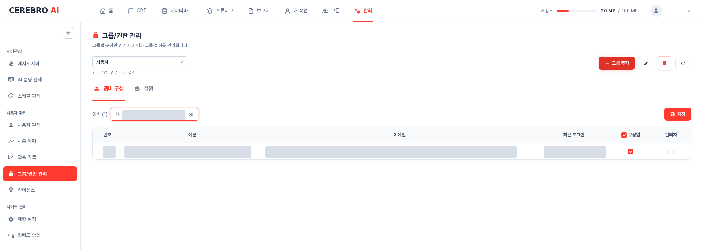
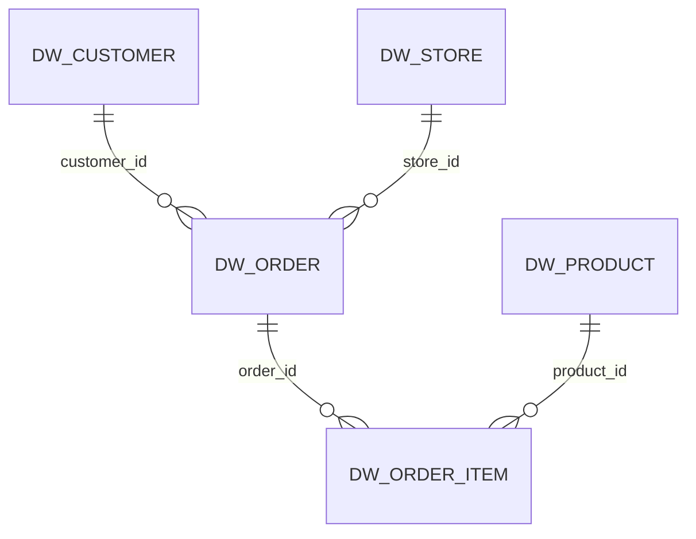
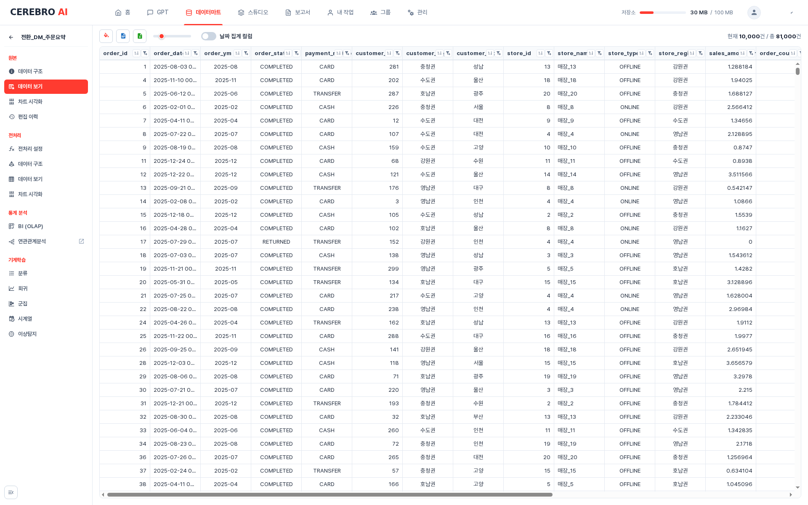
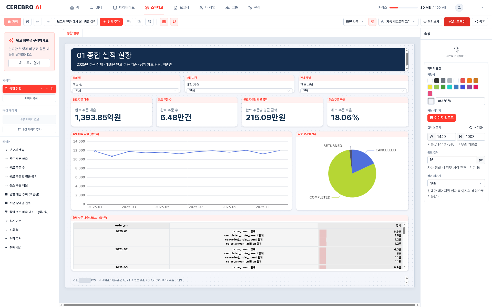
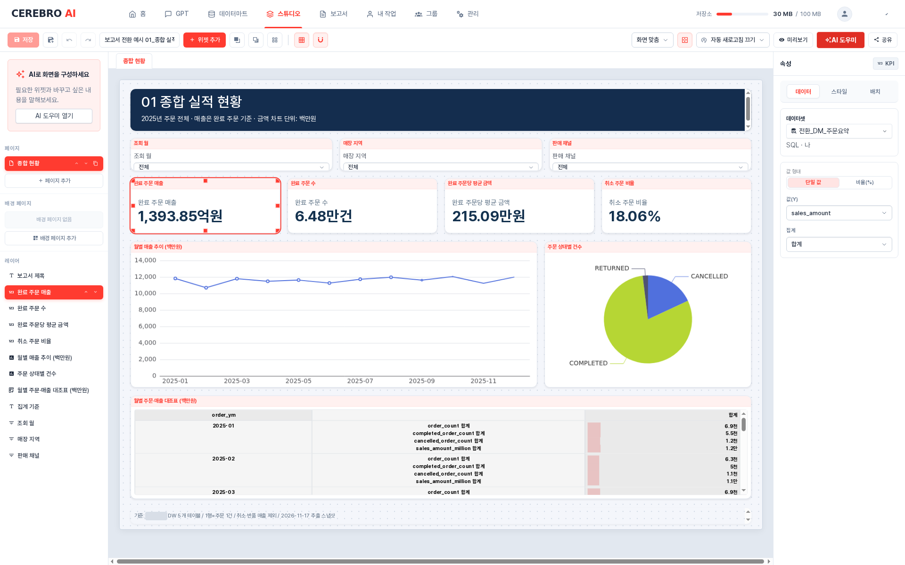
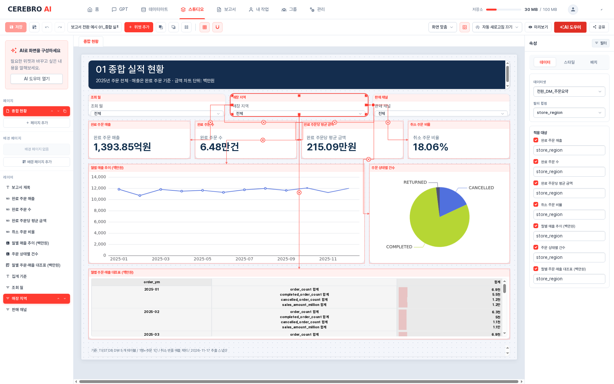
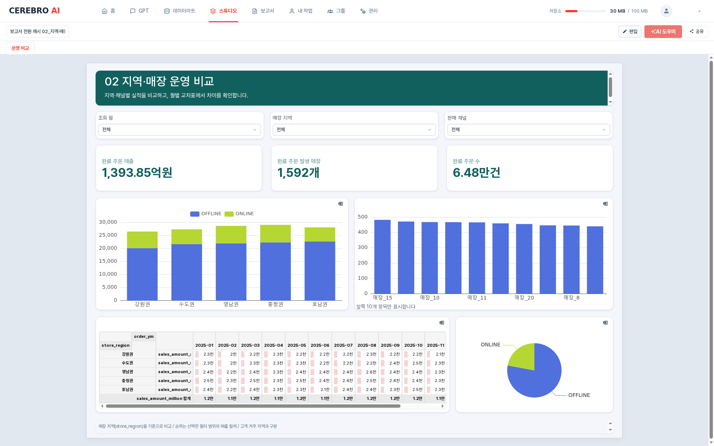
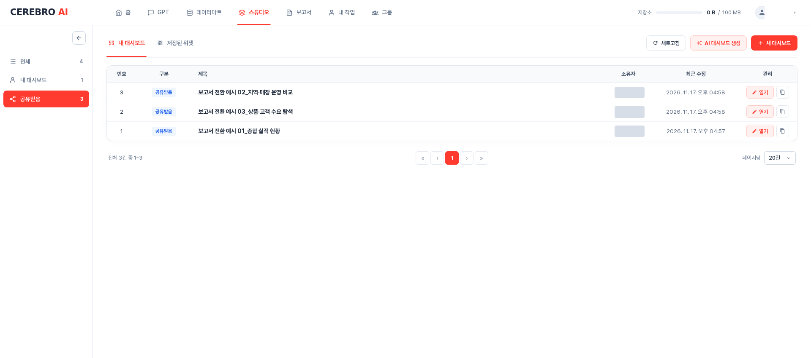
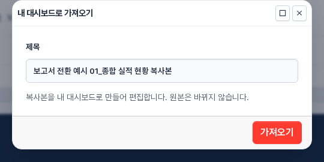
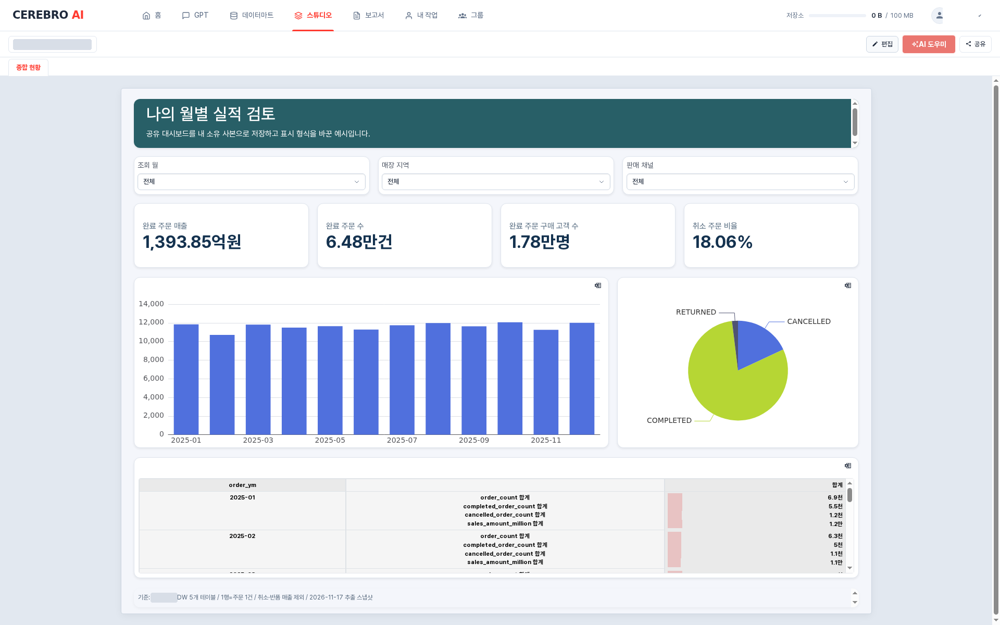

# CEREBRO AI 보고서 전환 가이드

기존 보고서의 항목을 데이터셋과 대시보드로 구성하고, 작성 담당자가 공유한 화면을 사용자가 자신의 업무에 맞게 활용하는 과정을 안내합니다.

## 목차

1. [개요](#1-개요)
2. [그룹 생성](#2-그룹-생성)
3. [DB 연결](#3-db-연결)
4. [새 데이터셋 등록하기](#4-새-데이터셋-등록하기)
5. [스튜디오 작성](#5-스튜디오-작성)
6. [대시보드 공유](#6-대시보드-공유)
7. [사용자: 대시보드 저장 및 사용](#7-사용자-대시보드-저장-및-사용)

## 1. 개요

### 1.1 목적 및 적용 범위

본 문서는 국방부 보고서를 CEREBRO AI 대시보드로 재구성하는 작업을 안내합니다. 기존 보고서에서 확인하던 수치·표·그래프를 데이터셋에 연결하고, 조회 조건을 바꾸며 통계와 근거 자료를 한눈에 확인할 수 있도록 구성합니다.

실습에는 DB에 저장된 고객·주문·주문상세·상품·매장 데이터를 사용합니다. 아래 판매 지표는 대시보드 구성 방법을 익히기 위한 예시이며, 실제 보고서 전환 시에는 해당 보고서의 항목명과 집계 기준을 적용합니다.


### 1.2 담당자와 그룹의 역할

이름이 **관리자**, **사용자**인 두 그룹을 구성합니다.

| 구분 | 그룹 내 역할 | 수행 업무 |
|---|---|---|
| 작성 담당자 | **관리자** 그룹의 그룹 관리자 | DB 연결, 데이터셋 등록·조인, 대시보드 작성·저장, 사용자 그룹에 공유 |
| 조회 담당자 | **사용자** 그룹의 일반 멤버 | 공유 대시보드 조회, 조건 변경, 사본 저장·수정, 결과 다운로드 |

### 1.3 작업 순서와 완성 결과

**그룹 구성 → DB 연결 설정 → DW 데이터셋 등록 → 대시보드 3개 작성 → 사용자 그룹에 조회 공유 → 조회 담당자의 사본 저장·활용** 순서로 진행합니다.

| 대시보드 | 구성 방식 | 확인하려는 내용 |
|---|---|---|
| 종합 실적 현황 | 핵심 수치와 추이 중심의 요약형 | 전체 규모, 월별 변화, 주문 상태별 구성 |
| 지역·매장 운영 비교 | 지역·채널 비교와 피벗 중심의 비교형 | 어느 지역·매장의 실적이 큰지, 지역별 실적이 월마다 어떻게 달라지는지 |
| 상품·고객 수요 탐색 | 분류별 차트와 상세 표 중심의 탐색형 | 어떤 상품군을 어느 지역의 고객이 구매하는지, 그 근거 주문은 무엇인지 |

## 2. 그룹 생성

### 2.1 관리자 그룹 생성

1. 사이트 관리자 계정으로 로그인합니다.
2. 상단 **관리 → 그룹/권한 관리**를 선택합니다.
3. **그룹 추가**를 클릭하고 그룹명에 **관리자**를 입력합니다.
4. **추가**를 클릭한 후 그룹 선택 목록에서 **관리자**를 선택합니다.

<p align="center">
  
</p>

### 2.2 관리자 그룹에 작성 담당자 배정

1. **멤버 구성**에서 작성 계정의 이메일을 검색합니다.
2. 검색된 작성 담당자 계정의 **구성원**과 **관리자**를 선택합니다.
3. **저장**을 클릭하고 관리자 지정 결과를 확인합니다.

<p align="center">
  
</p>

### 2.3 사용자 그룹 생성

1. 같은 화면에서 **그룹 추가**를 클릭합니다.
2. 그룹명에 **사용자**를 입력하고 **추가**를 클릭합니다.
3. 그룹 선택 목록에서 **사용자**를 선택합니다.

<p align="center">
  
</p>

### 2.4 사용자 그룹에 조회 담당자 배정

1. **멤버 구성**에서 조회 담당자의 이름이나 이메일을 검색합니다.
2. 대상 계정을 확인한 후 **구성원**을 선택합니다.
3. **관리자**는 선택하지 않고 **저장**을 클릭합니다.
4. 사용자 그룹에 조회 담당자가 일반 멤버로 포함되었는지 확인합니다.

<p align="center">
  
</p>

## 3. DB 연결

### 3.1 관리자 그룹에 DB 연결 등록

1. 상단 **그룹** 메뉴에서 **관리자** 그룹을 선택합니다.
2. **DB 연결 → DB 연결 등록**을 클릭합니다.
3. 운영 환경에 맞는 연결 정보를 입력합니다. 비밀번호는 별도로 전달받은 값을 입력합니다.

| 항목 | 입력할 내용 |
|---|---|
| 데이터베이스 종류 | MySQL |
| 이름 | 연결을 구분할 이름 |
| 호스트 | 운영 환경의 DB 서버 주소 |
| 포트 | 운영 환경의 DB 접속 포트 |
| Database | 사용할 데이터베이스명 |
| 사용자 | DB 조회 권한을 부여받은 접속 계정 |
| 비밀번호 | 별도로 전달받은 DB 접속 비밀번호 |

<p align="center">
  
</p>

### 3.2 연결 테스트 및 현재 결과 확인

1. **연결 테스트**를 클릭합니다.
2. 정상 연결된 환경에서는 성공 결과를 확인한 후 저장합니다.
3. 연결에 실패하면 호스트·포트·방화벽과 **CEREBRO 서버에서 DB까지의 접근 경로**를 확인합니다.

<p align="center">
  
</p>

## 4. 새 데이터셋 등록하기

### 4.1 사용할 DW 테이블과 연결 관계

예시 테이블명은 다음과 같습니다. 주문상세의 정확한 이름은 `dw_order_item`입니다.

| 테이블 | 내용 | 기본키 | 주요 연결 컬럼 | 원본 행 수 |
|---|---|---|---|---:|
| `dw_customer` | 고객의 지역·가입 정보 | `customer_id` | 주문의 `customer_id`와 연결 | 24,300 |
| `dw_store` | 매장명·지역 등 매장 정보 | `store_id` | 주문의 `store_id`와 연결 | 1,620 |
| `dw_order` | 주문 고객·매장 등 주문정보 | `order_id` | `customer_id`, `store_id` | 81,000 |
| `dw_product` | 상품명·분류·브랜드 등 상품 정보 | `product_id` | 주문상세의 `product_id`와 연결 | 16,200 |
| `dw_order_item` | 주문에 포함된 상품·수량·주문 당시 주문 상품정보 | `order_item_id` | `order_id`, `product_id` | 199,152 |




고객 한 명과 매장 한 곳에 여러 주문이 연결되고, 주문 한 건에는 여러 주문상세가 연결됩니다. 상품 한 종류도 여러 주문상세에 포함될 수 있습니다.

### 4.2 DB 추출로 고객 데이터셋 등록

DB 연결이 정상인 환경에서는 고객 테이블을 먼저 등록하여 데이터셋 생성 과정을 익힙니다.

1. **데이터마트 → 새 데이터셋 등록 → DB 추출**을 선택합니다.
2. DB 연결에서 등록한 보고서용 DB 연결을 선택합니다.
3. 사용할 스키마에서 `dw_customer`를 선택해 컬럼을 확인합니다.
4. SQL 편집기에 다음 조회문을 입력하고 실행합니다.
5. 결과를 확인한 후 **데이터셋 만들기**를 클릭합니다.
6. 제목을 **전환_DW_CUSTOMER**로 지정하여 저장합니다.

```sql
SELECT
    customer_id,
    city AS customer_city,
    region AS customer_region,
    signup_date
FROM dw_customer
WHERE COALESCE(del_yn, 'N') = 'N';
```

### 4.3 이번 실습의 파일 등록 결과

위 고객 조회 결과와 나머지 네 테이블의 필요한 컬럼을 CSV로 추출한 후, **새 데이터셋 등록 → 파일 업로드**로 등록했습니다. 고객 데이터셋의 제목을 클릭해 컬럼 구성과 행 수를 확인합니다.

<p align="center">
  
</p>

전환에 필요한 테이블을 같은 과정을 반복하여 데이터셋에 등록합니다.

<p align="center">
  
</p>

### 4.4 데이터셋 조인으로 보고에 필요한 정보 연결

**데이터셋 조인**을 사용하면 여러 데이터셋에 나뉜 정보를 공통 컬럼으로 연결하여 하나의 보고용 데이터셋으로 구성할 수 있습니다. 예를 들어 주문 자료에 고객 지역·상품 분류·매장 정보를 연결하면, 같은 자료를 다양한 기준으로 비교할 수 있습니다.

1. **새 데이터셋 등록 → 데이터셋 조인**을 선택합니다.
2. 보고에 필요한 데이터셋을 추가합니다.
3. 주문 ID·고객 ID 등 서로 대응하는 키 컬럼을 연결합니다.
4. 연결된 자료만 사용할지, 기준 자료를 모두 유지할지에 따라 조인 방식을 지정합니다.

<p align="center">
  
</p>

5. 보고에 필요한 컬럼을 출력 항목으로 선택하고, 중복되거나 불필요한 컬럼은 제외합니다.
6. **실행**으로 연결 결과를 확인합니다.
7. **데이터셋 만들기**를 클릭하고 용도를 구분할 수 있는 제목으로 저장합니다.

<p align="center">
  
</p>

이렇게 구성한 데이터셋은 스튜디오의 KPI·차트·표에 공통으로 연결할 수 있습니다. 보고서마다 필요한 정보를 다시 조합하는 작업을 줄이고, 같은 기준의 데이터로 여러 화면을 구성할 때 활용합니다.

> **💡 참고 : 조인 후 집계 기준 확인**
>
> 기준 자료 한 건에 여러 상세 자료가 연결되면 같은 기준 값이 여러 행에 반복될 수 있습니다. 건수는 행 수와 고유 개수 중 무엇을 의미하는지 확인하고, 금액은 중복 합산되지 않도록 집계 기준을 정합니다.

### 4.5 SQL 쿼리로 보고용 데이터 가공

**SQL 쿼리**를 사용하면 등록한 데이터셋에서 필요한 항목을 조회하고, 조건별 분류·계산·집계를 적용한 새 데이터셋을 만들 수 있습니다. 기존 보고서의 계산식이나 집계 기준을 데이터셋에 반영할 때 활용합니다.

| 활용 목적 | 구성 방법 | 활용 예시 |
|---|---|---|
| 필요한 자료 선택 | 조회 조건을 지정합니다. | 특정 기간이나 상태에 해당하는 자료만 조회 |
| 보고 단위로 집계 | 같은 기준의 자료를 묶어 합계·평균·건수를 계산합니다. | 상세 자료를 주문별 또는 월별로 요약 |
| 계산 항목 추가 | 컬럼 간 계산식이나 조건식을 적용합니다. | 수량과 단가로 금액 계산, 상태별 건수 구분 |
| 여러 자료 결합 | 집계 결과와 기준 자료를 연결합니다. | 상세 합계를 기준 목록에 연결하여 현황표 구성 |

1. **새 데이터셋 등록 → SQL 쿼리**를 선택합니다.
2. 조회에 사용할 소스 데이터셋을 추가합니다.
3. 필요한 컬럼·조건·계산식·집계 기준을 SQL로 작성합니다.
4. **실행**을 클릭하고 미리보기에서 결과를 확인합니다.
5. **데이터셋 만들기**를 클릭하여 보고용 데이터셋으로 저장합니다.

<p align="center">
  
</p>

예를 들어 상세 자료를 주문별로 먼저 합산한 뒤 주문 목록에 연결하면, 주문 한 건을 한 행으로 나타내는 요약 자료를 만들 수 있습니다. 상세 자료가 없는 주문까지 포함해야 한다면 기준 목록을 유지하는 LEFT JOIN을 적용할 수 있습니다.

<p align="center">
  
</p>

데이터셋을 상세 조회용과 현황 집계용으로 나누어 구성하면, 상세 표와 요약 차트에 각각 적합한 자료를 연결할 수 있습니다.

### 4.6 보고 목적에 맞는 집계 기준 확인

대시보드에 데이터를 연결하기 전에 기존 보고서에서 사용하던 조회 조건과 계산 기준을 확인합니다. 같은 자료라도 집계 단위나 제외 조건에 따라 결과가 달라질 수 있습니다.

| 확인 항목 | 확인할 내용 |
|---|---|
| 한 행의 의미 | 한 행이 주문·상품·처리 이력 중 무엇을 나타내는지 확인합니다. |
| 건수의 기준 | 전체 행 수를 셀지, 중복을 제외한 고유 개수를 셀지 정합니다. |
| 합계·평균의 기준 | 합산할 수치와 평균에 포함할 대상 범위를 확인합니다. |
| 포함·제외 조건 | 취소·반품 등 특정 상태를 지표에 포함할지 정합니다. |
| 기간과 단위 | 기준 날짜, 집계 기간과 금액·수량의 표시 단위를 맞춥니다. |
| 조인 결과 | 연결 과정에서 자료가 빠지거나 같은 값이 반복되는지 확인합니다. |

이 기준을 데이터셋과 위젯 설정에 일관되게 적용하면, 기존 보고서의 수치와 대시보드 결과를 같은 조건으로 비교할 수 있습니다.

## 5. 스튜디오 작성

스튜디오에서는 데이터셋을 KPI·차트·피벗·테이블 등의 위젯에 연결하고, 보고 목적에 맞게 배치할 수 있습니다. 기존 보고서의 요약 수치·비교표·상세 목록을 한 화면에 구성하거나, 용도에 따라 대시보드를 나누어 활용합니다.

아래 화면은 판매 자료를 사용한 구성 예시입니다. 실제 보고서에서는 업무에 맞는 항목과 지표를 연결하여 같은 방식으로 활용할 수 있습니다.

### 5.1 대시보드와 위젯 구성

1. **스튜디오 → 새 대시보드**를 클릭합니다.
2. 제목을 입력하고 **저장**을 클릭합니다.
3. 보고할 내용과 조회 환경에 맞게 캔버스 크기를 지정합니다.
4. 텍스트 위젯으로 제목과 조회·집계 기준을 작성합니다.
5. **위젯 추가 → 데이터 위젯**에서 필요한 KPI·차트·피벗·테이블·필터를 추가합니다.
6. 각 위젯의 **데이터** 속성에서 데이터셋, 기준 컬럼과 집계 방식을 지정합니다.
7. 위젯을 정렬하고 **미리보기**에서 결과를 확인한 후 저장합니다.

<p align="center">
  
</p>

**KPI**는 보고서에서 먼저 확인해야 할 핵심 수치를 크게 표시할 때 사용합니다. 합계·평균·고유 개수·비율 등 지표의 의미에 맞는 집계 방식을 선택합니다. 예를 들어 금액의 전체 규모는 합계로, 대상별 평균 수준은 평균으로 표시할 수 있습니다.

<p align="center">
  
</p>

**필터**는 사용자가 기간·지역·분류 등의 조회 조건을 직접 바꾸어 볼 수 있도록 구성하는 기능입니다. 필터 컬럼을 지정하고 **적용 대상**에 연결할 위젯을 선택합니다. 여러 위젯을 같은 필터에 연결하면, 조건 변경에 따른 주요 수치와 차트를 함께 살펴볼 수 있습니다.

<p align="center">
  
</p>

### 5.2 활용 예시 1: 전체 현황을 요약하는 대시보드

보고서의 첫 화면에서 전체 규모와 주요 변화를 빠르게 확인해야 할 때는 **KPI·추이 차트·구성 차트·요약표**를 함께 배치합니다. 정기 현황 보고나 주요 실적을 종합하여 전달할 때 활용할 수 있습니다.

<p align="center">
  
</p>

| 구성 요소 | 활용 방법 | 화면의 예시 |
|---|---|---|
| 필터 | 보고 기간과 조회 범위를 선택합니다. | 조회 월·지역·판매 채널 |
| KPI | 전체 규모, 평균 수준, 비율 등 핵심 수치를 표시합니다. | 매출·주문 수·평균 금액·취소 비율 |
| 선그래프 | 기간에 따른 증가·감소와 변화 흐름을 확인합니다. | 월별 매출 추이 |
| 파이그래프 | 전체에서 각 항목이 차지하는 비중을 비교합니다. | 주문 상태별 구성 |
| 피벗 | 차트의 근거 수치를 기간이나 항목별 표로 확인합니다. | 월별 주문·매출 집계 |

기존 보고서의 핵심 지표를 상단에, 변화 흐름과 근거 표를 아래에 배치하면 전체 현황에서 세부 수치로 이어지는 순서로 내용을 전달할 수 있습니다. 비율 지표는 분자·분모의 대상 범위와 조회 조건을 함께 확인합니다.

### 5.3 활용 예시 2: 조직·지역·항목별 실적을 비교하는 대시보드

부서·지역·사업 등 여러 대상을 같은 기준으로 비교해야 할 때는 **막대그래프·누적 막대그래프·피벗**을 활용합니다. 항목별 규모 차이와 기간별 변화를 함께 확인하는 보고서에 적합합니다.

<p align="center">
  
</p>

| 구성 요소 | 활용 방법 | 화면의 예시 |
|---|---|---|
| 필터 | 비교할 대상에 같은 기간과 범위를 적용합니다. | 조회 월·지역·판매 채널 |
| KPI | 선택한 범위의 전체 실적과 대상 수를 확인합니다. | 매출·매장 수·주문 수 |
| 누적 막대그래프 | 대상별 규모와 세부 항목의 구성을 함께 비교합니다. | 지역별 온라인·오프라인 매출 |
| 막대그래프 | 값을 정렬하여 규모가 크거나 작은 대상을 파악합니다. | 매출 상위 매장 |
| 피벗 | 두 기준을 행과 열에 배치하여 수치를 교차 비교합니다. | 지역별·월별 매출 |
| 파이그래프 | 전체 실적에서 세부 항목의 비중을 확인합니다. | 판매 채널별 매출 비중 |

비교 대상에 동일한 필터와 집계 기준을 적용해야 수치를 같은 기준으로 해석할 수 있습니다. 대상 수를 표시할 때는 상세 행 수 대신 대상 ID의 고유 개수를 사용하는 등 중복 집계 여부도 확인합니다.

### 5.4 활용 예시 3: 조건을 바꾸며 상세 자료를 탐색하는 대시보드

요약 수치에서 출발하여 어떤 항목이 결과에 영향을 주었는지 살펴보려면 **필터·분류별 차트·교차표·상세 테이블**을 함께 구성합니다. 사용자가 관심 조건을 선택하고 그에 해당하는 근거 자료를 확인하는 데 활용할 수 있습니다.

<p align="center">
  
</p>

| 구성 요소 | 활용 방법 | 화면의 예시 |
|---|---|---|
| 필터 | 관심 있는 기간·지역·분류로 조회 범위를 좁힙니다. | 조회 월·상품 분류·고객 지역 |
| KPI | 선택 조건에 해당하는 규모를 요약합니다. | 수량·매출·고객 수·상품 수 |
| 막대·파이그래프 | 항목별 크기와 구성을 살펴봅니다. | 상품군별 수량·고객 지역별 구성 |
| 피벗 | 두 분류를 교차하여 차이가 나타나는 구간을 찾습니다. | 상품군과 고객 지역의 교차 집계 |
| 테이블 | 요약 수치를 구성하는 개별 자료를 확인합니다. | 주문일·상품명·수량·금액 목록 |

상세 테이블에는 업무에 필요한 컬럼을 선택하고 표시 순서·정렬·행 수를 설정합니다. 차트와 상세 표에 같은 조건이 적용되도록 필터 대상을 연결하면, 요약 결과와 근거 자료를 함께 확인할 수 있습니다.

### 5.5 저장 및 보고 화면 확인

대시보드를 구성한 후 **저장**하고 **미리보기**에서 사용자가 확인할 화면을 점검합니다. 저장한 자료는 **스튜디오 → 내 대시보드**에서 다시 열어 수정하거나 공유할 수 있습니다.

| 확인 항목 | 확인할 내용 |
|---|---|
| 보고 흐름 | 핵심 수치에서 비교·추이·상세 자료로 내용이 자연스럽게 이어지는지 확인합니다. |
| 지표와 단위 | 제목·집계 방식·표시 단위가 보고 목적과 맞는지 확인합니다. |
| 필터 동작 | 조건을 바꾸면 의도한 위젯에 같은 조건이 적용되는지 확인합니다. |
| 화면 배치 | 제목과 수치가 잘 보이고 차트·표를 읽기 편한지 확인합니다. |

> **💡 참고 : 화면 새로고침과 원본 데이터 갱신**
>
> 스튜디오의 자동 새로고침은 연결된 데이터셋을 다시 조회하는 기능입니다. DB나 파일의 변경 사항을 반영하려면 원본 수집·재업로드 등 해당 데이터셋의 갱신 절차도 수행해야 합니다.

## 6. 대시보드 공유

작성한 대시보드는 사용자나 그룹에 공유하여 공통 보고 화면으로 활용할 수 있습니다. 작성 담당자는 원본을 관리하고, 조회 담당자는 부여받은 권한으로 같은 기준의 현황을 확인합니다.

### 6.1 사용자 그룹에 대시보드 조회 권한 부여

1. 공유할 대시보드를 엽니다.
2. 오른쪽 위 **공유 → 멤버 공유**를 선택합니다.
3. 공유 대상 사용자 또는 그룹을 검색하여 추가합니다.
4. 열람용으로 제공할 대상에는 **조회** 권한을 지정합니다.
5. 공유 대상과 권한이 의도한 값으로 설정되었는지 확인합니다.

<p align="center">
  
</p>

그룹에 공유하면 해당 그룹의 구성원이 공통 보고 화면을 이용할 수 있습니다. 원본 편집은 작성 담당자가 맡고, 사용자는 조회 조건을 바꾸어 필요한 현황을 확인하는 방식으로 운영할 수 있습니다.

### 6.2 연결된 데이터셋의 조회 권한 설정

대시보드 공유와 데이터셋 공유는 별도입니다. 사용자가 화면의 데이터를 확인할 수 있도록 대시보드에 연결된 데이터셋의 권한도 설정합니다.

1. 데이터마트에서 대시보드에 연결한 데이터셋의 **공유 설정**을 엽니다.
2. 대시보드와 같은 사용자 또는 그룹을 공유 대상에 추가합니다.
3. 업무에 필요한 권한을 지정합니다. 열람용으로 제공할 경우 **조회**를 선택합니다.
4. 다른 연결 데이터셋에도 필요한 공유 설정을 적용합니다.
5. 지정된 대상에게만 제공하려면 일반 액세스는 **제한됨**으로 유지합니다.

<p align="center">
  
</p>

보고에 필요한 최종 데이터셋을 공유하면, 조회 담당자에게 DB 연결 관리 권한을 부여하지 않고도 자료를 제공할 수 있습니다. 공유 후에는 조회 담당자 계정에서 위젯의 데이터가 정상적으로 표시되는지 확인합니다.

## 7. 사용자: 대시보드 저장 및 사용

공유받은 대시보드는 현황 조회에 활용하고, 별도의 구성이 필요하면 내 소유의 사본으로 저장하여 업무에 맞게 수정할 수 있습니다.

### 7.1 공유받은 대시보드 조회

1. 조회 담당자 계정으로 로그인합니다.
2. **스튜디오 → 공유받음**을 선택합니다.
3. 확인할 대시보드를 선택하여 엽니다.

<p align="center">
  
</p>

4. KPI·차트·표에서 필요한 현황을 확인합니다.
5. 다른 화면 구성이 필요하면 **내 대시보드로 가져오기**를 사용하여 사본을 만듭니다.

<p align="center">
  
</p>

### 7.2 필터로 필요한 현황 조회

대시보드에 배치된 필터를 사용하면 같은 보고 화면에서 기간·지역·분류 등을 바꾸어 자료를 살펴볼 수 있습니다. 조건마다 보고서를 별도로 작성하지 않고 필요한 범위의 현황을 확인할 때 활용합니다.

1. 확인할 기간이나 항목을 필터에서 선택합니다.
2. 연결된 KPI·차트·표가 선택 조건에 맞게 바뀌는지 확인합니다.
3. 다른 조건과 비교하거나 **전체**로 되돌려 전체 현황을 확인합니다.

<p align="center">
  
</p>

필터 선택은 조회 범위를 바꾸는 기능이며, 원본 데이터의 내용을 수정하지 않습니다.

### 7.3 내 대시보드로 사본 저장

공유 화면의 지표나 배치를 본인 업무에 맞게 바꾸고 싶다면 사본을 저장하여 활용합니다. 원본 보고 화면을 유지하면서 개인별 검토 화면을 구성할 수 있습니다.

1. 공유 대시보드 위쪽의 **내 대시보드로 가져오기**를 클릭합니다.
2. 용도를 구분할 수 있는 제목을 입력하고 저장합니다.
3. **내 대시보드** 목록에서 사본을 열어 편집합니다.

<p align="center">
  
</p>

사본은 페이지와 위젯 구성을 복사하며, 원본 대시보드의 구성에는 영향을 주지 않습니다. 연결된 데이터셋의 이용 권한은 계속 필요하고, 원본의 공유 대상은 사본에 자동으로 복사되지 않습니다.

### 7.4 사본을 업무에 맞게 수정

사본에서는 보고 목적에 맞게 지표·차트·배치를 변경할 수 있습니다. 같은 데이터셋을 사용하더라도 관심 항목을 강조하여 별도의 검토 화면으로 활용합니다.

| 변경 항목 | 활용 방법 |
|---|---|
| 제목과 설명 | 보고 대상이나 검토 목적에 맞게 변경합니다. |
| 차트 종류 | 추이를 볼 때는 선그래프, 항목별 크기를 비교할 때는 막대그래프 등으로 조정합니다. |
| KPI | 합계·평균·고유 개수 등 확인하려는 지표에 맞는 컬럼과 집계를 지정합니다. |
| 위젯 배치 | 자주 확인하는 지표와 표가 먼저 보이도록 위치와 크기를 조정합니다. |

<p align="center">
  
</p>

수정한 내용은 **저장**하고 **미리보기**에서 확인합니다. 추가로 공유할 경우 사본의 공유 대상을 별도로 설정합니다.

### 7.5 조회 결과 다운로드

위젯의 조회 결과는 엑셀 파일로 내려받아 후속 검토나 다른 업무 자료 작성에 활용할 수 있습니다.

1. 대시보드에서 필요한 조회 조건을 지정합니다.
2. 차트·피벗·테이블 오른쪽 위의 **엑셀 내보내기** 버튼을 클릭합니다.
3. 내려받은 파일의 컬럼·집계 기준·조회 조건을 확인합니다.

<p align="center">
  
</p>

내보내는 자료의 범위는 해당 위젯의 설정을 따릅니다. 차트는 집계 결과를, 상세 테이블은 설정된 표시 컬럼과 행 수 범위의 결과를 제공하므로 원본 전체 자료와 구분하여 사용합니다.

### 7.6 보고서 전환 후 확인 항목

| 구분 | 확인할 내용 |
|---|---|
| 데이터 구성 | 보고에 필요한 정보가 연결되어 있고, 건수와 금액이 중복 집계되지 않는지 확인합니다. |
| 지표와 화면 | 기존 보고서의 항목·집계 기준·단위가 위젯에 적절히 반영되었는지 확인합니다. |
| 조회 조건 | 필터에 연결한 위젯이 같은 조건으로 조회되는지 확인합니다. |
| 공유 권한 | 사용자가 대시보드와 연결 데이터셋을 필요한 권한으로 이용할 수 있는지 확인합니다. |
| 사본 활용 | 개인별 화면은 사본으로 수정하고 원본 보고 화면은 유지되는지 확인합니다. |
| 결과 다운로드 | 내려받은 자료의 범위와 집계 기준이 업무 목적에 맞는지 확인합니다. |
| 데이터 갱신 | 원본 자료가 바뀐 뒤 데이터셋과 대시보드에 반영되는 절차를 확인합니다. |
