# CEREBRO AI 보고서 전환 가이드

기존 보고서의 항목을 데이터셋과 대시보드로 구성하고, 작성 담당자가 공유한 화면을 사용자가 자신의 업무에 맞게 활용하는 과정을 안내합니다.

## 목차

1. [개요](#1-개요)
2. [그룹 생성](#2-그룹-생성)
3. [DB 연결](#3-db-연결)
4. [새 데이터셋 등록하기](#4-새-데이터셋-등록하기)
5. [스튜디오 작성](#5-스튜디오-작성)
6. [대시보드 공유](#6-대시보드-공유)
7. [사용자: 대시보드 저장 및 사용](#7-사용자-대시보드-저장-및-사용)

## 1. 개요

### 1.1 목적 및 적용 범위

본 문서는 국방부 보고서를 CEREBRO AI 대시보드로 재구성하는 작업을 안내합니다. 기존 보고서에서 확인하던 수치·표·그래프를 데이터셋에 연결하고, 조회 조건을 바꾸며 통계와 근거 자료를 한눈에 확인할 수 있도록 구성합니다.

실습에는 MySQL `testdb`의 고객·주문·주문상세·상품·매장 데이터를 사용합니다. 아래 판매 지표는 대시보드 구성 방법을 익히기 위한 예시이며, 실제 보고서 전환 시에는 해당 보고서의 항목명과 집계 기준을 적용합니다.

| 기존 보고서의 내용 | 대시보드 구성 요소 | 실습 예시 |
|---|---|---|
| 전체 현황과 주요 수치 | KPI | 완료 주문 매출, 완료 주문 수, 취소 주문 비율 |
| 기간별 실적 표 | 선그래프·피벗 | 월별 매출 추이와 월별 주문 집계 |
| 조직·지역·항목별 비교 | 막대그래프·누적 막대·피벗 | 지역·매장·판매 채널별 실적 비교 |
| 세부 근거 목록 | 테이블 | 선택 조건에 해당하는 주문상세 |
| 보고서의 조회 기준 | 필터 | 조회 월, 매장 지역, 상품 분류, 고객 지역 |

### 1.2 담당자와 그룹의 역할

실습에서는 이름이 **관리자**, **사용자**인 두 그룹을 구성합니다.

| 구분 | 계정 및 그룹 내 역할 | 수행 업무 |
|---|---|---|
| 작성 담당자 | `jsh160316@naver.com` / **관리자** 그룹의 그룹 관리자 | DB 연결, 데이터셋 등록·조인, 대시보드 작성·저장, 사용자 그룹에 공유 |
| 조회 담당자 | 홍길동(`test@naver.com`) / **사용자** 그룹의 일반 멤버 | 공유 대시보드 조회, 조건 변경, 사본 저장·수정, 결과 다운로드 |

그룹 이름을 **관리자**로 지정하는 것과 계정에 관리자 등급을 부여하는 것은 서로 다릅니다. 그룹 생성과 구성원 배정은 사이트 관리자 계정으로 수행하며, DB 연결과 그룹 자료의 운영 담당자는 해당 그룹의 관리자 역할로 지정합니다.

### 1.3 작업 순서와 완성 결과

**그룹 구성 → DB 연결 설정 → DW 데이터셋 등록 → DM 데이터셋 구성 → 대시보드 3개 작성 → 사용자 그룹에 조회 공유 → 홍길동의 사본 저장·활용** 순서로 진행합니다.

| 대시보드 | 구성 방식 | 확인하려는 내용 |
|---|---|---|
| 종합 실적 현황 | 핵심 수치와 추이 중심의 요약형 | 전체 규모, 월별 변화, 주문 상태별 구성 |
| 지역·매장 운영 비교 | 지역·채널 비교와 피벗 중심의 비교형 | 어느 지역·매장의 실적이 큰지, 지역별 실적이 월마다 어떻게 달라지는지 |
| 상품·고객 수요 탐색 | 분류별 차트와 상세 표 중심의 탐색형 | 어떤 상품군을 어느 지역의 고객이 구매하는지, 그 근거 주문은 무엇인지 |

> **💡 참고 : 이번 실습의 데이터 등록 경로**
>
> 2026-11-17 확인 기준, 작업 환경에서는 TESTDB를 정상 조회했지만 CEREBRO 서버의 DB 연결 테스트는 네트워크 오류를 반환했습니다. 따라서 지정된 DW 5개 테이블에서 필요한 컬럼만 읽기 전용으로 추출한 CSV 파일을 등록하여 실습을 완료했습니다. DB 연결 설정과 연결 테스트 결과는 3장에, 정상적인 DB 추출 절차와 이번에 사용한 파일 등록 절차는 4장에 구분해 설명합니다.

## 2. 그룹 생성

### 2.1 관리자 그룹 생성

1. 사이트 관리자 계정으로 로그인합니다.
2. 상단 **관리 → 그룹/권한 관리**를 선택합니다.
3. **그룹 추가**를 클릭하고 그룹명에 **관리자**를 입력합니다.
4. **추가**를 클릭한 후 그룹 선택 목록에서 **관리자**를 선택합니다.

<p align="center">
  
</p>

### 2.2 관리자 그룹에 작성 담당자 배정

1. **멤버 구성**에서 작성 계정의 이메일을 검색합니다.
2. `jsh160316@naver.com` 계정의 **구성원**과 **관리자**를 선택합니다.
3. **저장**을 클릭하고 관리자 지정 결과를 확인합니다.

<p align="center">
  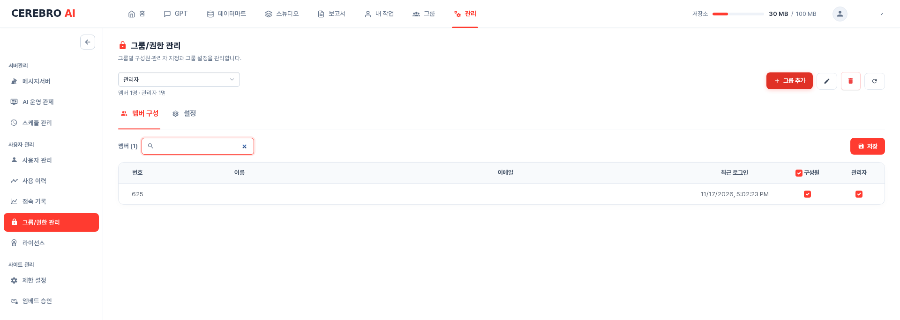
</p>

### 2.3 사용자 그룹 생성

1. 같은 화면에서 **그룹 추가**를 클릭합니다.
2. 그룹명에 **사용자**를 입력하고 **추가**를 클릭합니다.
3. 그룹 선택 목록에서 **사용자**를 선택합니다.

<p align="center">
  
</p>

### 2.4 사용자 그룹에 홍길동 배정

1. **멤버 구성**에서 `test@naver.com`을 검색합니다.
2. 이름이 **홍길동**인 계정의 **구성원**을 선택합니다.
3. **관리자**는 선택하지 않고 **저장**을 클릭합니다.
4. 사용자 그룹에 홍길동이 일반 멤버로 포함되었는지 확인합니다.

<p align="center">
  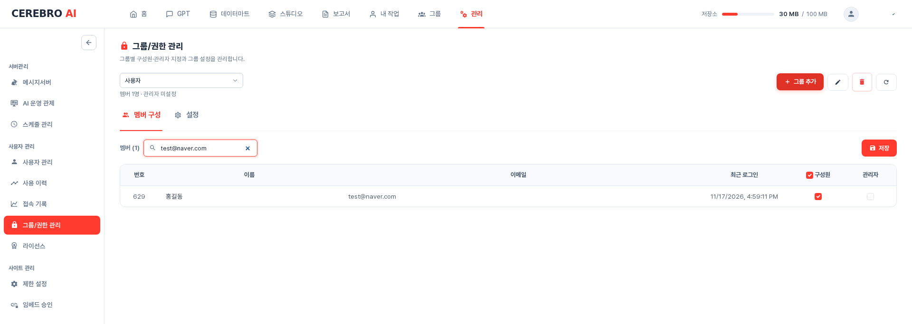
</p>

## 3. DB 연결

### 3.1 관리자 그룹에 DB 연결 등록

1. 상단 **그룹** 메뉴에서 **관리자** 그룹을 선택합니다.
2. **DB 연결 → DB 연결 등록**을 클릭합니다.
3. 다음 정보를 입력합니다. 비밀번호는 별도로 전달받은 값을 입력합니다.

| 항목 | 입력값 |
|---|---|
| 데이터베이스 종류 | MySQL |
| 이름 | 보고서전환_TESTDB |
| 호스트 | `192.168.50.30` |
| 포트 | `3306` |
| Database | `testdb` |
| 사용자 | `dataworld_dw` |
| 비밀번호 | 별도로 전달받은 DB 접속 비밀번호 |

<p align="center">
  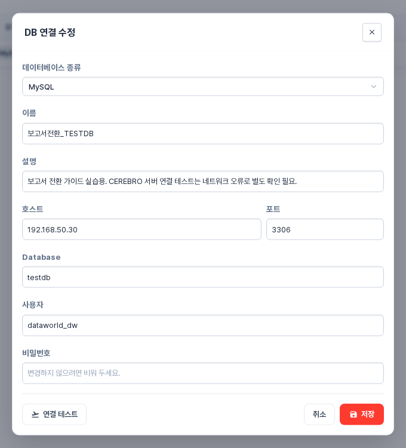
</p>

### 3.2 연결 테스트 및 현재 결과 확인

1. **연결 테스트**를 클릭합니다.
2. 정상 연결된 환경에서는 성공 결과를 확인한 후 저장합니다.
3. 연결에 실패하면 호스트·포트·방화벽과 **CEREBRO 서버에서 DB까지의 접근 경로**를 확인합니다.

<p align="center">
  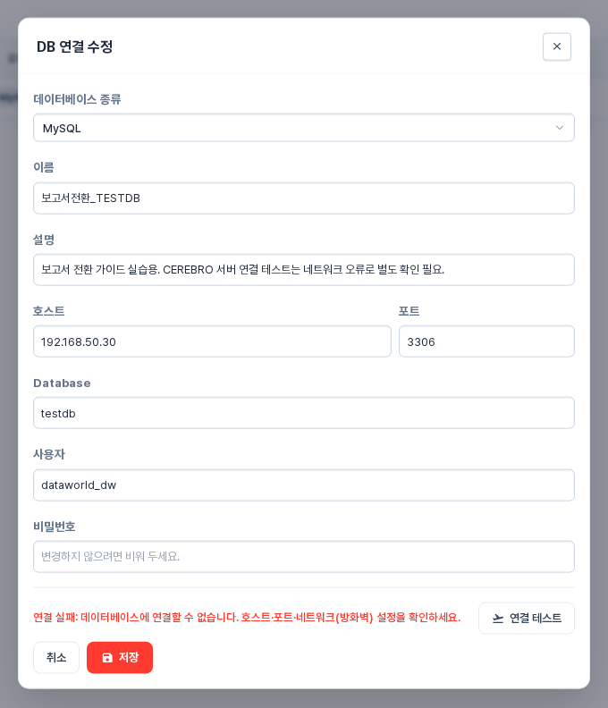
</p>

이번 실습에서는 연결 정보를 저장했으나 연결 테스트는 성공하지 못했습니다. 아래 데이터셋은 DB 자동 수집 결과가 아니라, 별도로 추출한 DW 테이블의 파일을 등록한 결과입니다. 네트워크 연결이 확보된 후에는 4.2의 DB 추출 경로로 같은 컬럼을 등록할 수 있습니다.

### 3.3 조회 담당자와 DB 연결 권한 구분

DB 연결의 등록·수정·재추출은 관리자 그룹에서 담당합니다. 사용자 그룹에는 대시보드와 최종 DM 데이터셋의 조회 권한을 부여합니다. 홍길동에게 원본 DB 접속 정보나 연결 관리 권한을 부여할 필요는 없습니다.

## 4. 새 데이터셋 등록하기

### 4.1 사용할 DW 테이블과 연결 관계

실제 확인한 테이블명은 다음과 같습니다. 주문상세의 정확한 이름은 `dw_order_item`입니다.

| 테이블 | 내용 | 기본키 | 주요 연결 컬럼 | 원본 행 수 |
|---|---|---|---|---:|
| `dw_customer` | 고객의 지역·가입 정보 | `customer_id` | 주문의 `customer_id`와 연결 | 24,300 |
| `dw_order` | 주문일·상태·결제수단·주문 고객·매장 | `order_id` | `customer_id`, `store_id` | 81,000 |
| `dw_order_item` | 주문에 포함된 상품·수량·주문 당시 단가·할인율 | `order_item_id` | `order_id`, `product_id` | 199,152 |
| `dw_product` | 상품명·분류·세부 분류·브랜드 | `product_id` | 주문상세의 `product_id`와 연결 | 16,200 |
| `dw_store` | 매장명·판매 채널·지역 | `store_id` | 주문의 `store_id`와 연결 | 1,620 |

행 수는 2026-11-17 조회 시점의 값입니다. 주문 기간은 **2025-01-01~2025-12-31**이며, 주문 상태는 `COMPLETED`(완료), `CANCELLED`(취소), `RETURNED`(반품)입니다.

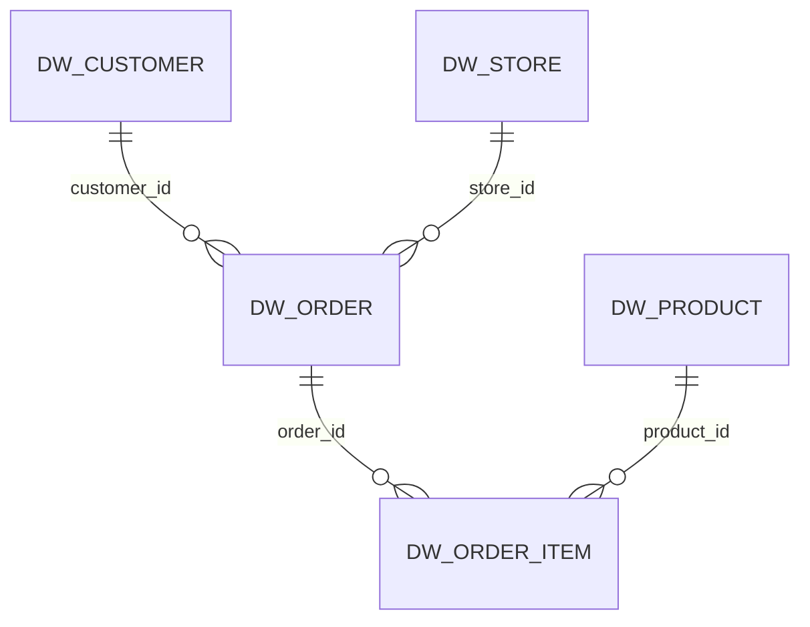

고객 한 명과 매장 한 곳에 여러 주문이 연결되고, 주문 한 건에는 여러 주문상세가 연결됩니다. 상품 한 종류도 여러 주문상세에 포함될 수 있습니다.

### 4.2 DB 추출로 고객 데이터셋 등록

DB 연결이 정상인 환경에서는 고객 테이블을 먼저 등록하여 데이터셋 생성 과정을 익힙니다.

1. **데이터마트 → 새 데이터셋 등록 → DB 추출**을 선택합니다.
2. DB 연결에서 **보고서전환_TESTDB**를 선택합니다.
3. 스키마 `testdb`에서 `dw_customer`를 선택해 컬럼을 확인합니다.
4. SQL 편집기에 다음 조회문을 입력하고 실행합니다.
5. 결과를 확인한 후 **데이터셋 만들기**를 클릭합니다.
6. 제목을 **전환_DW_CUSTOMER**로 지정하여 저장합니다.

```sql
SELECT
    customer_id,
    city AS customer_city,
    region AS customer_region,
    signup_date
FROM testdb.dw_customer
WHERE COALESCE(del_yn, 'N') = 'N';
```

이름·메일주소·연락처는 이번 분석에 사용하지 않습니다. 고객의 지역을 매장의 지역과 구분하기 위해 컬럼명을 `customer_city`, `customer_region`으로 지정합니다.

### 4.3 이번 실습의 파일 등록 결과

이번 실습에서는 위 고객 조회 결과와 나머지 네 테이블의 필요한 컬럼을 CSV로 추출한 후, **새 데이터셋 등록 → 파일 업로드**로 등록했습니다. 고객 데이터셋의 제목을 클릭해 컬럼 구성과 행 수를 확인합니다.

<p align="center">
  
</p>

나머지 테이블도 같은 등록 과정을 반복하며, 다음 컬럼으로 구성합니다.

| 데이터셋 제목 | 등록할 컬럼 및 처리 |
|---|---|
| 전환_DW_CUSTOMER | `customer_id`, `customer_city`, `customer_region`, `signup_date` |
| 전환_DW_ORDER | `order_id`, `customer_id`, `store_id`, `order_date`, `order_ym`, `order_status`, `payment_method` |
| 전환_DW_ORDER_ITEM | `order_item_id`, `order_id`, `product_id`, `quantity`, `unit_price`, `discount_rate`, `line_amount` |
| 전환_DW_PRODUCT | `product_id`, `product_name`, `category`, `subcategory`, `brand` |
| 전환_DW_STORE | `store_id`, `store_name`, `store_type`, `store_region` |

`order_ym`은 주문일을 `YYYY-MM` 형태로 만든 값입니다. MySQL에서는 `DATE_FORMAT(order_date, '%Y-%m')`으로 생성합니다. 매장 테이블의 `region`은 `store_region`으로 구분합니다.

`line_amount`는 **수량 × 주문 당시 단가 × (1 − 할인율)**을 소수점 둘째 자리까지 반올림한 값입니다. 상품 테이블의 현재 단가로 과거 주문 금액을 다시 계산하지 않습니다.

```sql
ROUND(quantity * unit_price * (1 - COALESCE(discount_rate, 0)), 2)
    AS line_amount
```

모든 원본 테이블에 `COALESCE(del_yn, 'N') = 'N'` 조건을 적용했습니다. 조회 시점에는 전부 `N`이었습니다.

<p align="center">
  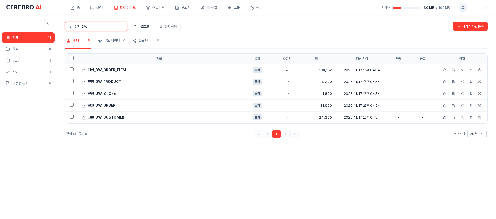
</p>

### 4.4 조인으로 주문상세 DM 만들기

상품·고객 수요를 분석할 수 있도록 **주문상세 한 건이 한 행인 데이터셋**을 만듭니다. DM은 보고에 필요한 컬럼을 모아 구성한 분석용 데이터셋을 뜻합니다.

1. **새 데이터셋 등록 → 데이터셋 조인**을 선택합니다.
2. 등록한 DW 데이터셋 5개를 추가합니다.
3. 다음 네 관계를 키 컬럼으로 연결합니다. 이번 데이터는 연결 대상이 모두 존재하여 **INNER JOIN**을 사용합니다.

| 기준 데이터셋 | 연결 데이터셋 | 조인 키 |
|---|---|---|
| 전환_DW_ORDER_ITEM | 전환_DW_ORDER | `order_id` |
| 전환_DW_ORDER_ITEM | 전환_DW_PRODUCT | `product_id` |
| 전환_DW_ORDER | 전환_DW_CUSTOMER | `customer_id` |
| 전환_DW_ORDER | 전환_DW_STORE | `store_id` |

<p align="center">
  
</p>

가로 스크롤을 오른쪽으로 이동하면 주문과 고객·매장의 연결도 확인할 수 있습니다.

<p align="center">
  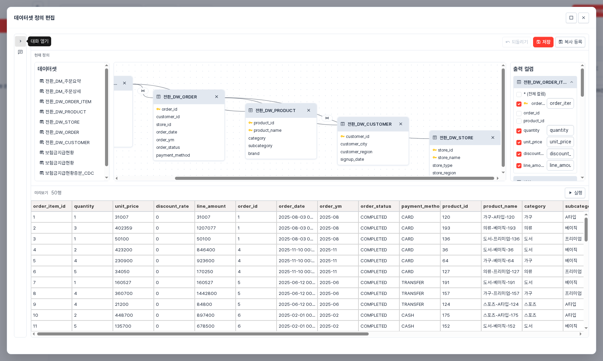
</p>

4. 중복된 키 컬럼은 하나만 남기고 주문일·상태, 상품 분류, 고객 지역, 매장 지역, 수량·단가·금액을 출력 컬럼으로 지정합니다.
5. **실행**으로 결과를 확인하고 **데이터셋 만들기**를 클릭합니다.
6. 제목을 **전환_DM_주문상세**로 지정하여 저장합니다.
7. 전체 행 수가 **199,152행**, `order_item_id`가 상세 한 건을 구분하는 키인지 확인합니다.

<p align="center">
  
</p>

> **💡 참고 : 주문 건수와 주문상세 건수**
>
> 상품이 세 종류인 주문은 주문상세에서 여러 행으로 나타납니다. 주문상세의 행 수를 주문 건수로 사용하면 중복 집계됩니다. 주문 건수는 주문 단위 데이터셋에서 집계하거나 `order_id`의 **고유 개수**로 계산합니다.

### 4.5 취소 주문을 포함하는 주문요약 DM 만들기

확인한 데이터에서 취소 주문 **14,629건은 주문상세가 없습니다.** 따라서 주문상세 기준의 INNER JOIN 결과만으로 주문 상태를 집계하면 취소 주문이 빠집니다.

주문상세를 `order_id`별로 먼저 합산한 뒤, **주문 테이블을 기준으로 LEFT JOIN**하여 주문 한 건이 한 행인 **전환_DM_주문요약**을 만듭니다.

1. **새 데이터셋 등록 → SQL 쿼리**를 선택합니다.
2. 소스에 주문·주문상세·고객·매장 데이터셋을 추가합니다.
3. 주문상세의 `quantity`, `line_amount`를 주문별로 합산합니다.
4. 주문을 기준으로 집계 결과·고객·매장을 LEFT JOIN합니다.
5. 완료·취소·반품 건수와 완료 주문 매출 컬럼을 구성합니다.
6. **실행**으로 확인한 뒤 **전환_DM_주문요약**으로 저장합니다.

<p align="center">
  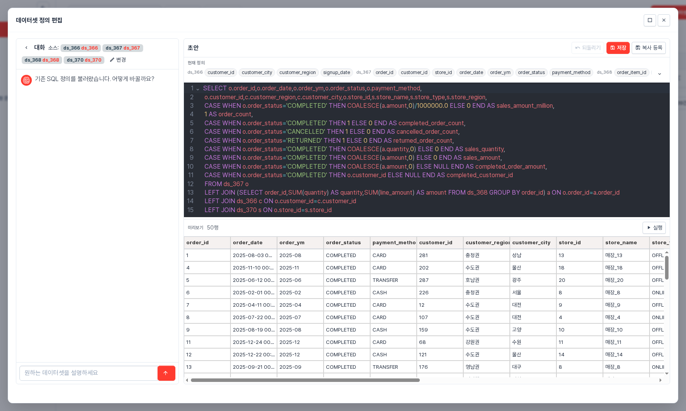
</p>

실습에서 사용한 SQL은 다음과 같습니다. `ds_번호`는 SQL 편집기의 소스 데이터셋 참조명이며, 아래 번호는 이번에 등록한 데이터셋에 해당합니다. 다른 환경에서는 소스 목록에 표시되는 번호로 바꿉니다.

```sql
SELECT o.order_id,o.order_date,o.order_ym,o.order_status,o.payment_method,
 o.customer_id,c.customer_region,c.customer_city,o.store_id,s.store_name,s.store_type,s.store_region,
 CASE WHEN o.order_status='COMPLETED' THEN COALESCE(a.amount,0)/1000000.0 ELSE 0 END AS sales_amount_million,
 1 AS order_count,
 CASE WHEN o.order_status='COMPLETED' THEN 1 ELSE 0 END AS completed_order_count,
 CASE WHEN o.order_status='CANCELLED' THEN 1 ELSE 0 END AS cancelled_order_count,
 CASE WHEN o.order_status='RETURNED' THEN 1 ELSE 0 END AS returned_order_count,
 CASE WHEN o.order_status='COMPLETED' THEN COALESCE(a.quantity,0) ELSE 0 END AS sales_quantity,
 CASE WHEN o.order_status='COMPLETED' THEN COALESCE(a.amount,0) ELSE 0 END AS sales_amount,
 CASE WHEN o.order_status='COMPLETED' THEN COALESCE(a.amount,0) ELSE NULL END AS completed_order_amount,
 CASE WHEN o.order_status='COMPLETED' THEN o.customer_id ELSE NULL END AS completed_customer_id
 FROM ds_367 o
 LEFT JOIN (SELECT order_id,SUM(quantity) AS quantity,SUM(line_amount) AS amount FROM ds_368 GROUP BY order_id) a ON o.order_id=a.order_id
 LEFT JOIN ds_366 c ON o.customer_id=c.customer_id
 LEFT JOIN ds_370 s ON o.store_id=s.store_id;
```

| 결과 컬럼 | 의미와 집계 방법 |
|---|---|
| `order_count` | 주문 한 건마다 1. 합계가 전체 주문 건수입니다. |
| `completed_order_count` | 완료 주문이면 1. 합계가 완료 주문 건수입니다. |
| `cancelled_order_count` | 취소 주문이면 1. 합계가 취소 주문 건수입니다. |
| `returned_order_count` | 반품 주문이면 1. 합계가 반품 주문 건수입니다. |
| `sales_amount` | 완료 주문의 금액. 취소·반품은 0으로 처리합니다. |
| `sales_amount_million` | 완료 주문 금액을 1,000,000으로 나눈 값. 금액 차트와 비교표에서 백만원 단위로 사용합니다. |
| `completed_order_amount` | 완료 주문 금액. 취소·반품은 NULL로 두어 완료 주문당 평균 금액을 계산합니다. |
| `completed_customer_id` | 완료 주문의 고객 ID. 고유 개수로 구매 고객 수를 계산합니다. |

<p align="center">
  
</p>

### 4.6 데이터와 집계 결과 대조

스튜디오 작성 전에 두 DM의 행 단위와 금액 기준을 확인합니다.

| 확인 항목 | 이번 실습의 결과 |
|---|---:|
| 주문요약 행 수 | 81,000 |
| 주문상세 행 수 | 199,152 |
| 완료 주문 수 | 64,802 |
| 취소 주문 수 | 14,629 |
| 반품 주문 수 | 1,569 |
| 완료 주문 매출 | 139,385,306,031원 |
| 완료 주문 판매 수량 | 584,399개 |
| 완료 주문 구매 고객 수 | 17,774명 |

이번 대시보드의 매출은 **완료 주문의 할인 후 상품 금액 합계**입니다. 별도 정산·세금·배송비 테이블은 사용하지 않았으므로 회계상 매출·실제 수납액과 동일하다고 해석하지 않습니다.

## 5. 스튜디오 작성

### 5.1 공통 작성 방법

1. **스튜디오 → 새 대시보드**를 클릭합니다.
2. 제목을 입력하고 **저장**을 클릭합니다.
3. 캔버스 크기를 **1440 × 1008**로 지정합니다.
4. 텍스트 위젯으로 제목과 집계 기준을 구성합니다.
5. **위젯 추가 → 데이터 위젯**에서 KPI·차트·피벗·테이블·필터를 추가합니다.
6. 각 위젯의 **데이터** 속성에서 데이터셋, 기준 컬럼과 집계 방식을 지정합니다.
7. 위젯을 정렬하고 **미리보기**에서 결과를 확인한 후 저장합니다.

<p align="center">
  
</p>

KPI는 숫자 컬럼을 선택하는 것만으로 의미가 정해지지 않습니다. 매출은 합계, 완료 주문당 금액은 평균, 고객·상품 수는 고유 개수처럼 지표에 맞는 집계를 지정합니다.

<p align="center">
  
</p>

필터는 컬럼을 지정한 뒤 **적용 대상**에 연결할 위젯을 선택합니다. 이번 예시는 각 페이지의 KPI·차트·피벗·테이블을 같은 필터에 연결합니다. 필터 동작은 미리보기에서 확인합니다.

<p align="center">
  
</p>

### 5.2 예시 1: 종합 실적 현황

**보고 목적:** 전체 규모와 월별 변화, 완료·취소·반품 구성을 한 화면에서 확인합니다. 보고서의 첫 장이나 정기 현황 보고에 적합한 요약형 구성입니다.

**저장 제목:** 보고서 전환 예시 01_종합 실적 현황  
**사용 데이터셋:** 전환_DM_주문요약

<p align="center">
  
</p>

| 영역 | 위젯 및 설정 | 확인할 내용 |
|---|---|---|
| 상단 | 조회 월·매장 지역·판매 채널 필터 | 같은 조건을 모든 지표에 적용합니다. |
| KPI 1 | `sales_amount` 합계 | 완료 주문 매출 |
| KPI 2 | `completed_order_count` 합계 | 완료 주문 수 |
| KPI 3 | `completed_order_amount` 평균 | 완료 주문당 평균 금액 |
| KPI 4 | 취소 주문 합계 ÷ 전체 주문 합계 × 100 | 취소 주문 비율 |
| 가운데 왼쪽 | 선그래프: X=`order_ym`, Y=`sales_amount_million` 합계 | 월별 매출 추이. 월 오름차순으로 정렬합니다. |
| 가운데 오른쪽 | 파이: 분류=`order_status`, 값=`order_count` 합계 | 완료·취소·반품 건수의 구성 |
| 하단 | 피벗: 행=`order_ym`, 값=전체·완료·취소 건수와 매출 | 차트의 근거 수치를 월별로 대조합니다. |

취소 비율 KPI는 **값 형태 → 비율(%)**에서 분자에 `cancelled_order_count` 합계, 분모에 `order_count` 합계를 지정합니다. 주문 상태 파이는 전체 상태를 비교해야 하므로 완료 주문만으로 필터링하지 않습니다.

### 5.3 예시 2: 지역·매장 운영 비교

**보고 목적:** 전체 수치가 비슷하더라도 어느 지역·채널·매장의 기여가 다른지 비교합니다. 조직별 실적 비교와 운영 현황 점검에 적합한 비교형 구성입니다.

**저장 제목:** 보고서 전환 예시 02_지역·매장 운영 비교  
**사용 데이터셋:** 전환_DM_주문요약

<p align="center">
  
</p>

| 영역 | 위젯 및 설정 | 확인할 내용 |
|---|---|---|
| 상단 | 조회 월·매장 지역·판매 채널 필터 | 비교 범위를 같은 조건으로 제한합니다. |
| 핵심 수치 | 매출 합계, 완료 주문 발생 매장 고유 개수, 완료 주문 수 | 선택 범위의 실적과 운영 규모 |
| 지역·채널 비교 | 누적 막대: X=`store_region`, 계열=`store_type`, 값=`sales_amount_million` 합계 | 지역별 실적과 온라인·오프라인 구성 |
| 매장 순위 | 막대: X=`store_name`, 값=`sales_amount_million` 합계 | 금액 내림차순으로 상위 10개 매장을 표시합니다. |
| 월별 비교표 | 피벗: 행=`store_region`, 열=`order_ym`, 값=`sales_amount_million` 합계 | 어느 지역의 실적이 어느 달에 달라졌는지 비교합니다. |
| 채널 구성 | 파이: 분류=`store_type`, 값=`sales_amount` 합계 | 온라인·오프라인 매출 비중 |

매장 수는 완료 주문 조건에서 `store_id`의 **고유 개수**로 집계합니다. 전체 매장 등록 수와 완료 주문이 발생한 매장 수는 서로 다른 지표입니다.

이 데이터의 지역은 수도권·충청권 등 권역 단위입니다. 좌표나 지도에 맞는 지역 코드가 없으므로 이번 예시에서는 지도 대신 막대와 피벗으로 비교합니다.

### 5.4 예시 3: 상품·고객 수요 탐색

**보고 목적:** 상품 분류와 고객 지역을 바꾸어 보며 수요의 구성을 살펴보고, 해당 수치를 만든 주문상세까지 확인합니다. 세부 현황을 탐색하고 후속 분석 대상을 찾는 데 적합합니다.

**저장 제목:** 보고서 전환 예시 03_상품·고객 수요 탐색  
**사용 데이터셋:** 전환_DM_주문상세

<p align="center">
  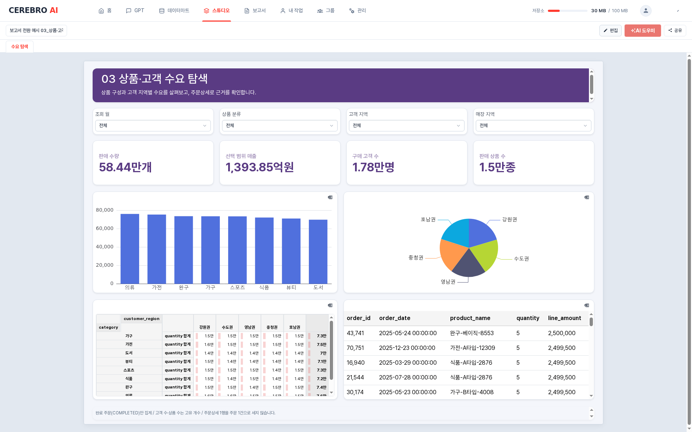
</p>

| 영역 | 위젯 및 설정 | 확인할 내용 |
|---|---|---|
| 상단 | 조회 월·상품 분류·고객 지역·매장 지역 필터 | 상품과 고객의 관점으로 범위를 좁힙니다. |
| 핵심 수치 | `quantity` 합계, `line_amount` 합계, `customer_id` 고유 개수, `product_id` 고유 개수 | 판매 수량·매출·구매 고객 수·판매 상품 수 |
| 상품 구성 | 막대: X=`category`, 값=`quantity` 합계 | 어떤 분류의 상품이 많이 판매되었는지 확인합니다. |
| 고객 지역 구성 | 파이: 분류=`customer_region`, 값=`quantity` 합계 | 구매 고객 지역별 판매 수량의 구성 |
| 수요 교차표 | 피벗: 행=`category`, 열=`customer_region`, 값=`quantity` 합계 | 상품군별 수요가 큰 고객 지역을 비교합니다. |
| 근거 자료 | 테이블: 주문 ID·주문일·상품명·수량·금액 | 금액 내림차순으로 조건에 맞는 상세 50행을 확인합니다. |

모든 데이터 위젯에 `order_status = COMPLETED` 조건을 적용합니다. 고객 지역과 매장 지역은 서로 다른 컬럼이므로 필터와 차트에서 구분하여 사용합니다.

### 5.5 저장된 대시보드 확인

각 예시는 하나의 대시보드로 따로 저장했습니다.

| 번호 | 저장한 대시보드 | 화면 열기 |
|---|---|---|
| 1 | 보고서 전환 예시 01_종합 실적 현황 | [스튜디오에서 열기](https://cerebro.alpl.co.kr/#/studio/160) |
| 2 | 보고서 전환 예시 02_지역·매장 운영 비교 | [스튜디오에서 열기](https://cerebro.alpl.co.kr/#/studio/161) |
| 3 | 보고서 전환 예시 03_상품·고객 수요 탐색 | [스튜디오에서 열기](https://cerebro.alpl.co.kr/#/studio/162) |

> **💡 참고 : 새로고침과 원본 갱신**
>
> 스튜디오의 자동 새로고침은 연결된 데이터셋을 다시 조회하는 기능입니다. 이번 CSV 데이터셋의 내용이 DB 변경에 맞춰 자동으로 바뀌는 것은 아닙니다. DB 추출 연결이 정상화되면 원본 추출·데이터셋 갱신 절차를 별도로 구성하고, DM과 대시보드의 반영 결과를 확인합니다.

## 6. 대시보드 공유

### 6.1 사용자 그룹에 대시보드 조회 권한 부여

1. 작성 계정에서 저장한 대시보드를 엽니다.
2. 오른쪽 위 **공유 → 멤버 공유**를 선택합니다.
3. 그룹명 **사용자**를 검색하여 추가합니다.
4. 권한을 **조회**로 지정합니다.
5. 같은 절차를 예시 대시보드 3개에 적용합니다.

<p align="center">
  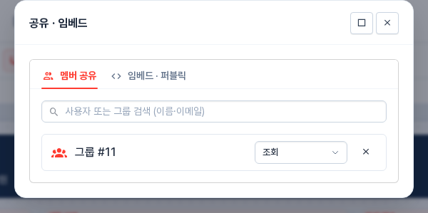
</p>

현재 공유 창에는 그룹명이 **그룹 #11**로 표시됩니다. 이번 실습에서 생성한 **사용자** 그룹의 번호이며, 홍길동이 소속된 공유 대상입니다.

사용자 그룹에는 원본 편집 권한을 부여하지 않습니다. 홍길동은 원본을 조회하고 사본을 자신의 소유로 저장하여 활용합니다.

### 6.2 최종 DM 데이터셋 조회 권한 확인

1. 데이터마트에서 **전환_DM_주문요약**의 **공유 설정**을 엽니다.
2. **사용자** 그룹을 추가하고 권한을 **조회**로 지정합니다.
3. **전환_DM_주문상세**에도 같은 설정을 적용합니다.
4. 일반 액세스는 **제한됨**을 유지합니다.

<p align="center">
  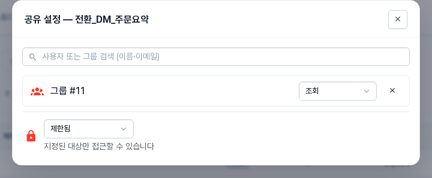
</p>

대시보드 공유와 데이터셋 공유는 별도입니다. 대시보드가 열리더라도 연결 데이터셋 권한이 없으면 데이터가 표시되지 않거나 사본에서 위젯 설정을 변경할 수 없습니다. 이번 실습은 최종 DM 2개만 공유하고, 원본 DW 5개와 DB 연결 관리 권한은 사용자 그룹에 공유하지 않았습니다.

## 7. 사용자: 대시보드 저장 및 사용

### 7.1 홍길동 계정으로 공유 대시보드 조회

1. 작성 계정에서 로그아웃하고 홍길동(`test@naver.com`) 계정으로 로그인합니다.
2. **스튜디오 → 공유받음**을 선택합니다.
3. 공유된 예시 대시보드 3개가 표시되는지 확인합니다.

<p align="center">
  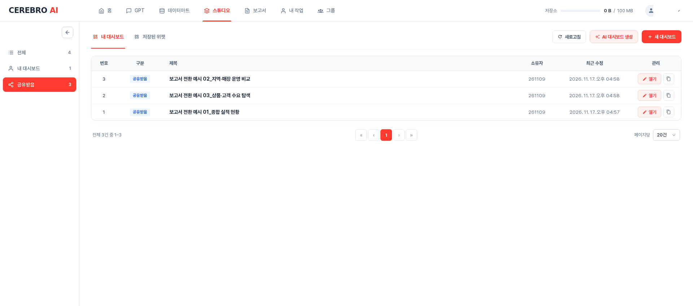
</p>

4. **종합 실적 현황**을 열어 KPI·차트·표의 데이터가 표시되는지 확인합니다.
5. 원본은 조회 모드로 제공되며, 편집·공유 설정을 바꾸는 대신 사본으로 가져오는 기능을 사용합니다.

<p align="center">
  
</p>

### 7.2 조회 조건 변경

1. **매장 지역** 필터에서 **수도권**을 선택합니다.
2. KPI·월별 그래프·상태 구성·피벗이 같은 지역 조건으로 바뀌는지 확인합니다.
3. 다른 지역과 비교한 후 **전체**로 되돌립니다.

<p align="center">
  
</p>

필터 선택은 조회 범위를 바꾸는 동작입니다. 원본 데이터나 관리자 대시보드의 구성을 수정하지 않습니다.

### 7.3 내 대시보드로 사본 저장

1. 공유 대시보드 위쪽의 **내 대시보드로 가져오기**를 클릭합니다.
2. 사본 제목을 입력하고 저장합니다. 실습에서는 **홍길동_월별 실적 검토용**으로 저장했습니다.

<p align="center">
  
</p>

3. **내 대시보드** 목록에서 사본을 열어 편집할 수 있는지 확인합니다.

사본 저장은 페이지와 위젯 구성을 복사하는 기능입니다. 데이터셋 전체를 새로 복제하거나 DB 권한을 가져오는 기능은 아니며, 연결된 데이터셋의 이용 권한은 계속 필요합니다. 원본의 공유 대상도 사본에 자동으로 복사되지 않습니다.

### 7.4 사본 수정 및 저장

1. 사본의 제목과 화면 제목을 본인 용도에 맞게 바꿉니다.
2. 월별 매출 차트를 **선그래프에서 막대그래프로** 변경합니다.
3. 평균 주문 금액 KPI를 `completed_customer_id`의 **고유 개수**로 바꾸어 구매 고객 수를 표시합니다.
4. **저장** 후 미리보기에서 수정한 결과를 확인합니다.

<p align="center">
  
</p>

실습에서는 [홍길동_월별 실적 검토용](https://cerebro.alpl.co.kr/#/studio/163) 사본을 저장하고, 관리자 원본의 구성과 버전이 유지되는 것을 확인했습니다. 사본은 홍길동 계정의 소유 자료이므로 해당 계정으로 열어 확인합니다.

### 7.5 조회 결과 다운로드

1. 대시보드에서 필요한 조회 조건을 지정합니다.
2. 차트·피벗·테이블 오른쪽 위의 **엑셀 내보내기** 버튼을 클릭합니다.
3. 내려받은 파일의 집계 기준과 조건을 확인한 후 업무 자료로 활용합니다.

<p align="center">
  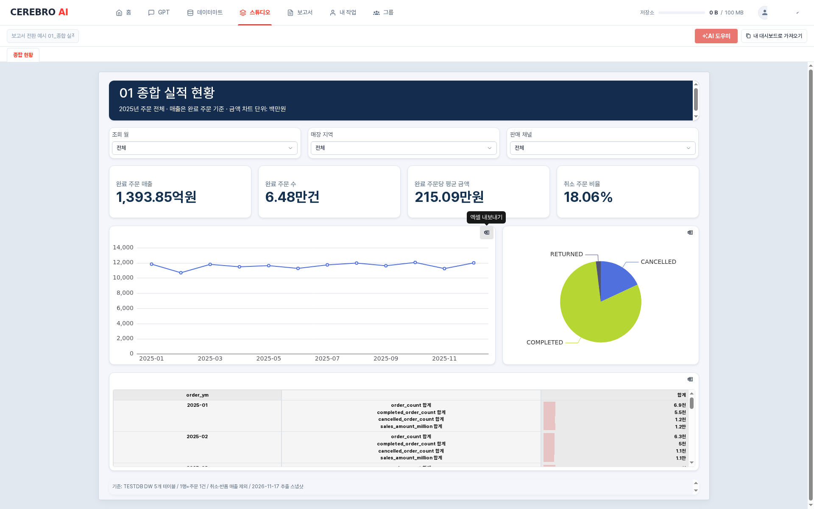
</p>

다운로드 파일은 해당 위젯의 조회 결과입니다. 차트는 집계 결과를, 상세 테이블은 설정된 표시 컬럼·행 수 범위의 결과를 내보냅니다. 이번 실습에서는 홍길동 계정의 월별 매출 차트를 엑셀 파일로 내려받는 것까지 확인했습니다.

### 7.6 최종 확인 항목

| 구분 | 확인 내용 | 실습 결과 |
|---|---|---|
| 그룹 | 관리자·사용자 그룹 생성 | 완료 |
| 구성원 | 작성 계정은 관리자 그룹 관리자, 홍길동은 사용자 그룹 일반 멤버 | 완료 |
| DB 연결 | 연결 정보 저장 및 테스트 | 정보 저장 완료 / CEREBRO 서버 연결 테스트는 네트워크 오류 |
| 원본 데이터 | 지정 DW 5개 테이블의 필요한 컬럼 등록 | DB에서 직접 추출한 CSV로 등록 완료 |
| DM | 주문요약 81,000행 / 주문상세 199,152행 | 완료 |
| 대시보드 | 작성 계정에 예시 3개 저장 | 완료 |
| 공유 | 사용자 그룹에 대시보드와 최종 DM 조회 권한 부여 | 완료 |
| 사용자 조회 | 홍길동이 3개 대시보드를 조회하고 원본 편집은 제한 | 확인 |
| 사본 활용 | 홍길동 사본 저장·수정, 관리자 원본 유지 | 확인 |
| 결과 활용 | 홍길동 계정의 엑셀 다운로드 | 확인 |
