# CEREBRO AI 보고서 전환 가이드

기존 보고서의 항목을 데이터셋과 대시보드로 구성하고, 작성 담당자가 공유한 화면을 사용자가 자신의 업무에 맞게 활용하는 과정을 안내합니다.

## 목차

1. [개요](#1-개요)
2. [그룹 생성](#2-그룹-생성)
3. [DB 연결](#3-db-연결)
4. [새 데이터셋 등록하기](#4-새-데이터셋-등록하기)
5. [스튜디오 작성](#5-스튜디오-작성)
6. [대시보드 공유](#6-대시보드-공유)
7. [사용자: 대시보드 저장 및 사용](#7-사용자-대시보드-저장-및-사용)

## 1. 개요

### 1.1 목적 및 적용 범위

본 문서는 국방부 보고서를 CEREBRO AI 대시보드로 재구성하는 작업을 안내합니다. 기존 보고서에서 확인하던 수치·표·그래프를 데이터셋에 연결하고, 조회 조건을 바꾸며 통계와 근거 자료를 한눈에 확인할 수 있도록 구성합니다.

실습에는 DB에 저장된 고객·주문·주문상세·상품·매장 데이터를 사용합니다. 아래 판매 지표는 대시보드 구성 방법을 익히기 위한 예시이며, 실제 보고서 전환 시에는 해당 보고서의 항목명과 집계 기준을 적용합니다.


### 1.2 담당자와 그룹의 역할

이름이 **관리자**, **사용자**인 두 그룹을 구성합니다.

| 구분 | 그룹 내 역할 | 수행 업무 |
|---|---|---|
| 작성 담당자 | **관리자** 그룹의 그룹 관리자 | DB 연결, 데이터셋 등록·조인, 대시보드 작성·저장, 사용자 그룹에 공유 |
| 조회 담당자 | **사용자** 그룹의 일반 멤버 | 공유 대시보드 조회, 조건 변경, 사본 저장·수정, 결과 다운로드 |

### 1.3 작업 순서와 완성 결과

**그룹 구성 → DB 연결 설정 → DW 데이터셋 등록 → 대시보드 3개 작성 → 사용자 그룹에 조회 공유 → 조회 담당자의 사본 저장·활용** 순서로 진행합니다.

| 대시보드 | 구성 방식 | 확인하려는 내용 |
|---|---|---|
| 종합 실적 현황 | 핵심 수치와 추이 중심의 요약형 | 전체 규모, 월별 변화, 주문 상태별 구성 |
| 지역·매장 운영 비교 | 지역·채널 비교와 피벗 중심의 비교형 | 어느 지역·매장의 실적이 큰지, 지역별 실적이 월마다 어떻게 달라지는지 |
| 상품·고객 수요 탐색 | 분류별 차트와 상세 표 중심의 탐색형 | 어떤 상품군을 어느 지역의 고객이 구매하는지, 그 근거 주문은 무엇인지 |

## 2. 그룹 생성

### 2.1 관리자 그룹 생성

1. 사이트 관리자 계정으로 로그인합니다.
2. 상단 **관리 → 그룹/권한 관리**를 선택합니다.
3. **그룹 추가**를 클릭하고 그룹명에 **관리자**를 입력합니다.
4. **추가**를 클릭한 후 그룹 선택 목록에서 **관리자**를 선택합니다.

<p align="center">
  
</p>

### 2.2 관리자 그룹에 작성 담당자 배정

1. **멤버 구성**에서 작성 계정의 이메일을 검색합니다.
2. 검색된 작성 담당자 계정의 **구성원**과 **관리자**를 선택합니다.
3. **저장**을 클릭하고 관리자 지정 결과를 확인합니다.

<p align="center">
  
</p>

### 2.3 사용자 그룹 생성

1. 같은 화면에서 **그룹 추가**를 클릭합니다.
2. 그룹명에 **사용자**를 입력하고 **추가**를 클릭합니다.
3. 그룹 선택 목록에서 **사용자**를 선택합니다.

<p align="center">
  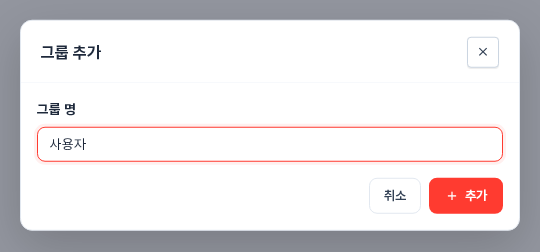
</p>

### 2.4 사용자 그룹에 조회 담당자 배정

1. **멤버 구성**에서 조회 담당자의 이름이나 이메일을 검색합니다.
2. 대상 계정을 확인한 후 **구성원**을 선택합니다.
3. **관리자**는 선택하지 않고 **저장**을 클릭합니다.
4. 사용자 그룹에 조회 담당자가 일반 멤버로 포함되었는지 확인합니다.

<p align="center">
  
</p>

## 3. DB 연결

### 3.1 관리자 그룹에 DB 연결 등록

1. 상단 **그룹** 메뉴에서 **관리자** 그룹을 선택합니다.
2. **DB 연결 → DB 연결 등록**을 클릭합니다.
3. 운영 환경에 맞는 연결 정보를 입력합니다. 비밀번호는 별도로 전달받은 값을 입력합니다.

| 항목 | 입력할 내용 |
|---|---|
| 데이터베이스 종류 | MySQL |
| 이름 | 연결을 구분할 이름 |
| 호스트 | 운영 환경의 DB 서버 주소 |
| 포트 | 운영 환경의 DB 접속 포트 |
| Database | 사용할 데이터베이스명 |
| 사용자 | DB 조회 권한을 부여받은 접속 계정 |
| 비밀번호 | 별도로 전달받은 DB 접속 비밀번호 |

<p align="center">
  
</p>

### 3.2 연결 테스트 및 현재 결과 확인

1. **연결 테스트**를 클릭합니다.
2. 정상 연결된 환경에서는 성공 결과를 확인한 후 저장합니다.
3. 연결에 실패하면 호스트·포트·방화벽과 **CEREBRO 서버에서 DB까지의 접근 경로**를 확인합니다.

<p align="center">
  
</p>

## 4. 새 데이터셋 등록하기

### 4.1 사용할 DW 테이블과 연결 관계

예시 테이블명은 다음과 같습니다. 주문상세의 정확한 이름은 `dw_order_item`입니다.

| 테이블 | 내용 | 기본키 | 주요 연결 컬럼 | 원본 행 수 |
|---|---|---|---|---:|
| `dw_customer` | 고객의 지역·가입 정보 | `customer_id` | 주문의 `customer_id`와 연결 | 24,300 |
| `dw_store` | 매장명·지역 등 매장 정보 | `store_id` | 주문의 `store_id`와 연결 | 1,620 |
| `dw_order` | 주문 고객·매장 등 주문정보 | `order_id` | `customer_id`, `store_id` | 81,000 |
| `dw_product` | 상품명·분류·브랜드 등 상품 정보 | `product_id` | 주문상세의 `product_id`와 연결 | 16,200 |
| `dw_order_item` | 주문에 포함된 상품·수량·주문 당시 주문 상품정보 | `order_item_id` | `order_id`, `product_id` | 199,152 |


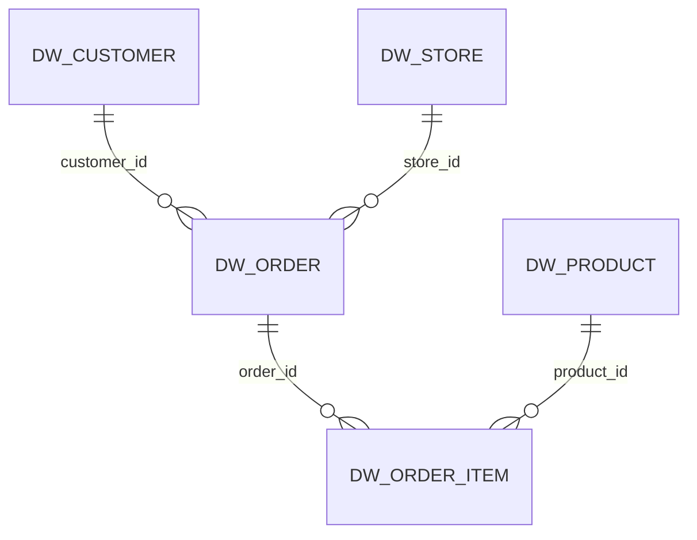

고객 한 명과 매장 한 곳에 여러 주문이 연결되고, 주문 한 건에는 여러 주문상세가 연결됩니다. 상품 한 종류도 여러 주문상세에 포함될 수 있습니다.

### 4.2 DB 추출로 고객 데이터셋 등록

DB 연결이 정상인 환경에서는 고객 테이블을 먼저 등록하여 데이터셋 생성 과정을 익힙니다.

1. **데이터마트 → 새 데이터셋 등록 → DB 추출**을 선택합니다.
2. DB 연결에서 등록한 보고서용 DB 연결을 선택합니다.
3. 사용할 스키마에서 `dw_customer`를 선택해 컬럼을 확인합니다.
4. SQL 편집기에 다음 조회문을 입력하고 실행합니다.
5. 결과를 확인한 후 **데이터셋 만들기**를 클릭합니다.
6. 제목을 **전환_DW_CUSTOMER**로 지정하여 저장합니다.

```sql
SELECT
    customer_id,
    city AS customer_city,
    region AS customer_region,
    signup_date
FROM dw_customer
WHERE COALESCE(del_yn, 'N') = 'N';
```

### 4.3 이번 실습의 파일 등록 결과

위 고객 조회 결과와 나머지 네 테이블의 필요한 컬럼을 CSV로 추출한 후, **새 데이터셋 등록 → 파일 업로드**로 등록했습니다. 고객 데이터셋의 제목을 클릭해 컬럼 구성과 행 수를 확인합니다.

<p align="center">
  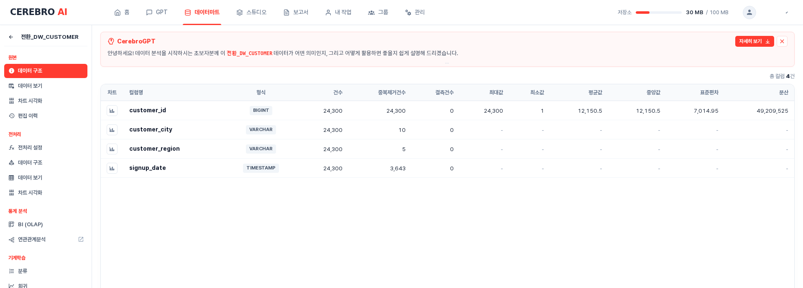
</p>

전환에 필요한 테이블을 같은 과정을 반복하여 데이터셋에 등록합니다.

<p align="center">
  
</p>

### 4.4 데이터셋 조인

**데이터셋 조인**을 사용하면 여러 데이터셋에 나뉜 정보를 공통 컬럼으로 연결하여 조인 데이터셋을 만들 수 있습니다.  

1. **새 데이터셋 등록 → 데이터셋 조인**을 선택합니다.
2. 데이터셋을 추가합니다.
3. 주문 ID·고객 ID 등 서로 대응하는 키 컬럼을 연결합니다.
4. 연결된 자료만 사용할지, 기준 자료를 모두 유지할지에 따라 조인 방식을 지정합니다.

<p align="center">
  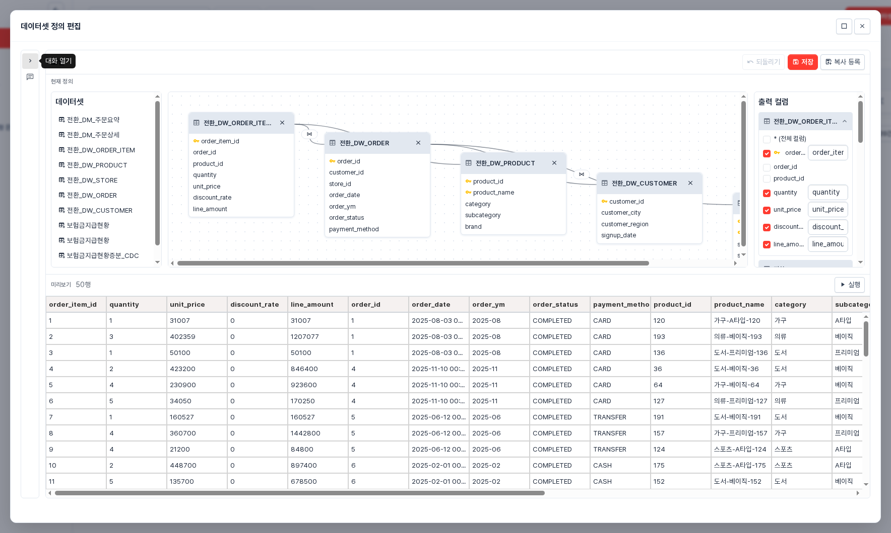
</p>

5. 필요한 컬럼을 출력 항목으로 선택하고, 중복되거나 불필요한 컬럼은 제외합니다.
6. **실행**으로 연결 결과를 확인합니다.
7. **데이터셋 만들기**를 클릭하고 제목을 입력하고 저장합니다.

<p align="center">
  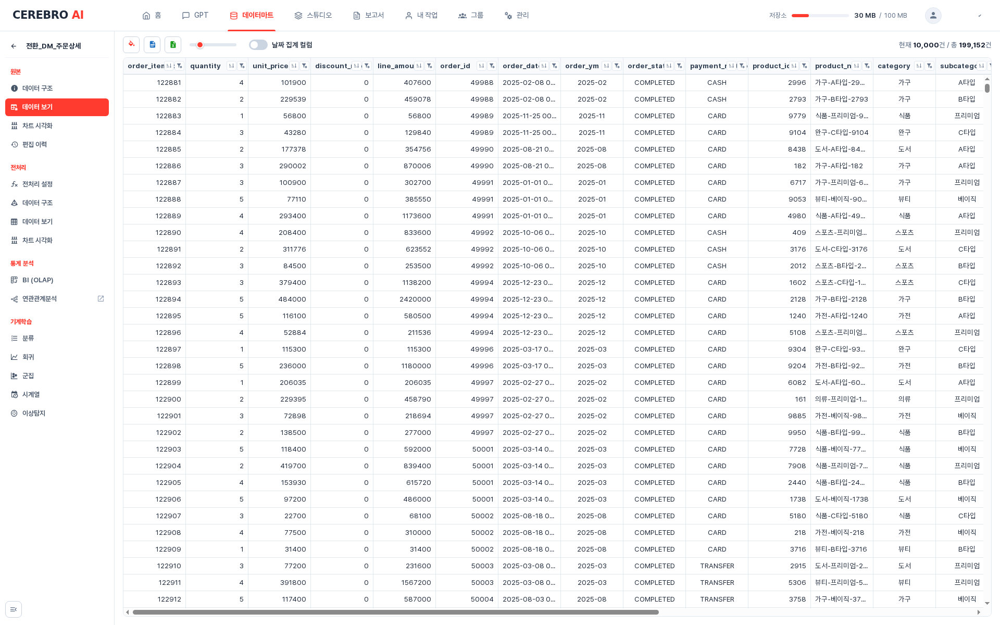
</p>


> **💡 참고 : 조인 후 집계 기준 확인**
>
> 기준 자료 한 건에 여러 상세 자료가 연결되면 같은 기준 값이 여러 행에 반복될 수 있습니다. 건수는 행 수와 고유 개수 중 무엇을 의미하는지 확인하고, 금액은 중복 합산되지 않도록 집계 기준을 정합니다.

### 4.5 목적에 맞는 집계 기준 확인

대시보드에 데이터를 연결하기 전에 기존 보고서에서 사용하던 조회 조건과 계산 기준을 확인합니다. 같은 자료라도 집계 단위나 제외 조건에 따라 결과가 달라질 수 있습니다.

| 확인 항목 | 확인할 내용 |
|---|---|
| 한 행의 의미 | 한 행이 주문·상품·처리 이력 중 무엇을 나타내는지 확인합니다. |
| 건수의 기준 | 전체 행 수를 셀지, 중복을 제외한 고유 개수를 셀지 정합니다. |
| 합계·평균의 기준 | 합산할 수치와 평균에 포함할 대상 범위를 확인합니다. |
| 포함·제외 조건 | 취소·반품 등 특정 상태를 지표에 포함할지 정합니다. |
| 기간과 단위 | 기준 날짜, 집계 기간과 금액·수량의 표시 단위를 맞춥니다. |
| 조인 결과 | 연결 과정에서 자료가 빠지거나 같은 값이 반복되는지 확인합니다. |

이 기준을 데이터셋과 위젯 설정에 일관되게 적용하면, 기존 보고서의 수치와 대시보드 결과를 같은 조건으로 비교할 수 있습니다.

## 5. 스튜디오 작성

스튜디오에서는 데이터셋을 KPI·차트·피벗·테이블 등의 위젯에 연결하고, 보고 목적에 맞게 배치할 수 있습니다. 기존 보고서의 요약 수치·비교표·상세 목록을 한 화면에 구성하거나, 용도에 따라 대시보드를 나누어 활용합니다.

아래 화면은 판매 자료를 사용한 구성 예시입니다. 실제 보고서에서는 업무에 맞는 항목과 지표를 연결하여 같은 방식으로 활용할 수 있습니다.

### 5.1 대시보드와 위젯 구성

#### 5.1.1 기본 화면 설정

<p align="center">
  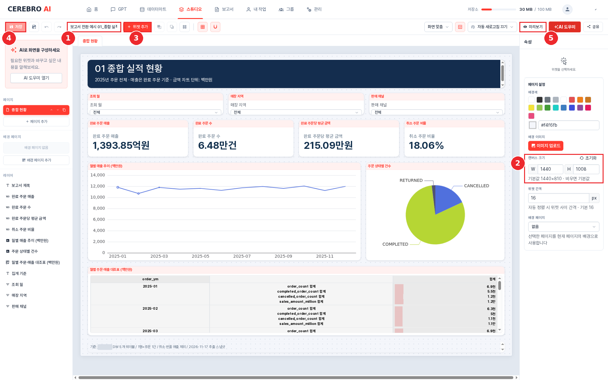
</p>

스튜디오에서 새 대시보드를 연 뒤 다음 순서로 구성합니다. 사진의 동그라미 번호는 아래 설명 번호와 대응합니다.

1. **제목 입력:** 대시보드의 용도를 구분할 수 있는 제목을 입력합니다.
2. **캔버스 크기:** 위젯을 선택하지 않은 상태에서 오른쪽 **페이지 설정 → 캔버스 크기**의 W(너비)와 H(높이)를 지정합니다.
3. **위젯 추가:** **위젯 추가 → 데이터 위젯**에서 KPI·차트·필터·피벗·테이블 등 필요한 위젯을 선택합니다.
4. **저장:** 작성한 제목과 화면 구성을 저장합니다.
5. **미리보기:** 사용자가 보게 될 화면에서 위젯과 필터의 동작을 확인합니다.

#### 5.1.2 KPI 설정

<p align="center">
  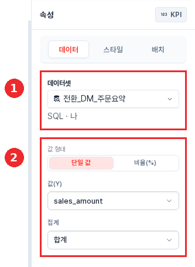
</p>

KPI 위젯을 선택하고 오른쪽 속성의 **데이터** 탭에서 설정합니다.

1. **데이터셋:** 표시할 수치가 들어 있는 데이터셋을 선택합니다.
2. **값과 집계 설정:** **값 형태 → 단일 값**을 선택하고, **값(Y)**에서 계산할 컬럼을 지정합니다. **집계**에서 합계·평균·고유 개수 등 지표에 맞는 방식을 선택합니다. 예를 들어 전체 금액은 금액 컬럼의 합계로, 평균 금액은 같은 컬럼의 평균으로 설정합니다.

비율 지표가 필요하면 **값 형태 → 비율(%)**로 바꾸고 분자·분모의 컬럼과 집계 방식을 각각 지정합니다.

#### 5.1.3 필터 설정

<p align="center">
  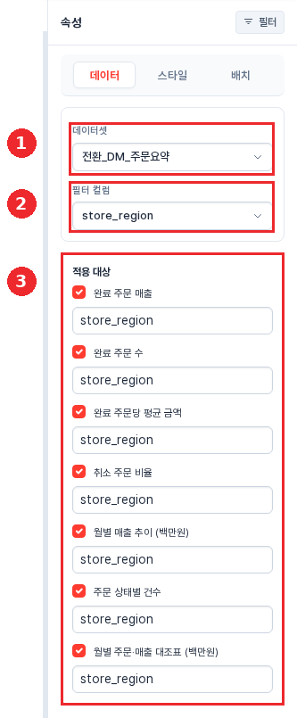
</p>

필터 위젯을 선택하고 오른쪽 **데이터** 탭에서 조회 조건과 적용할 위젯을 연결합니다.

1. **데이터셋:** 조회 조건으로 사용할 컬럼이 들어 있는 데이터셋을 선택합니다.
2. **필터 컬럼:** 사용자가 선택할 기준 컬럼을 지정합니다. 기간별 조회에는 날짜·연월 컬럼을, 지역별 조회에는 지역 컬럼을 사용합니다.
3. **적용 대상:** 조건을 적용할 KPI·차트·피벗·테이블을 체크합니다. 대상별 입력란에는 해당 위젯 데이터셋의 대응 컬럼명을 지정합니다.

적용 대상을 연결한 뒤 미리보기에서 값을 선택하여 원하는 위젯이 함께 바뀌는지 확인합니다.

#### 5.1.4 차트 설정

<p align="center">
  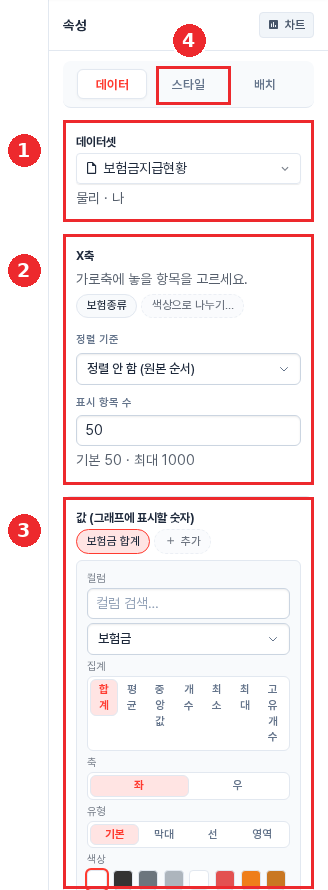
</p>

차트 위젯을 선택한 뒤 데이터와 표시 형태를 차례로 지정합니다. 화면의 데이터셋과 컬럼은 설정 위치를 보여주는 예시이며, 실제 보고에 사용할 항목으로 선택합니다.

1. **데이터셋:** 차트에 사용할 데이터셋을 선택합니다.
2. **X축:** 현재 컬럼 표시나 **X축 선택** 항목을 클릭하여 기간·지역·분류 등 비교 기준 컬럼을 선택합니다. **정렬 기준**과 **표시 항목 수**도 지정합니다. 항목을 색상별로 나누려면 **색상으로 나누기**에서 두 번째 분류 컬럼을 선택합니다.
3. **값과 집계 설정:** 값 항목을 클릭하여 계산할 컬럼과 집계 방식을 선택합니다. 금액·수량은 합계, 대상 수는 건수 또는 고유 개수 등 지표에 맞는 방식으로 지정합니다. 측정값을 더 표시하려면 **추가**를 이용합니다.
4. **차트 종류:** **스타일** 탭을 선택하고 **차트**에서 막대·선·파이·누적 막대 등 원하는 종류를 지정합니다.

#### 5.1.5 피벗 설정

<p align="center">
  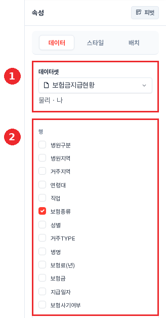
</p>

피벗 위젯을 선택하고 오른쪽 **데이터** 탭에서 표의 행·열과 집계 항목을 지정합니다.

1. **데이터셋:** 교차 집계할 데이터셋을 선택합니다.
2. **행:** 표의 세로 방향으로 구분할 기준 컬럼을 체크합니다. 지역·조직·상품 분류 등 비교할 항목을 선택합니다.

<p align="center">
  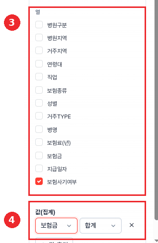
</p>

3. **열:** 오른쪽 속성을 아래로 스크롤하여 가로 방향으로 구분할 기준 컬럼을 체크합니다. 월별 비교라면 연월 컬럼을 선택합니다.
4. **값과 집계 설정:** **값(집계) → 값 추가**에서 계산할 컬럼과 합계·평균·건수 등의 집계 방식을 지정합니다. 여러 지표를 함께 보려면 값을 추가합니다.

#### 5.1.6 테이블 설정

<p align="center">
  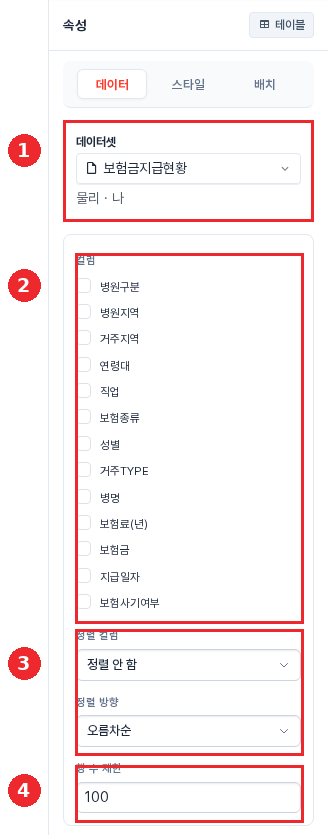
</p>

테이블 위젯을 선택하고 오른쪽 **데이터** 탭에서 상세 목록의 표시 항목을 지정합니다.

1. **데이터셋:** 상세 자료가 들어 있는 데이터셋을 선택합니다.
2. **컬럼:** 화면에 표시할 컬럼을 체크합니다. 업무에 필요한 식별 항목·날짜·분류·수치 등을 선택합니다.
3. **정렬:** **정렬 컬럼**과 **정렬 방향**을 지정합니다. 금액이 큰 자료부터 확인하려면 금액 컬럼과 내림차순을 선택합니다.
4. **행 수 제한:** 화면에 표시할 최대 행 수를 입력합니다.

### 5.2 전체 현황 대시보드 설정

<p align="center">
  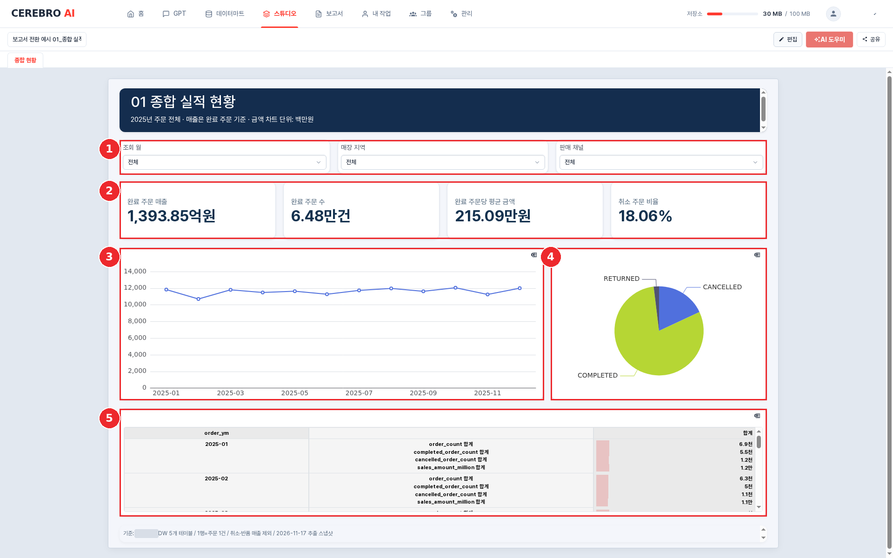
</p>

전체 규모와 기간별 변화를 함께 보고 싶을 때 다음과 같이 위젯을 설정합니다.

1. **조회 조건:** 필터 위젯에 기간·지역 등 조회 기준 컬럼을 지정하고, 같은 조건으로 조회할 KPI·차트·피벗을 적용 대상으로 연결합니다.
2. **핵심 수치:** KPI마다 데이터셋과 **값(Y)**을 선택합니다. 전체 규모는 합계, 평균 수준은 평균으로 설정합니다. 비율 지표는 분자·분모를 지정합니다.
3. **기간별 추이:** 차트의 X축에 날짜·연월 컬럼을, 값에 비교할 수치와 집계를 지정합니다. X축을 시간 순서로 정렬하고 **스타일 → 차트 → 선**을 선택합니다.
4. **항목별 구성:** 차트의 X축에 상태·분류 컬럼을, 값에 해당 항목의 건수나 합계를 지정한 뒤 **스타일 → 차트 → 파이**를 선택합니다.
5. **근거 집계표:** 피벗의 행에 기간 컬럼을 지정하고, **값(집계)**에 차트와 대조할 지표를 추가합니다. 건수·금액 등 필요한 값을 같은 표에 배치합니다.

### 5.3 비교 대시보드 설정

<p align="center">
  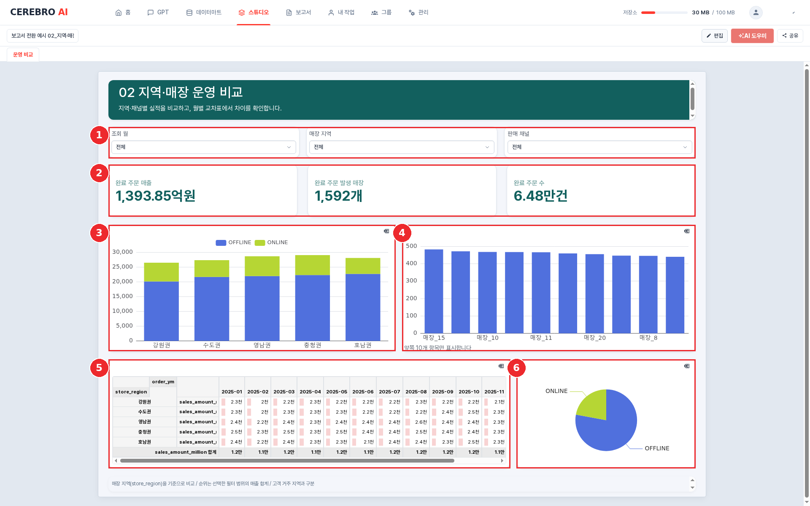
</p>

지역·조직·사업 등 여러 대상을 같은 기준으로 비교하려면 다음과 같이 설정합니다.

1. **비교 범위:** 기간과 대상 범위를 선택할 필터 컬럼을 지정하고, 비교할 위젯을 적용 대상으로 연결합니다.
2. **규모 요약:** KPI의 데이터셋과 수치 컬럼을 선택합니다. 전체 금액은 합계로, 대상 수는 대상 ID의 고유 개수로 지정하여 중복을 구분합니다.
3. **규모와 구성 비교:** 차트의 X축에 지역·조직 등 비교 대상을 지정합니다. **색상으로 나누기**에는 세부 분류를, 값에는 수치 컬럼과 집계를 선택하고 **스타일 → 차트 → 누적 막대**로 설정합니다.
4. **순위 비교:** 차트의 X축에 대상명, 값에 비교 수치를 지정하고 막대를 선택합니다. **정렬 기준 → 값 크기순**, **정렬 방향 → 큰 값부터(내림차순)**를 선택하고 표시 항목 수를 지정합니다.
5. **기간별 교차표:** 피벗의 행에는 비교 대상, 열에는 기간을 지정합니다. **값(집계)**에 비교할 수치와 집계 방식을 추가합니다.
6. **세부 항목의 비중:** 차트의 X축에 세부 분류, 값에 해당 수치와 집계를 지정하고 파이를 선택합니다.

### 5.4 상세 조회 대시보드 설정

<p align="center">
  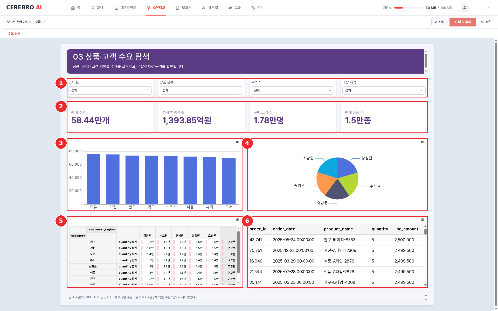
</p>

조건별 요약 수치와 근거 자료를 함께 확인하려면 다음과 같이 설정합니다.

1. **조회 조건:** 기간·지역·분류 필터를 구성하고, 아래 KPI·차트·피벗·테이블을 적용 대상으로 연결합니다.
2. **선택 범위의 요약:** KPI의 값과 집계를 지정합니다. 금액·수량은 합계, 대상 수는 식별 컬럼의 고유 개수 등으로 설정합니다.
3. **항목별 크기 비교:** 차트의 X축에 분류 컬럼을, 값에 수치 컬럼과 집계를 지정하고 막대를 선택합니다.
4. **항목별 구성 확인:** 차트의 X축에 구성 비중을 확인할 분류를 지정하고, 값과 집계를 선택한 뒤 파이로 설정합니다.
5. **분류 간 교차 집계:** 피벗의 행과 열에 서로 다른 분류를 지정하고, **값(집계)**에 확인할 수치를 추가합니다.
6. **근거 자료 목록:** 테이블의 데이터셋과 표시 컬럼을 선택한 뒤 정렬 컬럼·방향·행 수 제한을 지정합니다. 필터의 적용 대상에도 이 테이블을 포함합니다.

### 5.5 저장 및 미리보기

<p align="center">
  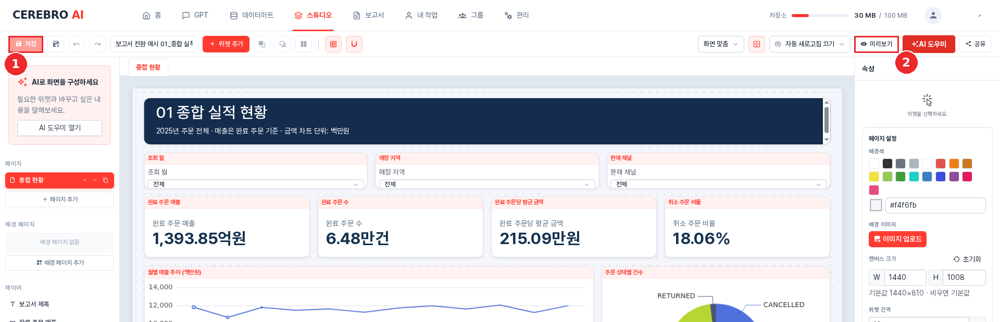
</p>

1. **저장:** 작성한 위젯과 속성 설정을 저장합니다.
2. **미리보기:** 필터를 선택하여 연결된 위젯이 같은 조건으로 바뀌는지 확인합니다. 지표·단위·화면 배치를 확인한 뒤 수정이 필요하면 편집 화면으로 돌아갑니다.

> **💡 참고 : 화면 새로고침과 원본 데이터 갱신**
>
> 스튜디오의 자동 새로고침은 연결된 데이터셋을 다시 조회하는 기능입니다. DB나 파일의 변경 사항을 반영하려면 원본 수집·재업로드 등 해당 데이터셋의 갱신 절차도 수행해야 합니다.
>
> 갱신을 지원하는 데이터셋은 데이터마트의 **갱신 스케줄**에서 수동으로 갱신하거나 **자동 갱신 주기**를 설정할 수 있습니다. 갱신이 완료된 뒤 대시보드를 다시 조회하면 변경된 데이터가 반영됩니다.
>
> <p align="center">
>   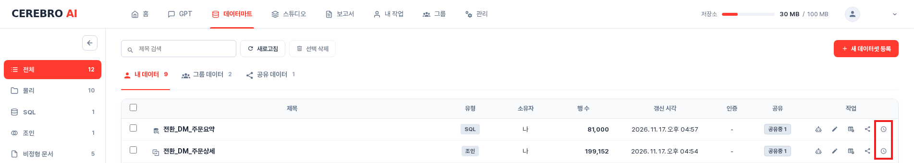
> </p>
>
> 데이터마트에서 해당 데이터셋의 **스케줄** 버튼(시계 모양)을 클릭합니다.
>
> <p align="center">
>   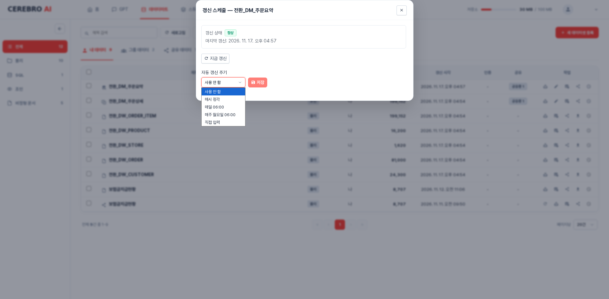
> </p>
>
> **지금 갱신**을 클릭하면 수동으로 갱신합니다. 자동으로 갱신하려면 **자동 갱신 주기**를 선택한 뒤 **저장**합니다.

## 6. 대시보드 공유

작성한 대시보드와 연결 데이터셋의 공유 대상을 각각 지정합니다.

### 6.1 사용자 그룹에 대시보드 조회 권한 부여

<p align="center">
  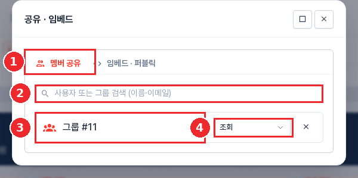
</p>

대시보드 오른쪽 위 **공유**를 연 뒤 다음 항목을 설정합니다.

1. **멤버 공유:** 사용자·그룹별로 공유할 수 있는 탭을 선택합니다.
2. **공유 대상 검색:** 사용자 또는 그룹명을 입력하여 대상을 찾습니다.
3. **대상 추가·확인:** 검색한 대상을 추가하고 공유 목록에 올바르게 표시되는지 확인합니다.
4. **권한 지정:** 열람용으로 제공할 대상에는 **조회**를 선택합니다. 함께 편집해야 할 경우에만 업무 범위에 맞는 권한을 지정합니다.

### 6.2 연결된 데이터셋의 조회 권한 설정

<p align="center">
  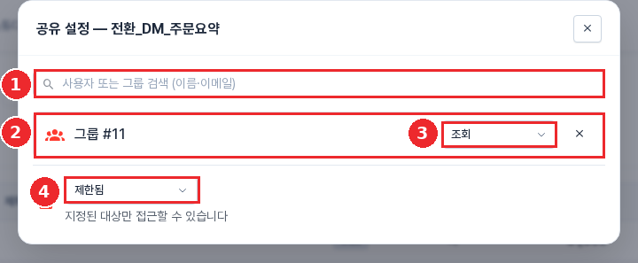
</p>

데이터마트에서 연결 데이터셋의 **공유 설정**을 열고 대시보드와 같은 대상에 필요한 권한을 지정합니다.

1. **공유 대상 검색:** 사용자 또는 그룹명을 입력합니다.
2. **대상 추가·확인:** 대시보드를 이용할 대상을 추가하고 목록을 확인합니다.
3. **권한 지정:** 데이터를 확인할 수 있도록 **조회** 등 필요한 권한을 선택합니다.
4. **일반 액세스:** 지정한 대상에게만 제공하려면 **제한됨**으로 설정합니다.

대시보드에 여러 데이터셋이 연결되어 있다면 각각 필요한 공유 설정을 적용하고, 조회 담당자 계정에서 데이터가 표시되는지 확인합니다.

## 7. 사용자: 대시보드 저장 및 사용

공유받은 화면을 조회하고, 별도의 구성이 필요하면 내 소유 사본으로 가져와 설정을 변경합니다.

### 7.1 공유받은 대시보드 조회

<p align="center">
  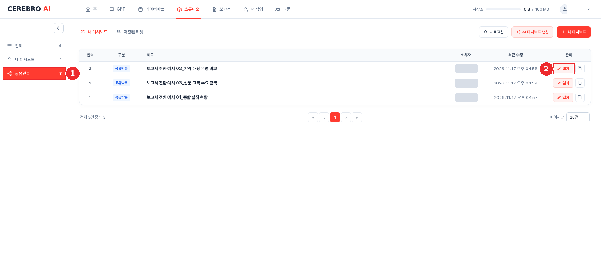
</p>

조회 담당자 계정으로 로그인한 뒤 스튜디오를 엽니다.

1. **공유받음:** 왼쪽 메뉴에서 공유받은 자료 목록을 선택합니다.
2. **열기:** 확인할 대시보드 행의 **열기** 버튼을 클릭합니다.

<p align="center">
  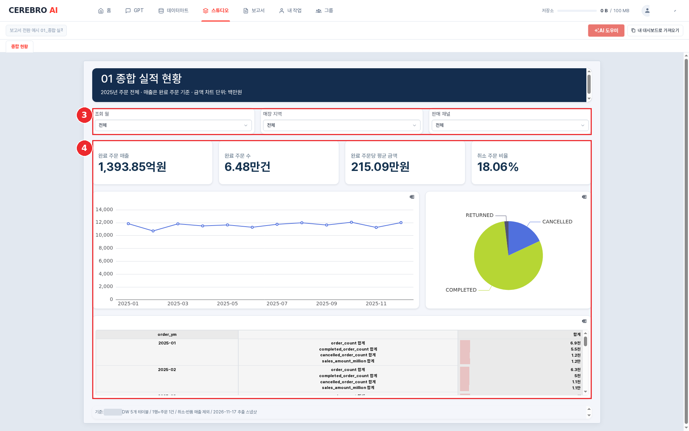
</p>

3. **조회 조건:** 화면 위쪽의 필터에서 확인할 조건을 선택합니다.
4. **결과 확인:** 연결된 KPI·차트·표에서 선택 조건에 해당하는 수치와 자료를 확인합니다.

### 7.2 필터로 필요한 현황 조회

<p align="center">
  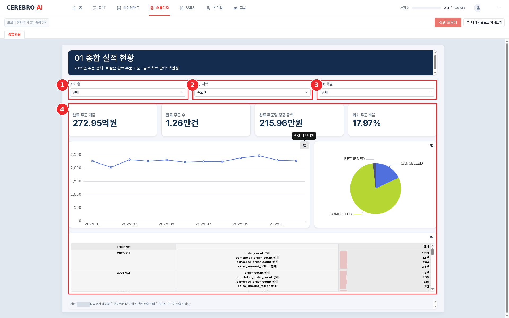
</p>

필터에 구성된 항목에 따라 필요한 조건을 선택합니다. 아래 화면은 기간·지역·판매 채널을 사용하는 예시입니다.

1. **기간 선택:** 조회할 월 등 기간 조건을 선택합니다.
2. **대상 범위 선택:** 지역 등 비교할 대상 범위를 선택합니다.
3. **세부 조건 선택:** 판매 채널 등 추가 분류를 선택합니다. 범위를 제한하지 않으려면 **전체**를 선택합니다.
4. **결과 확인:** 같은 조건이 적용된 KPI·차트·표를 확인합니다. 전체 현황으로 돌아가려면 필터 값을 **전체**로 되돌립니다.

필터 선택은 조회 범위를 바꾸며 원본 데이터의 내용을 수정하지 않습니다.

### 7.3 내 대시보드로 사본 저장

<p align="center">
  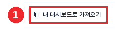
</p>

1. **내 대시보드로 가져오기:** 공유 대시보드 위쪽의 버튼을 클릭합니다.

<p align="center">
  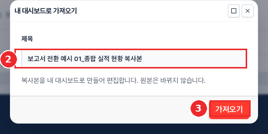
</p>

2. **제목 입력:** 용도를 구분할 수 있는 사본 제목을 입력합니다.
3. **가져오기:** 버튼을 클릭하여 내 소유 사본으로 저장한 뒤 **내 대시보드**에서 엽니다.

사본은 페이지와 위젯 구성을 복사하며 원본 대시보드의 구성에는 영향을 주지 않습니다. 연결된 데이터셋의 이용 권한은 계속 필요하고, 원본의 공유 대상은 사본에 자동으로 복사되지 않습니다.

### 7.4 사본을 업무에 맞게 수정

<p align="center">
  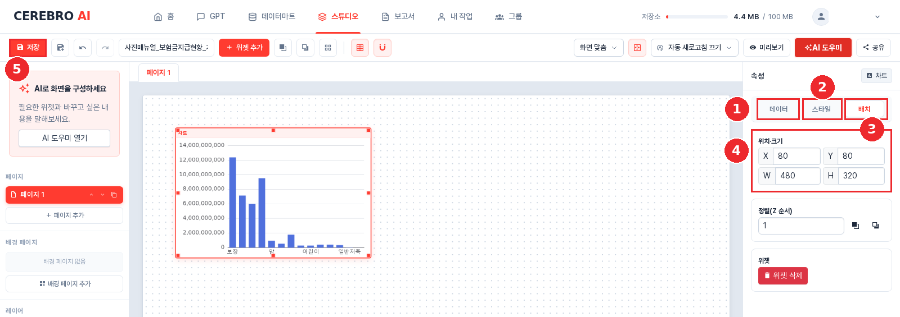
</p>

내 대시보드에서 사본을 열고 수정할 위젯을 선택합니다. 사진은 차트 위젯의 속성 탭과 배치 설정을 보여주는 예시입니다.

1. **데이터:** 위젯에 사용할 데이터셋, 컬럼과 집계 방식을 수정합니다. 세부 항목은 **5.1 대시보드와 위젯 구성**의 해당 위젯 설정을 참조합니다.
2. **스타일:** 차트 종류·제목·색상 등 제공되는 표시 항목을 변경합니다.
3. **배치:** 위젯의 위치와 크기를 조정하려면 배치 탭을 선택합니다.
4. **위치·크기:** X·Y로 위치를, W·H로 너비와 높이를 지정합니다.
5. **저장:** 수정한 구성을 저장하고 미리보기에서 결과를 확인합니다.

### 7.5 조회 결과 다운로드

<p align="center">
  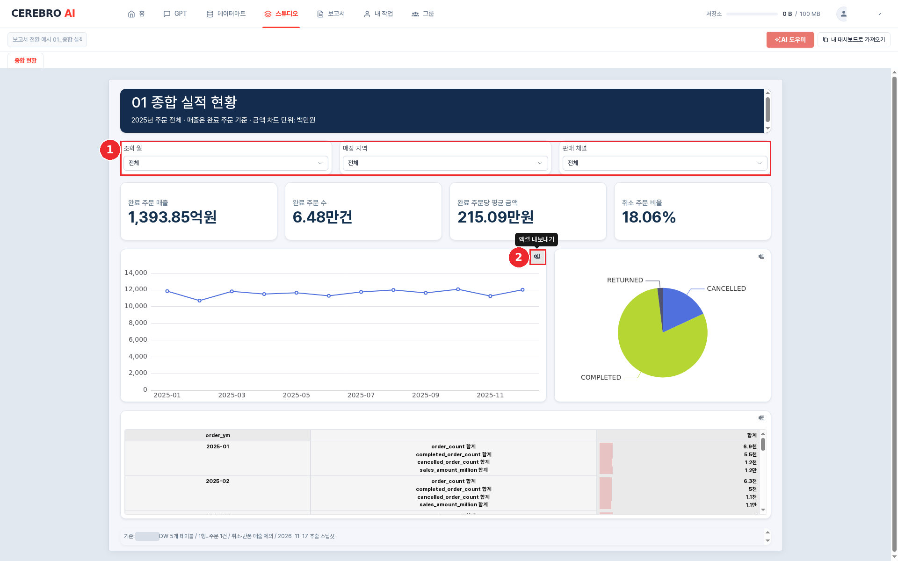
</p>

1. **조회 조건:** 필터에서 내려받을 자료의 기간과 대상 범위를 선택합니다.
2. **엑셀 내보내기:** 필요한 차트·피벗·테이블 오른쪽 위의 내보내기 버튼을 클릭합니다.

내려받은 파일의 컬럼·집계 기준·조회 조건을 확인하여 사용합니다. 내보내는 자료의 범위는 해당 위젯 설정을 따르므로, 상세 테이블의 행 수 제한 등도 함께 확인합니다.

### 7.6 보고서 전환 후 확인 항목

| 구분 | 확인할 내용 |
|---|---|
| 데이터 구성 | 건수와 금액이 중복 집계되지 않는지 확인합니다. |
| 지표 설정 | 데이터셋·컬럼·집계·표시 단위가 보고 목적과 맞는지 확인합니다. |
| 필터 연결 | 적용 대상과 대상별 대응 컬럼이 올바른지 확인합니다. |
| 공유 권한 | 사용자에게 대시보드와 연결 데이터셋의 이용 권한이 있는지 확인합니다. |
| 사본 활용 | 사본에서 수정한 구성이 저장되는지 확인합니다. |
| 결과 다운로드 | 내려받은 자료의 범위와 집계 기준을 확인합니다. |
| 데이터 갱신 | 원본 자료가 바뀐 뒤 데이터셋과 대시보드에 반영되는 절차를 확인합니다. |
