# BI 분석 서비스 전환 교육 및 기술지원 가이드

기존 BI 보고서의 조회 조건과 집계 기준을 CEREBRO AI의 데이터셋·분석·대시보드·보고서로 구성하는 과정을 안내합니다. 기본 환경을 준비한 뒤 같은 데이터를 분석하고, 분석 결과를 화면과 문서로 작성하여 공유하는 순서로 진행합니다.

## 1. 기본 환경 구성

### 1.1 그룹 생성 및 관리

작성 담당자와 조회 담당자를 구분하여 자료의 작성·관리 범위와 공유 대상을 정합니다.

#### 1.1.1 관리자 그룹 생성

<p align="center">
  
</p>

1. 사이트 관리자 계정으로 로그인합니다.
2. 상단 **관리 → 그룹/권한 관리**를 선택합니다.
3. **그룹 추가**를 클릭하고 그룹명에 **관리자**를 입력합니다.
4. **추가**를 클릭한 후 그룹 선택 목록에서 **관리자**를 선택합니다.

#### 1.1.2 작성 담당자 배정

<p align="center">
  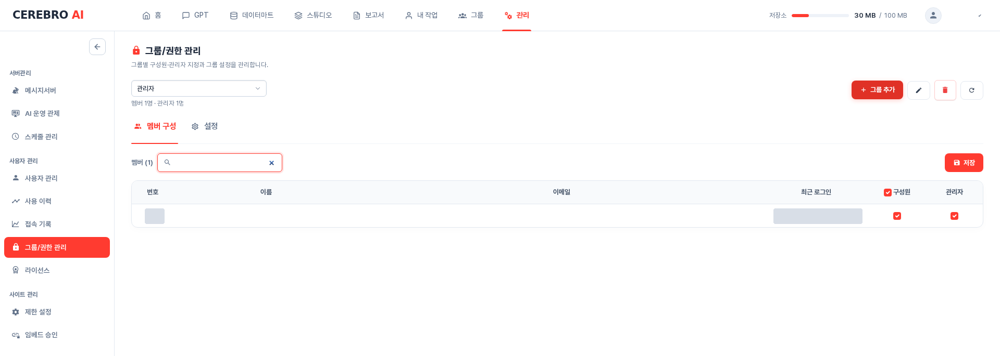
</p>

1. **멤버 구성**에서 작성 계정의 이메일을 검색합니다.
2. 검색된 작성 담당자 계정의 **구성원**과 **관리자**를 선택합니다.
3. **저장**을 클릭하고 관리자 지정 결과를 확인합니다.

#### 1.1.3 사용자 그룹 생성

<p align="center">
  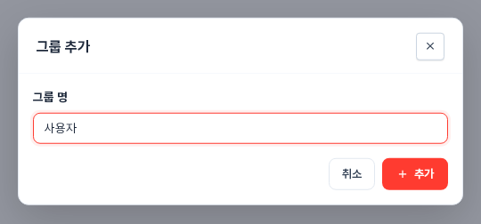
</p>

1. 같은 화면에서 **그룹 추가**를 클릭합니다.
2. 그룹명에 **사용자**를 입력하고 **추가**를 클릭합니다.
3. 그룹 선택 목록에서 **사용자**를 선택합니다.

#### 1.1.4 조회 담당자 배정

<p align="center">
  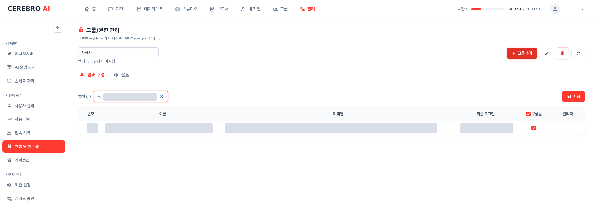
</p>

1. **멤버 구성**에서 조회 담당자의 이름이나 이메일을 검색합니다.
2. 대상 계정을 확인한 후 **구성원**을 선택합니다.
3. **관리자**는 선택하지 않고 **저장**을 클릭합니다.
4. 사용자 그룹에 조회 담당자가 일반 멤버로 포함되었는지 확인합니다.

### 1.2 DB 연결 및 설정

DB에 있는 자료를 데이터셋으로 가져오려면 사용할 DB 연결을 먼저 등록합니다. **1.1 그룹 생성 및 관리**에서 준비한 그룹에 DB 연결을 등록합니다.

<p align="center">
  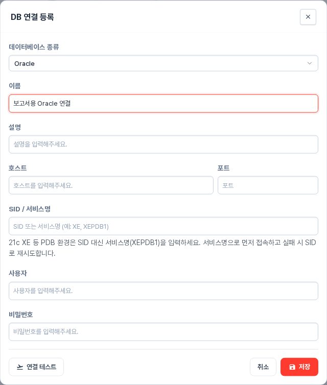
</p>

1. 상단 **그룹** 메뉴에서 연결을 관리할 **관리자** 그룹을 선택합니다.
2. **DB 연결 → DB 연결 등록**을 클릭합니다.
3. 운영 환경에 맞는 연결 정보를 입력합니다.
| 항목 | 입력할 내용 |
|---|---|
| 데이터베이스 종류 | Oracle |
| 이름 | 연결을 구분할 이름 |
| 호스트·포트 | DB 서버 주소와 접속 포트 |
| SID / 서비스명 | 연결할 Oracle DB의 SID 또는 서비스명 |
| 사용자·비밀번호 | DB 조회 권한을 부여받은 접속 계정과 비밀번호 |

4. **연결 테스트**로 CEREBRO 서버에서 DB까지 접속되는지 확인합니다.
5. 정상 연결된 환경에서는 결과를 확인한 후 저장합니다. 연결되지 않으면 입력값, 방화벽과 서버의 접근 경로를 확인합니다.

연결 정보를 등록하는 권한과 그 연결을 사용하여 데이터를 조회하는 권한은 구분됩니다. 연결 사용자는 허용된 테이블 범위에서 DB 추출을 진행합니다.

### 1.3 사용자 등록 및 관리

신규 담당자에게 이메일 로그인 계정을 발급하고, 업무에 필요한 계정 등급을 지정합니다.

<p align="center">
  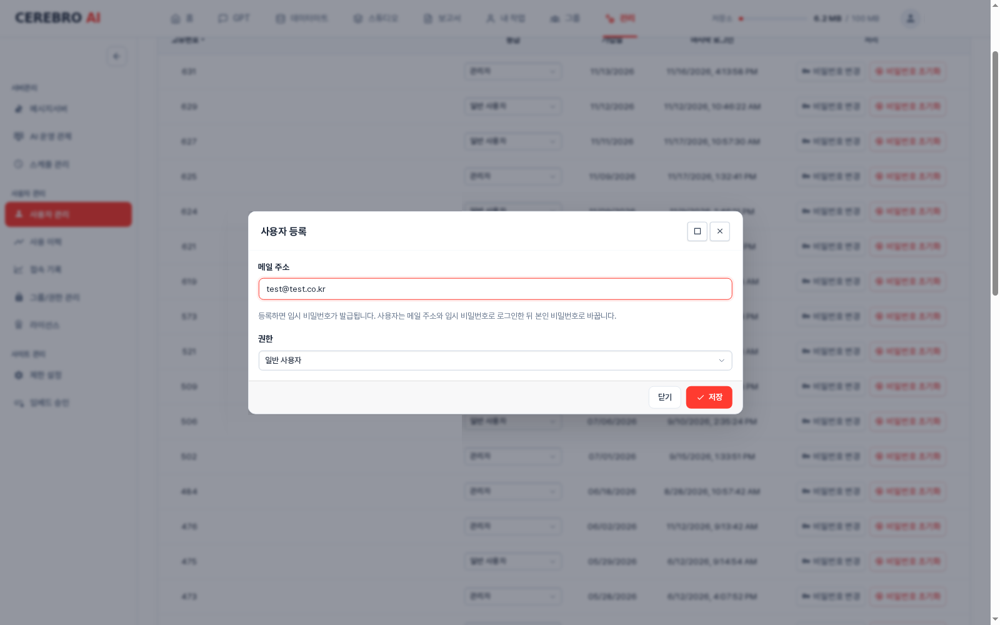
</p>

1. 사이트 관리자 계정으로 **관리 → 사용자 관리**를 엽니다.
2. **사용자 등록**을 선택하고 대상자의 메일 주소를 입력합니다.
3. 사이트 운영을 담당하지 않는 계정은 **일반 사용자**로 지정합니다.
4. 저장 후 발급된 임시 비밀번호를 대상자에게 안내합니다.

<p align="center">
  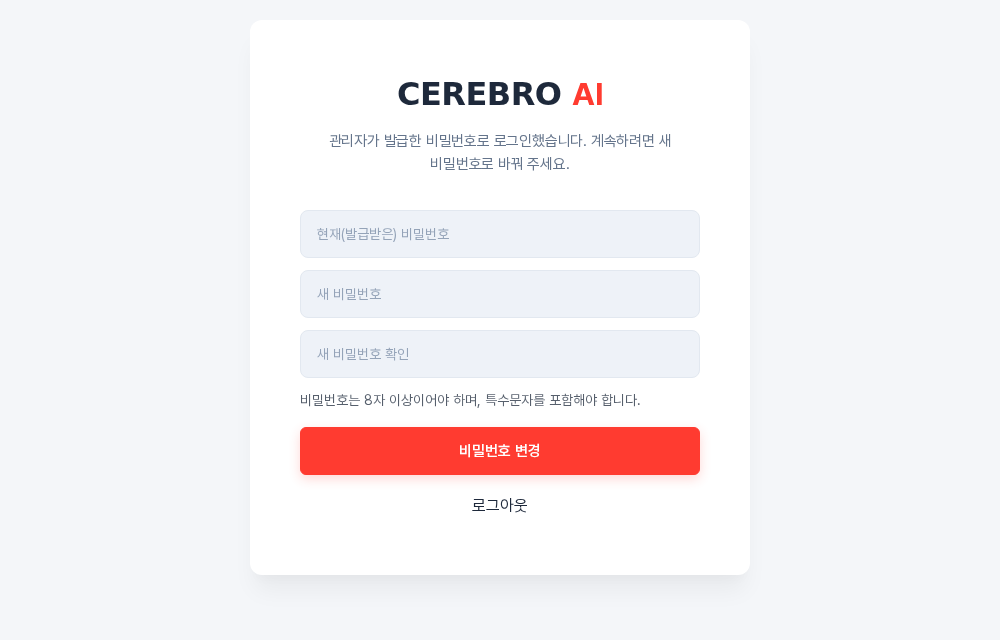
</p>

5. 사용자는 임시 비밀번호로 로그인한 뒤 본인의 새 비밀번호를 지정합니다.
6. 등록된 계정을 **1.1 그룹 생성 및 관리**의 방법으로 필요한 그룹에 배정합니다.

기존 계정은 사용자 관리에서 등급과 이용 상태를 확인합니다.

### 1.4 사용자 및 그룹별 권한 설정

자료를 작성하는 담당자와 결과를 확인하는 사용자의 권한을 나누어 설정합니다.

| 권한 구분 | 설정할 내용 | 실습 적용 |
|---|---|---|
| 사이트 등급 | 관리자·일반 사용자·비활성 | 사이트 설정을 담당하는 계정만 관리자 등급으로 지정 |
| 그룹 내 역할 | 그룹 관리자·일반 멤버 | 작성 담당자는 관리자 역할, 조회 담당자는 일반 멤버로 배정 |
| DB 연결 권한 | 연결 사용·관리 및 허용 테이블 | 추출 담당자에게 필요한 사용 범위 부여 |
| 데이터셋 권한 | 조회·조회 및 분석·편집 등 | 결과 조회자는 연결된 데이터셋의 필요한 조회 권한 부여 |
| 대시보드 권한 | 조회·편집 | 조회 담당자에게는 우선 조회 권한으로 공유 |
| 보고서 권한 | 보기·편집·복제·공유 설정 변경 | 조회만 필요한 경우 보기, 내 보고서로 가져올 경우 복제도 허용 |

DB 연결의 **권한 관리**와 **허용 테이블**을 확인하고, 자료별 공유 권한은 **6. 분석 결과 공유 및 관리**에서 설정합니다. 일반 사용자 등급이라도 그룹 관리자 역할이나 자료 편집 권한을 부여받으면 해당 범위의 업무를 수행할 수 있습니다.

보고서 공유 실습을 위해서는 작성 담당자를 공유 대상인 **사용자** 그룹에도 구성원으로 추가하고 그룹 관리자로 지정합니다. 조회 담당자는 일반 멤버로 유지합니다. 그룹 관리자 지정은 해당 그룹의 운영 권한을 부여하므로 실제 업무 담당 범위에 맞게 적용합니다.

### 1.5 기능 메뉴 설정

사용자에게 제공할 분석·전처리·기계학습·AI 기능과 사용 한도를 설정합니다. 화면의 메뉴를 자유롭게 편집하는 기능과는 구분하여, **기능 사용 여부 및 제한 설정**을 중심으로 확인합니다.

<p align="center">
  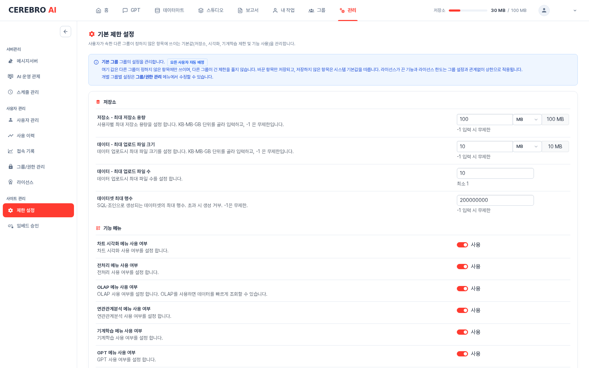
</p>

1. **관리 → 제한 설정**에서 기본 기능 사용 여부와 용량·건수 등 한도를 확인합니다.
2. 그룹별로 다른 기준이 필요하면 **관리 → 그룹/권한 관리**에서 대상 그룹의 설정을 확인합니다.
3. 차트·전처리·OLAP·연관관계분석·기계학습·GPT·AI 보고서 등 교육에 사용할 기능이 허용되어 있는지 확인합니다.
4. 대상 사용자 계정으로 다시 접속하여 필요한 메뉴와 작업이 제공되는지 확인합니다.

## 2. 분석 데이터 구성

여러 테이블이나 파일에 나뉜 정보를 함께 분석하기 위해 원본 자료를 데이터셋으로 등록하고 연결합니다.

### 2.1 분석 데이터 생성 및 관리

#### 2.1.1 원본 테이블과 연결 관계

예시 샘플 테이블명은 다음과 같습니다. 주문상세의 정확한 이름은 `dw_order_item`입니다.

| 테이블 | 내용 | 기본키 | 주요 연결 컬럼 | 원본 행 수 |
|---|---|---|---|---:|
| `dw_customer` | 고객의 지역·가입 정보 | `customer_id` | 주문의 `customer_id`와 연결 | 24,300 |
| `dw_store` | 매장명·지역 등 매장 정보 | `store_id` | 주문의 `store_id`와 연결 | 1,620 |
| `dw_order` | 주문 고객·매장 등 주문정보 | `order_id` | `customer_id`, `store_id` | 81,000 |
| `dw_product` | 상품명·분류·브랜드 등 상품 정보 | `product_id` | 주문상세의 `product_id`와 연결 | 16,200 |
| `dw_order_item` | 주문에 포함된 상품·수량·주문 당시 주문 상품정보 | `order_item_id` | `order_id`, `product_id` | 199,152 |


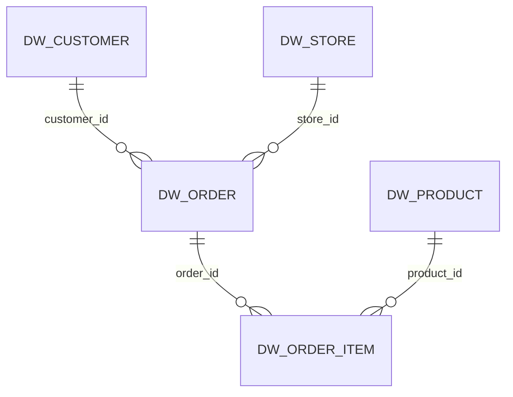

고객 한 명과 매장 한 곳에 여러 주문이 연결되고, 주문 한 건에는 여러 주문상세가 연결됩니다. 상품 한 종류도 여러 주문상세에 포함될 수 있습니다.

표의 행 수는 기존 실습 자료를 기준으로 한 예시입니다. 교육 환경에서는 데이터셋 등록 후 실제 건수를 확인합니다.

#### 2.1.2 DB 추출 또는 파일 업로드로 등록

<p align="center">
  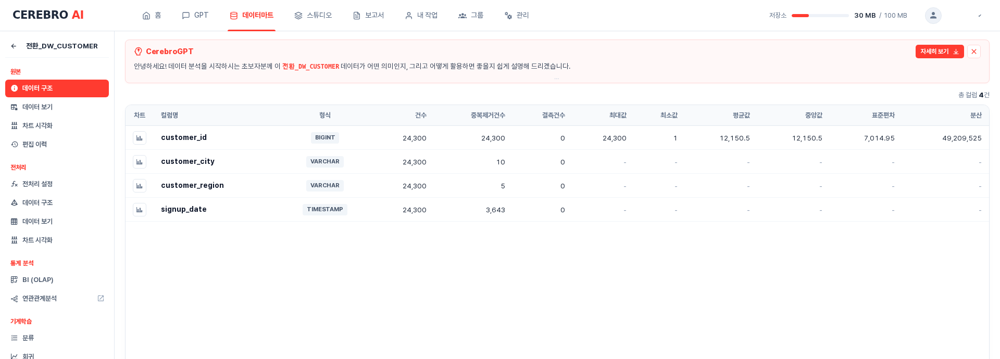
</p>

1. **데이터마트 → 새 데이터셋 등록 → DB 추출**을 선택합니다.
2. 사용할 DB 연결과 스키마를 선택하고 `dw_customer`의 컬럼을 확인합니다.
3. 필요한 컬럼과 조회 조건을 지정하여 실행합니다. 기존 SQL을 활용하는 방법은 **7.1 기존 SQL 활용 및 데이터 조회**에서 설명합니다.
4. 결과를 확인한 뒤 **데이터셋 만들기**를 클릭하고 제목을 **전환_DW_CUSTOMER**로 저장합니다.
5. 나머지 테이블도 필요한 컬럼을 선택하여 등록합니다.

CSV·Excel 실습 자료를 사용하는 경우에는 **파일 업로드**를 선택하고 제목과 파일을 지정합니다. 등록한 데이터셋 제목을 클릭하여 컬럼 구성·자료형·행 수를 확인합니다.

<p align="center">
  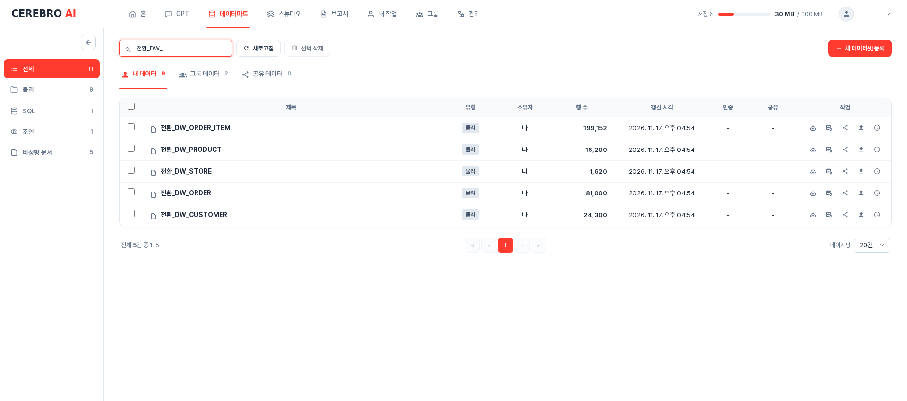
</p>

#### 2.1.3 데이터셋 조인

**데이터셋 조인**을 사용하면 여러 데이터셋에 나뉜 정보를 공통 컬럼으로 연결하여 조인 데이터셋을 만들 수 있습니다.  

1. **새 데이터셋 등록 → 데이터셋 조인**을 선택합니다.
2. 데이터셋을 추가합니다.
3. 주문 ID·고객 ID 등 서로 대응하는 키 컬럼을 연결합니다.
4. 연결된 자료만 사용할지, 기준 자료를 모두 유지할지에 따라 조인 방식을 지정합니다.

<p align="center">
  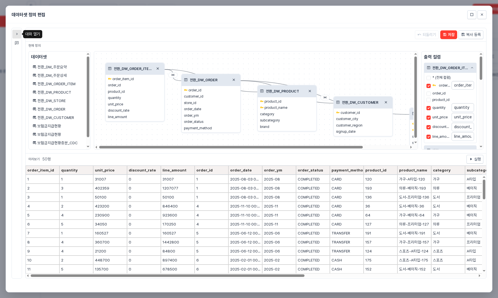
</p>

5. 필요한 컬럼을 출력 항목으로 선택하고, 중복되거나 불필요한 컬럼은 제외합니다.
6. **실행**으로 연결 결과를 확인합니다.
7. **데이터셋 만들기**를 클릭하고 제목을 입력하고 저장합니다.

<p align="center">
  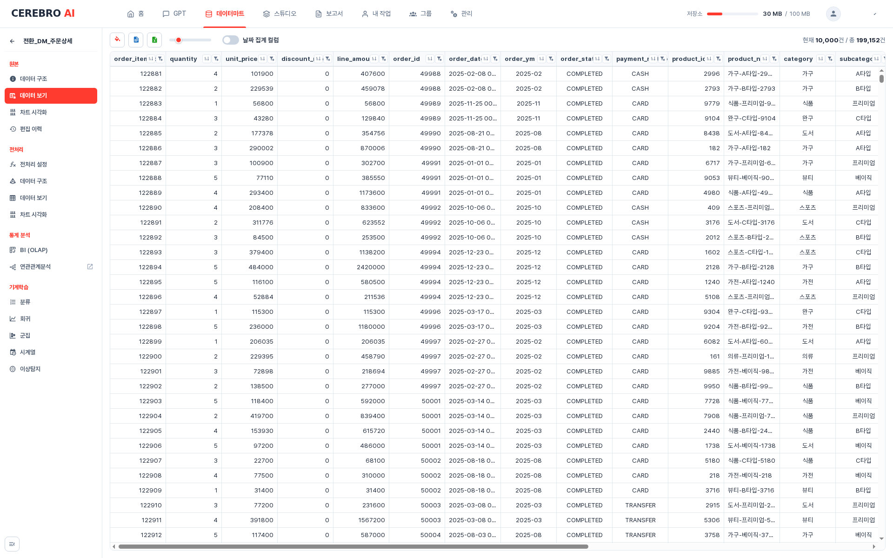
</p>


> **💡 참고 : 조인 후 집계 기준 확인**
>
> 기준 자료 한 건에 여러 상세 자료가 연결되면 같은 기준 값이 여러 행에 반복될 수 있습니다. 건수는 행 수와 고유 개수 중 무엇을 의미하는지 확인하고, 금액은 중복 합산되지 않도록 집계 기준을 정합니다.

#### 2.1.4 분석 단위와 데이터셋 관리

여러 테이블을 연결한 **전환_DM_주문상세**는 상품별 수량·금액을 비교하는 데 활용하고, **전환_DM_주문요약**은 한 행을 주문 한 건으로 맞추어 주문 수·평균 금액 등을 계산하는 데 활용합니다.

| 데이터셋 | 한 행의 의미 | 활용 예시 |
|---|---|---|
| 전환_DM_주문상세 | 주문에 포함된 상품 한 항목 | 상품 분류별 매출·수량, 상세 주문 목록 |
| 전환_DM_주문요약 | 주문 한 건 | 주문 수, 주문당 평균 금액, 지역·채널별 매출 |

데이터마트에서 제목, 유형, 행 수와 갱신 시각을 확인합니다. 원본 파일이 바뀌면 재업로드하고, SQL·조인 정의를 바꾸면 실행 결과와 집계 단위를 다시 확인합니다. 보고서에서 사용할 계산 기준은 **7.3 기존 보고서와 데이터 정합성 비교**와 함께 점검합니다.

### 2.2 스케줄 생성 및 실행

주기적으로 갱신되는 자료는 데이터셋의 갱신 스케줄을 설정하여 최신 결과를 조회할 수 있도록 구성합니다.

<p align="center">
  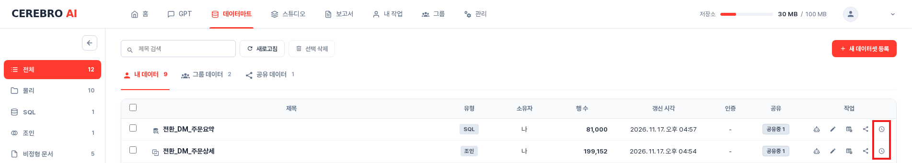
</p>

1. 데이터마트에서 갱신할 데이터셋을 찾습니다.
2. 작업 열의 **스케줄** 버튼(시계 모양)을 클릭합니다.

<p align="center">
  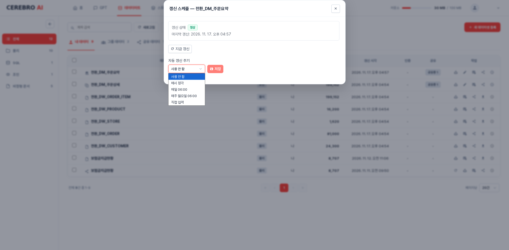
</p>

3. 즉시 실행하려면 **지금 갱신**을 클릭합니다.
4. 예약 실행하려면 **자동 갱신 주기**에서 매시 정각·매일·매주 등 필요한 주기를 선택합니다. 세부 시간 지정이 필요하면 **직접 입력**을 이용합니다.
5. **저장**한 뒤 설정한 주기와 갱신 상태·마지막 갱신 시각을 확인합니다.
6. 갱신이 완료되면 데이터셋을 다시 조회하고, 대시보드와 보고서에도 변경된 결과가 반영되는지 확인합니다.

> **💡 참고 : 원본 갱신과 결과 조회**
>
> 스케줄은 갱신을 지원하는 데이터셋에서 사용합니다. 일반 업로드 파일은 변경된 파일을 재업로드해야 하며, SQL·조인 데이터셋도 원본이 먼저 갱신되어야 변경된 자료를 반영할 수 있습니다. 대시보드의 자동 새로고침은 연결 데이터셋을 다시 조회하는 기능입니다. 보고서의 저장된 위젯 결과는 보고서 소유자가 **최신화**하여 확인합니다.

## 3. 데이터 분석

컬럼과 원본 값을 확인한 뒤, 같은 데이터를 차트와 피벗으로 집계합니다. 실습은 고객 데이터의 조회·필터·정렬을 익히고 주문요약 데이터의 지역별 매출을 분석하는 순서로 진행합니다.

### 3.1 데이터 조회 및 필터링

#### 3.1.1 데이터 구조 확인

<p align="center">
  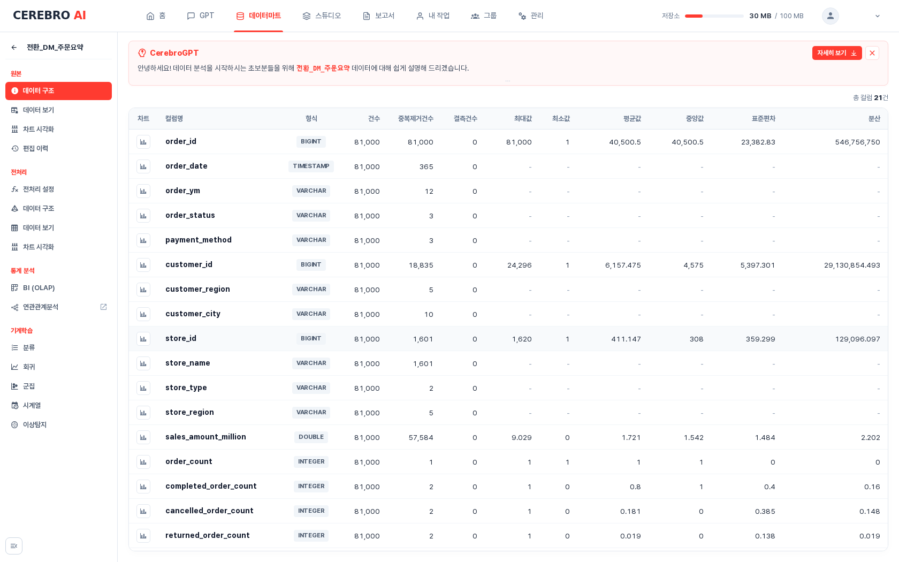
</p>

1. 데이터마트에서 분석할 데이터셋의 제목을 클릭합니다.
2. **원본 → 데이터 구조**를 선택합니다.
3. 컬럼명과 자료형을 확인하여 식별자·분류·날짜·수치 컬럼을 구분합니다.
4. 결측값과 통계 정보를 확인하고, 지표에 사용할 컬럼의 단위와 값 범위를 살펴봅니다.

예를 들어 `store_region`은 지역 비교 기준, `store_type`은 판매채널 구분, `sales_amount_million`은 백만원 단위의 매출 집계값으로 사용합니다.

#### 3.1.2 데이터 보기에서 조건 선택

<p align="center">
  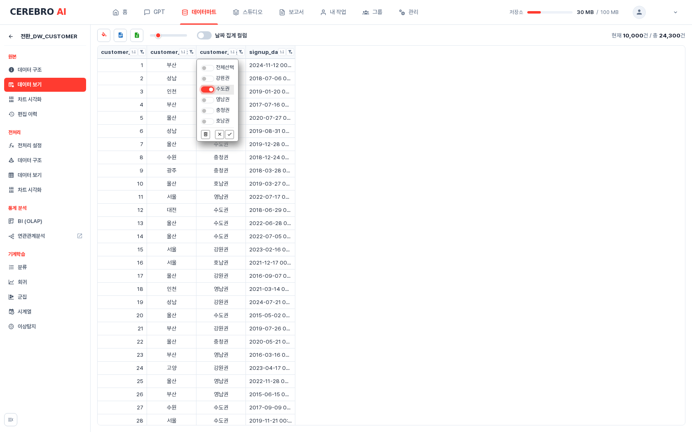
</p>

1. **전환_DW_CUSTOMER → 원본 → 데이터 보기**를 엽니다.
2. `customer_region` 컬럼 제목 옆의 필터 버튼을 클릭합니다.
3. 전체 선택을 해제하고 **수도권**을 선택한 뒤 적용 버튼을 클릭합니다.

<p align="center">
  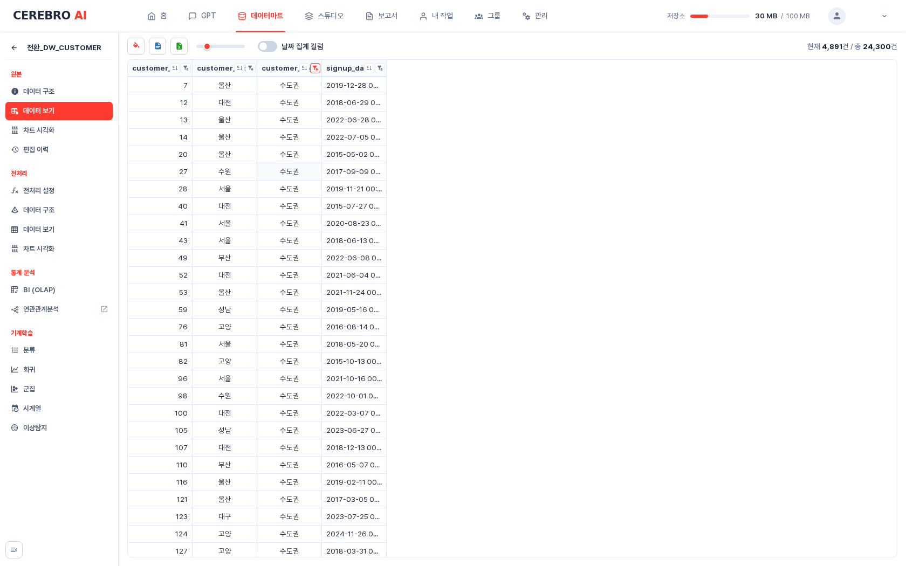
</p>

4. 선택한 조건에 맞는 행이 표시되는지 확인합니다.
5. 다음 실습 전에 해당 컬럼의 필터 창에서 조건을 삭제하거나 전체 선택으로 되돌립니다.

필터는 조회할 자료의 범위를 바꾸며 원본 값을 수정하지 않습니다.

#### 3.1.3 데이터 정렬

<p align="center">
  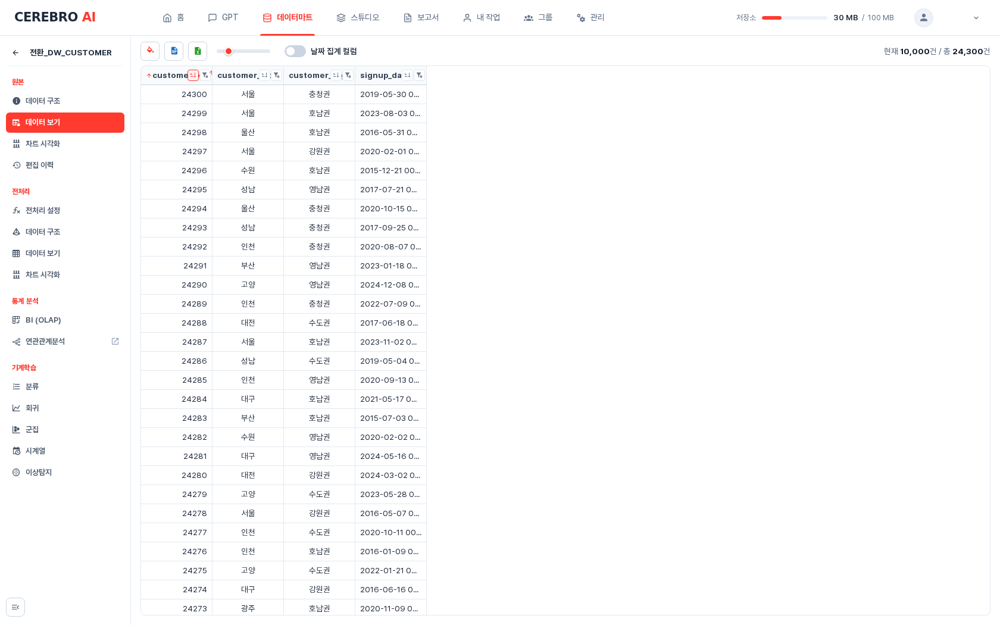
</p>

1. 앞에서 적용한 필터를 해제한 상태로 진행합니다.
2. `customer_id` 컬럼의 정렬 버튼을 클릭하여 오름차순·내림차순을 바꿉니다.
3. 값이 큰 순서 또는 작은 순서대로 표시되는지 확인합니다.

필터는 필요한 행을 고르는 기능이고, 정렬은 선택된 행의 표시 순서를 바꾸는 기능입니다.

### 3.2 데이터 집계: 지역별 매출 차트

지역별 금액을 합산하여 어느 지역의 실적이 큰지 비교하는 예시입니다. 차트 한 가지를 구성하며 분류 기준과 집계 방식의 관계를 익힙니다.

<p align="center">
  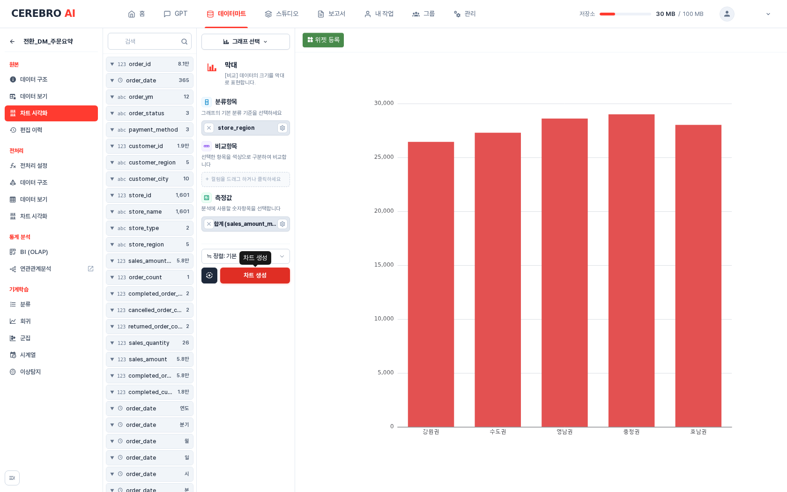
</p>

1. **전환_DM_주문요약 → 원본 → 차트 시각화**를 엽니다.
2. **그래프 선택 → 비교 → 막대**를 선택합니다.
3. **분류항목**에 `store_region`을 배치합니다.
4. **측정값**에 `sales_amount_million`을 배치하고 **합계**로 지정합니다.
5. **차트 생성**을 클릭하고 지역별 매출 규모를 비교합니다.
6. 결과를 재사용하려면 **위젯 등록**으로 **교육_지역별매출_막대**라는 이름을 저장합니다.

실습 컬럼은 완료 주문의 매출을 백만원 단위로 계산한 값입니다. 금액 합계와 건수·평균은 서로 다른 지표이므로 집계 방식과 단위를 함께 확인합니다.

### 3.3 피벗 분석 및 위젯 저장

지역별 매출을 온라인·오프라인 판매채널로 나누어 교차 집계합니다. 결과를 위젯으로 저장하여 뒤의 보고서 실습에서 사용합니다.

<p align="center">
  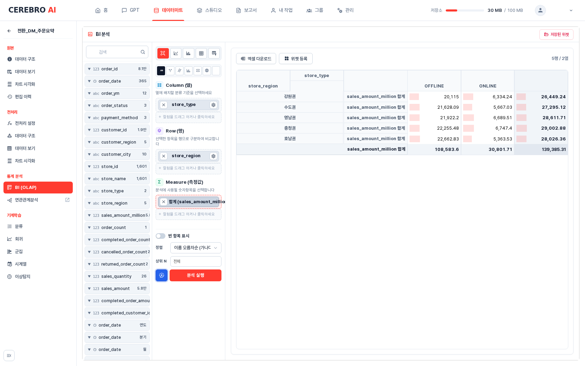
</p>

1. **전환_DM_주문요약 → BI(OLAP)**를 엽니다.
2. **Row(행)**에 `store_region`을 배치합니다.
3. **Column(열)**에 `store_type`을 배치합니다.
4. **Measure(측정값)**에 `sales_amount_million`을 배치하고 **합계**를 선택합니다.
5. **분석 실행**을 클릭합니다.
6. 행·열의 합계를 확인하고, 지역별 합계가 **3.2 지역별 매출 차트**의 결과와 일치하는지 비교합니다.

<p align="center">
  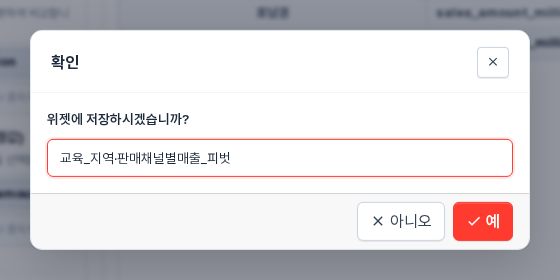
</p>

7. **위젯 등록**을 클릭하고 **교육_지역·판매채널별매출_피벗**으로 저장합니다.
8. **저장된 위젯**에서 등록 결과를 확인합니다. 보고서에서는 이 저장 위젯을 선택하여 본문에 넣습니다.

## 4. 대시보드

스튜디오에서는 데이터셋을 KPI·차트·피벗·테이블 등의 위젯에 연결하고 보고 목적에 맞게 배치합니다. 아래의 대시보드 3개는 기존 실습 예시를 사용하며, 개별 위젯의 설정 방법을 익힌 뒤 같은 구조로 구성합니다.

### 4.1 대시보드 생성 및 데이터 연계

<p align="center">
  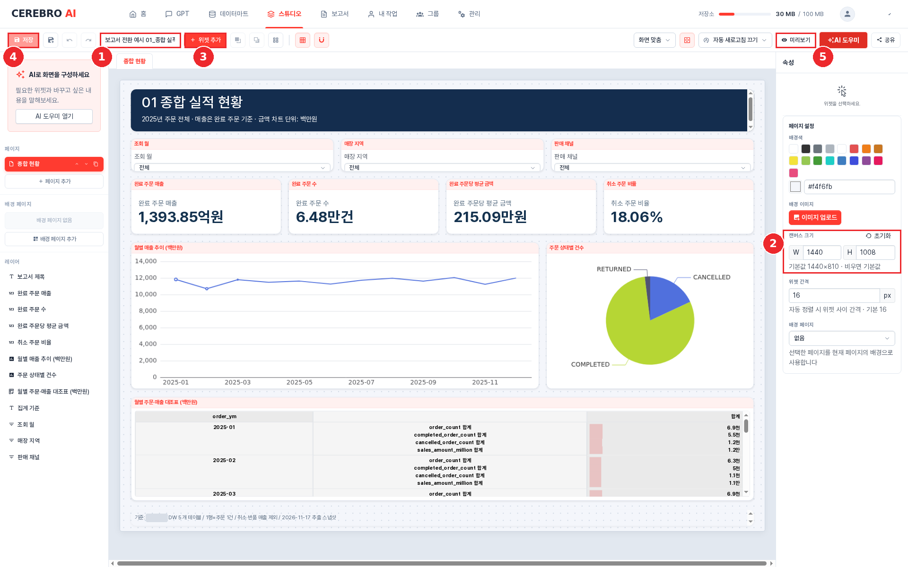
</p>

스튜디오에서 새 대시보드를 연 뒤 다음 순서로 구성합니다. 사진의 동그라미 번호는 아래 설명 번호와 대응합니다.

1. **제목 입력:** 대시보드의 용도를 구분할 수 있는 제목을 입력합니다.
2. **캔버스 크기:** 위젯을 선택하지 않은 상태에서 오른쪽 **페이지 설정 → 캔버스 크기**의 W(너비)와 H(높이)를 지정합니다.
3. **위젯 추가:** **위젯 추가 → 데이터 위젯**에서 KPI·차트·필터·피벗·테이블 등 필요한 위젯을 선택합니다.
4. **저장:** 작성한 제목과 화면 구성을 저장합니다.
5. **미리보기:** 사용자가 보게 될 화면에서 위젯과 필터의 동작을 확인합니다.

위젯별로 **데이터** 탭의 데이터셋을 선택합니다. 전체 현황과 지역 비교에는 주문요약을, 상품별 비교와 상세 목록에는 주문상세를 사용하면 분석 단위를 구분하기 쉽습니다.

### 4.2 데이터 시각화 및 차트 설정

#### 4.2.1 KPI 설정

<p align="center">
  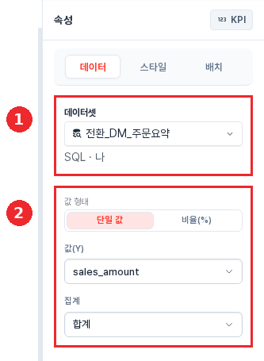
</p>

KPI 위젯을 선택하고 오른쪽 속성의 **데이터** 탭에서 설정합니다.

1. **데이터셋:** 표시할 수치가 들어 있는 데이터셋을 선택합니다.
2. **값과 집계 설정:** **값 형태 → 단일 값**을 선택하고, **값(Y)**에서 계산할 컬럼을 지정합니다. **집계**에서 합계·평균·고유 개수 등 지표에 맞는 방식을 선택합니다. 예를 들어 전체 금액은 금액 컬럼의 합계로, 평균 금액은 같은 컬럼의 평균으로 설정합니다.

비율 지표가 필요하면 **값 형태 → 비율(%)**로 바꾸고 분자·분모의 컬럼과 집계 방식을 각각 지정합니다.

#### 4.2.2 차트 설정

<p align="center">
  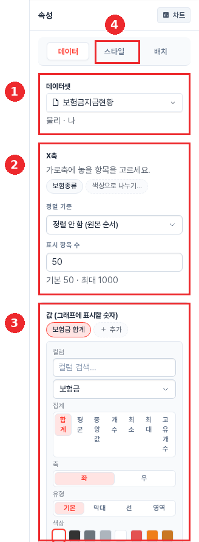
</p>

차트 위젯을 선택한 뒤 데이터와 표시 형태를 차례로 지정합니다. 화면의 데이터셋과 컬럼은 설정 위치를 보여주는 예시이며, 실제 보고에 사용할 항목으로 선택합니다.

1. **데이터셋:** 차트에 사용할 데이터셋을 선택합니다.
2. **X축:** 현재 컬럼 표시나 **X축 선택** 항목을 클릭하여 기간·지역·분류 등 비교 기준 컬럼을 선택합니다. **정렬 기준**과 **표시 항목 수**도 지정합니다. 항목을 색상별로 나누려면 **색상으로 나누기**에서 두 번째 분류 컬럼을 선택합니다.
3. **값과 집계 설정:** 값 항목을 클릭하여 계산할 컬럼과 집계 방식을 선택합니다. 금액·수량은 합계, 대상 수는 건수 또는 고유 개수 등 지표에 맞는 방식으로 지정합니다. 측정값을 더 표시하려면 **추가**를 이용합니다.
4. **차트 종류:** **스타일** 탭을 선택하고 **차트**에서 막대·선·파이·누적 막대 등 원하는 종류를 지정합니다.

#### 4.2.3 피벗 설정

<p align="center">
  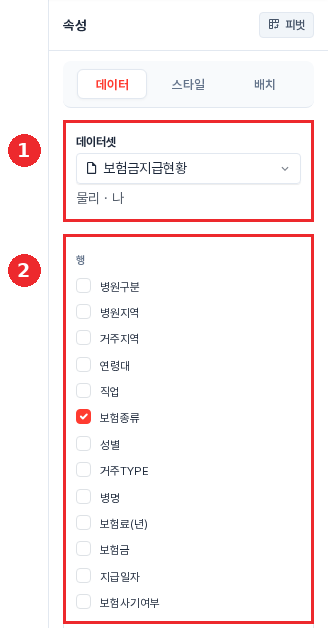
</p>

피벗 위젯을 선택하고 오른쪽 **데이터** 탭에서 표의 행·열과 집계 항목을 지정합니다.

1. **데이터셋:** 교차 집계할 데이터셋을 선택합니다.
2. **행:** 표의 세로 방향으로 구분할 기준 컬럼을 체크합니다. 지역·조직·상품 분류 등 비교할 항목을 선택합니다.

<p align="center">
  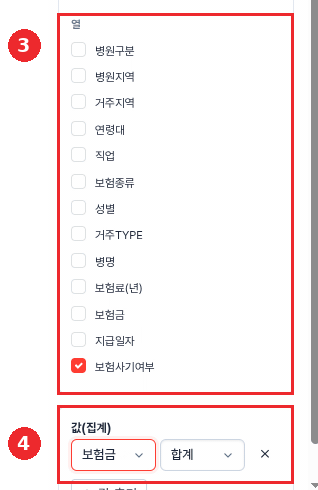
</p>

3. **열:** 오른쪽 속성을 아래로 스크롤하여 가로 방향으로 구분할 기준 컬럼을 체크합니다. 월별 비교라면 연월 컬럼을 선택합니다.
4. **값과 집계 설정:** **값(집계) → 값 추가**에서 계산할 컬럼과 합계·평균·건수 등의 집계 방식을 지정합니다. 여러 지표를 함께 보려면 값을 추가합니다.

#### 4.2.4 테이블 설정

<p align="center">
  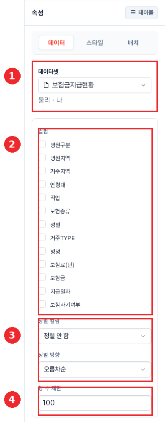
</p>

테이블 위젯을 선택하고 오른쪽 **데이터** 탭에서 상세 목록의 표시 항목을 지정합니다.

1. **데이터셋:** 상세 자료가 들어 있는 데이터셋을 선택합니다.
2. **컬럼:** 화면에 표시할 컬럼을 체크합니다. 업무에 필요한 식별 항목·날짜·분류·수치 등을 선택합니다.
3. **정렬:** **정렬 컬럼**과 **정렬 방향**을 지정합니다. 금액이 큰 자료부터 확인하려면 금액 컬럼과 내림차순을 선택합니다.
4. **행 수 제한:** 화면에 표시할 최대 행 수를 입력합니다.

### 4.3 레이아웃 구성 및 조회 조건 설정

#### 4.3.1 조회 조건 연결

<p align="center">
  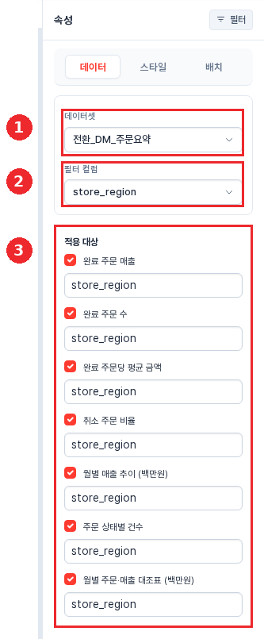
</p>

필터 위젯을 선택하고 오른쪽 **데이터** 탭에서 조회 조건과 적용할 위젯을 연결합니다.

1. **데이터셋:** 조회 조건으로 사용할 컬럼이 들어 있는 데이터셋을 선택합니다.
2. **필터 컬럼:** 사용자가 선택할 기준 컬럼을 지정합니다. 기간별 조회에는 날짜·연월 컬럼을, 지역별 조회에는 지역 컬럼을 사용합니다.
3. **적용 대상:** 조건을 적용할 KPI·차트·피벗·테이블을 체크합니다. 대상별 입력란에는 해당 위젯 데이터셋의 대응 컬럼명을 지정합니다.

적용 대상을 연결한 뒤 미리보기에서 값을 선택하여 원하는 위젯이 함께 바뀌는지 확인합니다.

#### 4.3.2 화면 배치

1. 페이지의 캔버스 크기와 배경을 지정합니다.
2. 제목과 조회 조건은 위쪽, 핵심 수치는 그 아래, 차트와 근거 표는 아래쪽에 배치합니다.
3. 위젯을 선택하고 **배치** 탭에서 위치·너비·높이를 조정합니다.
4. 정렬·스냅을 활용하여 위젯 간격과 기준선을 맞춥니다.
5. 화면에 겹치는 위젯이 있으면 레이어 순서를 조정하고, 미리보기에서 제목과 값이 잘리지 않는지 확인합니다.

#### 4.3.3 저장 및 미리보기

<p align="center">
  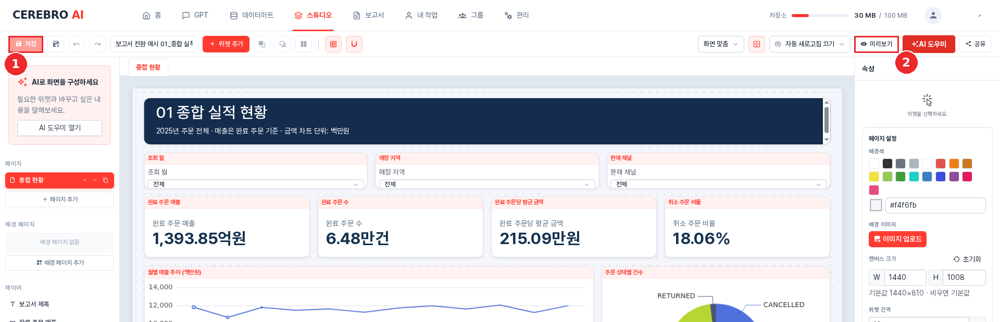
</p>

1. **저장:** 작성한 위젯과 속성 설정을 저장합니다.
2. **미리보기:** 필터를 선택하여 연결된 위젯이 같은 조건으로 바뀌는지 확인합니다. 지표·단위·화면 배치를 확인한 뒤 수정이 필요하면 편집 화면으로 돌아갑니다.

데이터셋 자체를 갱신하는 방법은 **2.2 스케줄 생성 및 실행**을 참고합니다.

### 4.4 대시보드 제작 실습

기존에 작성한 대시보드 3개를 기준으로 요약·비교·탐색의 서로 다른 구성을 확인합니다. 각 실습에서는 제목을 구분하여 저장하고, 미리보기에서 조회 조건이 연결된 위젯에 적용되는지 확인합니다.

#### 4.4.1 종합 실적 현황

<p align="center">
  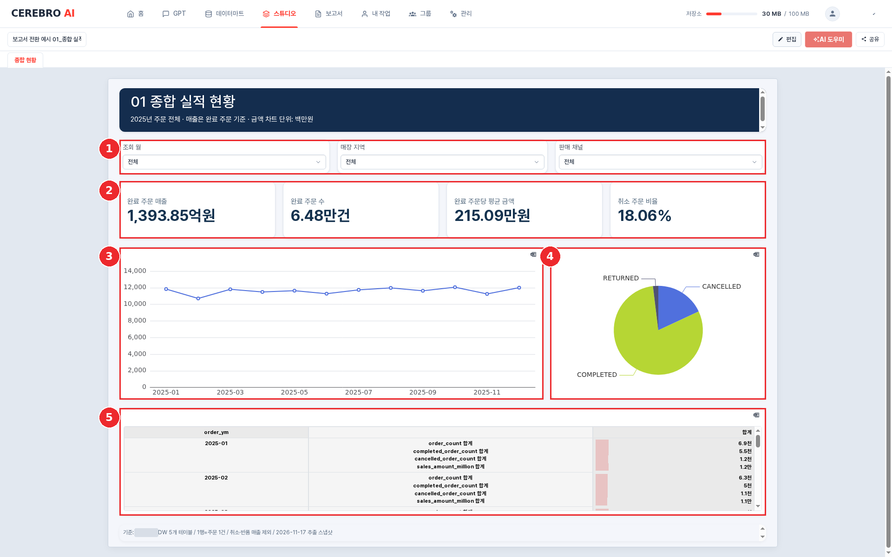
</p>

전체 규모와 기간별 변화를 함께 보고 싶을 때 다음과 같이 위젯을 설정합니다.

1. **조회 조건:** 필터 위젯에 기간·지역 등 조회 기준 컬럼을 지정하고, 같은 조건으로 조회할 KPI·차트·피벗을 적용 대상으로 연결합니다.
2. **핵심 수치:** KPI마다 데이터셋과 **값(Y)**을 선택합니다. 전체 규모는 합계, 평균 수준은 평균으로 설정합니다. 비율 지표는 분자·분모를 지정합니다.
3. **기간별 추이:** 차트의 X축에 날짜·연월 컬럼을, 값에 비교할 수치와 집계를 지정합니다. X축을 시간 순서로 정렬하고 **스타일 → 차트 → 선**을 선택합니다.
4. **항목별 구성:** 차트의 X축에 상태·분류 컬럼을, 값에 해당 항목의 건수나 합계를 지정한 뒤 **스타일 → 차트 → 파이**를 선택합니다.
5. **근거 집계표:** 피벗의 행에 기간 컬럼을 지정하고, **값(집계)**에 차트와 대조할 지표를 추가합니다. 건수·금액 등 필요한 값을 같은 표에 배치합니다.

#### 4.4.2 지역·매장 운영 비교

<p align="center">
  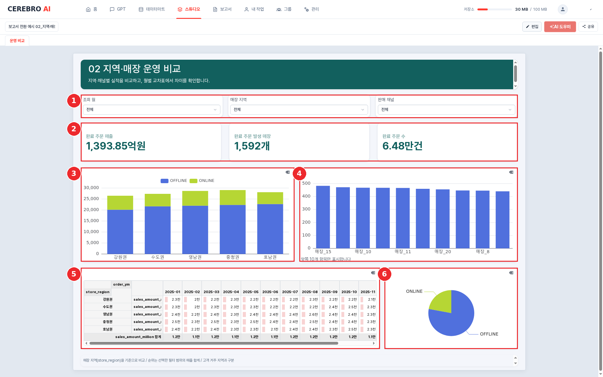
</p>

지역·조직·사업 등 여러 대상을 같은 기준으로 비교하려면 다음과 같이 설정합니다.

1. **비교 범위:** 기간과 대상 범위를 선택할 필터 컬럼을 지정하고, 비교할 위젯을 적용 대상으로 연결합니다.
2. **규모 요약:** KPI의 데이터셋과 수치 컬럼을 선택합니다. 전체 금액은 합계로, 대상 수는 대상 ID의 고유 개수로 지정하여 중복을 구분합니다.
3. **규모와 구성 비교:** 차트의 X축에 지역·조직 등 비교 대상을 지정합니다. **색상으로 나누기**에는 세부 분류를, 값에는 수치 컬럼과 집계를 선택하고 **스타일 → 차트 → 누적 막대**로 설정합니다.
4. **순위 비교:** 차트의 X축에 대상명, 값에 비교 수치를 지정하고 막대를 선택합니다. **정렬 기준 → 값 크기순**, **정렬 방향 → 큰 값부터(내림차순)**를 선택하고 표시 항목 수를 지정합니다.
5. **기간별 교차표:** 피벗의 행에는 비교 대상, 열에는 기간을 지정합니다. **값(집계)**에 비교할 수치와 집계 방식을 추가합니다.
6. **세부 항목의 비중:** 차트의 X축에 세부 분류, 값에 해당 수치와 집계를 지정하고 파이를 선택합니다.

#### 4.4.3 상품·고객 수요 탐색

<p align="center">
  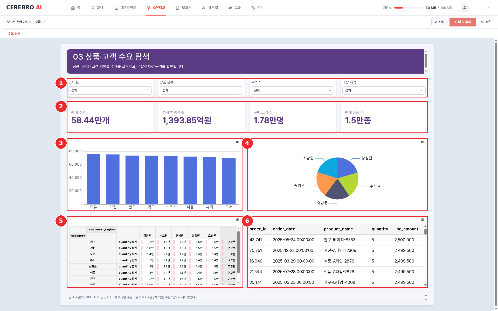
</p>

조건별 요약 수치와 근거 자료를 함께 확인하려면 다음과 같이 설정합니다.

1. **조회 조건:** 기간·지역·분류 필터를 구성하고, 아래 KPI·차트·피벗·테이블을 적용 대상으로 연결합니다.
2. **선택 범위의 요약:** KPI의 값과 집계를 지정합니다. 금액·수량은 합계, 대상 수는 식별 컬럼의 고유 개수 등으로 설정합니다.
3. **항목별 크기 비교:** 차트의 X축에 분류 컬럼을, 값에 수치 컬럼과 집계를 지정하고 막대를 선택합니다.
4. **항목별 구성 확인:** 차트의 X축에 구성 비중을 확인할 분류를 지정하고, 값과 집계를 선택한 뒤 파이로 설정합니다.
5. **분류 간 교차 집계:** 피벗의 행과 열에 서로 다른 분류를 지정하고, **값(집계)**에 확인할 수치를 추가합니다.
6. **근거 자료 목록:** 테이블의 데이터셋과 표시 컬럼을 선택한 뒤 정렬 컬럼·방향·행 수 제한을 지정합니다. 필터의 적용 대상에도 이 테이블을 포함합니다.

## 5. 보고서

보고서에서는 저장한 분석 위젯을 제목·본문·표·이미지와 함께 배치하여 결과를 설명하는 문서를 작성합니다. 이 장에서는 **3. 데이터 분석**에서 저장한 위젯으로 보고서 2개를 구성합니다.

### 5.1 보고서 데이터 연계

보고서에 넣을 분석 조건과 집계값은 먼저 차트·BI 분석 화면에서 구성한 뒤 위젯으로 저장합니다.

<p align="center">
  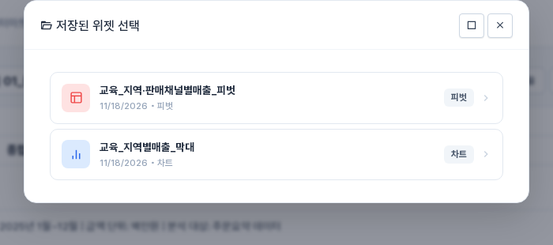
</p>

1. **보고서 → 빈 보고서**를 선택하고 제목을 입력합니다.
2. 블록 추가 영역에서 **위젯**을 선택합니다.
3. **위젯 선택**을 클릭하여 **교육_지역별매출_막대** 또는 **교육_지역·판매채널별매출_피벗**을 고릅니다.
4. 블록에 표시할 제목과 분석 결과를 확인합니다. 연결한 위젯을 바꾸려면 **위젯 변경**을 사용합니다.
5. 보고서를 저장한 후 **미리보기**로 표와 차트가 표시되는지 확인합니다.

> **💡 참고 : 보고서의 위젯 최신화**
>
> 보고서는 저장된 위젯의 설정과 계산 결과를 문서에서 활용합니다. 원본 데이터셋이 바뀐 경우에는 데이터셋을 먼저 갱신하고 보고서 소유자가 **최신화**를 실행합니다. 최신화는 본문에 작성한 설명을 자동으로 고치는 기능이 아니므로 설명 문구도 함께 검토합니다.

### 5.2 레이아웃 및 서식 설정

<p align="center">
  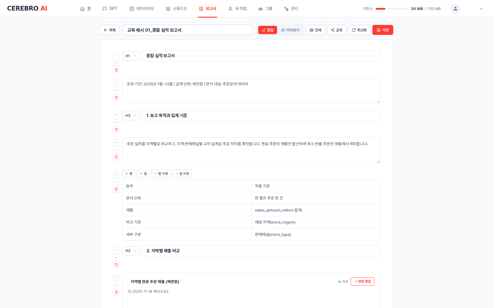
</p>

아래 블록을 조합하여 문서의 설명과 분석 근거를 함께 배치합니다.

| 블록 | 사용하는 상황 | 작성 방법 |
|---|---|---|
| **제목** | 문서 제목과 절 제목을 구분할 때 | H1에는 문서 제목을, H2 등에는 세부 항목을 입력합니다. |
| **본문** | 분석 목적·조회 조건·결과 해석을 설명할 때 | 기준 기간과 단위, 확인할 내용을 짧은 문단으로 입력합니다. |
| **페이지 구분** | 출력 시 다음 내용을 새 페이지에서 시작할 때 | 앞 절의 마지막과 다음 절의 첫 블록 사이에 추가합니다. |
| **표** | 집계 기준이나 검토 항목을 정리할 때 | 행·열을 추가하고 항목과 설명을 입력합니다. |
| **위젯** | 차트·피벗 등 계산 결과를 보여줄 때 | 저장된 위젯을 선택하고 블록 제목과 표시 결과를 확인합니다. |
| **이미지** | 화면 구성이나 참고 자료를 보여줄 때 | 보고서를 먼저 저장한 뒤 이미지 블록을 추가하여 파일을 업로드합니다. |

1. **제목 → 기준 설명 → 분석 위젯 → 결과 해석** 순서로 블록을 배치합니다.
2. 제목의 H1·H2 구분과 블록의 위·아래 이동 기능으로 문서 구조를 정리합니다.
3. 페이지 구분이 필요한 위치를 지정합니다. 페이지 구분은 화면 높이를 고정하는 기능이 아니라 출력 시 쪽을 나누는 기능입니다.
4. 표의 행·열을 조정하고, 이미지에는 내용을 알 수 있는 설명을 입력합니다.
5. **미리보기**에서 읽는 순서를 확인하고 **인쇄** 화면에서 페이지 구분과 잘림 여부를 확인합니다.

### 5.3 보고서 제작 실습

두 예시는 같은 데이터를 사용하되, 전체 실적을 설명하는 문서와 세부 비교·후속 조치를 정리하는 문서로 목적을 나눕니다.

#### 5.3.1 예시 1: 종합 실적 보고서

<p align="center">
  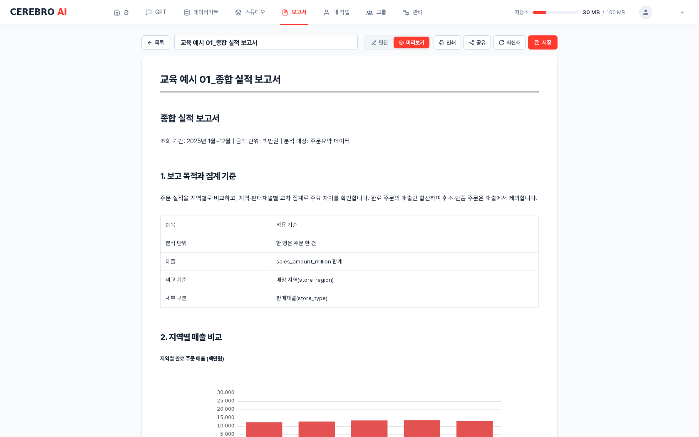
</p>

1. 보고서 제목을 **교육 예시 01_종합 실적 보고서**로 입력합니다.
2. 제목 블록에 **종합 실적 보고서**, 본문에 조회 기간·금액 단위·분석 대상을 작성합니다.
3. **보고 목적과 집계 기준** 절을 만들고, 한 행의 의미·매출 정의·비교 기준을 표로 정리합니다.
4. **지역별 매출 비교** 절에 **교육_지역별매출_막대** 위젯을 넣습니다.
5. 차트 아래에는 지역별 차이를 확인하고 판매채널 구성을 함께 살펴본다는 설명을 작성합니다.

<p align="center">
  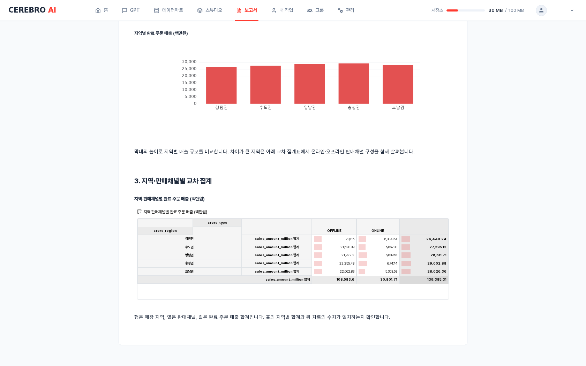
</p>

6. **지역·판매채널별 교차 집계** 절에 **교육_지역·판매채널별매출_피벗** 위젯을 넣습니다.
7. 피벗의 지역별 합계와 막대 차트의 값을 대조합니다.
8. **저장 → 미리보기**로 제목·본문·차트·표가 이어지는지 확인합니다.

| 구성 순서 | 입력할 내용 |
|---|---|
| 제목·기준 | 종합 실적 보고서 / 조회 기간: 2025년 1~12월 / 금액 단위: 백만원 |
| 목적·기준 표 | 한 행은 주문 한 건, 매출은 완료 주문만 합산, 취소·반품은 제외 |
| 지역별 매출 | 지역별 매출 막대 위젯과 비교 관점 설명 |
| 교차 집계 | 지역·판매채널별 피벗 위젯과 합계 대조 설명 |

#### 5.3.2 예시 2: 지역·판매채널 비교 보고서

<p align="center">
  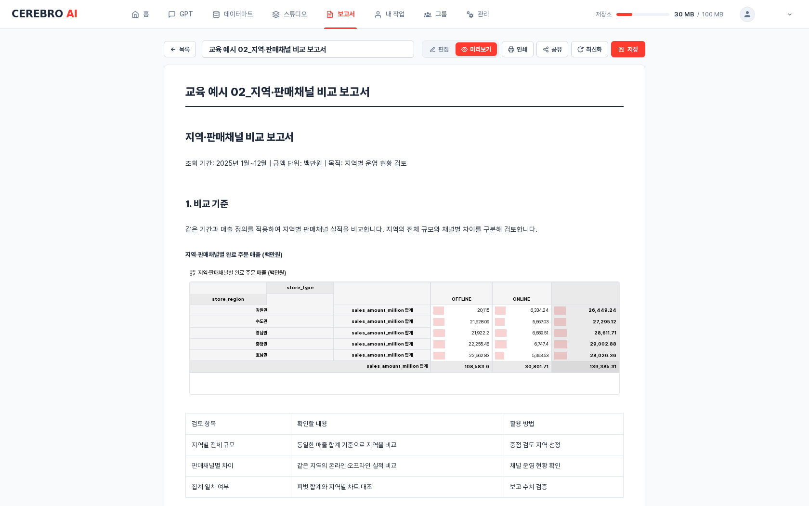
</p>

1. 보고서 제목을 **교육 예시 02_지역·판매채널 비교 보고서**로 입력합니다.
2. 제목과 본문에 조회 기간·금액 단위·비교 목적을 작성합니다.
3. **비교 기준** 절에 같은 기간과 매출 정의를 적용한다는 설명을 넣습니다.
4. **교육_지역·판매채널별매출_피벗** 위젯을 추가합니다.
5. 표를 추가하여 지역별 전체 규모, 판매채널별 차이, 집계 일치 여부를 검토 항목으로 정리합니다.
6. **페이지 구분**을 추가하여 뒤의 검토·조치 내용을 새 쪽에서 시작하도록 구성합니다.

<p align="center">
  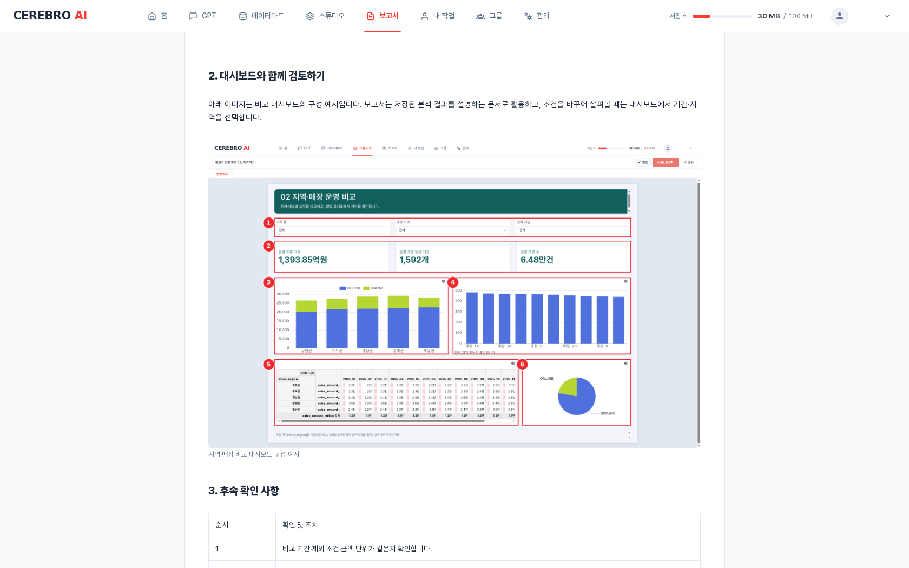
</p>

7. 다음 절 제목을 **대시보드와 함께 검토하기**로 입력합니다.
8. 보고서를 저장한 뒤 **이미지** 블록에서 비교 대시보드의 화면 사진을 업로드합니다.
9. 아래에 **후속 조치** 표를 작성하여 확인할 내용과 활용 방법을 정리합니다.
10. 저장 후 미리보기와 인쇄 화면에서 이미지, 표와 페이지 구분을 확인합니다.

| 검토 항목 | 확인할 내용 | 활용 방법 |
|---|---|---|
| 지역별 전체 규모 | 같은 매출 합계 기준으로 지역을 비교 | 중점 검토 지역 선정 |
| 판매채널별 차이 | 같은 지역의 온라인·오프라인 실적 비교 | 채널 운영 현황 확인 |
| 집계 일치 여부 | 피벗 합계와 지역별 차트 대조 | 보고 수치 검증 |

이 예시는 수치를 나열하는 데서 끝내지 않고, 분석 결과를 어떤 기준으로 검토하고 업무에 활용할지 본문과 표로 정리하는 방법을 보여줍니다.

## 6. 분석 결과 공유 및 관리

작성한 결과는 사용자가 필요한 범위에서 조회하거나 자기 자료로 복제할 수 있도록 권한을 나누어 공유합니다.

### 6.1 결과 공유 및 배포

#### 6.1.1 대시보드 공유

<p align="center">
  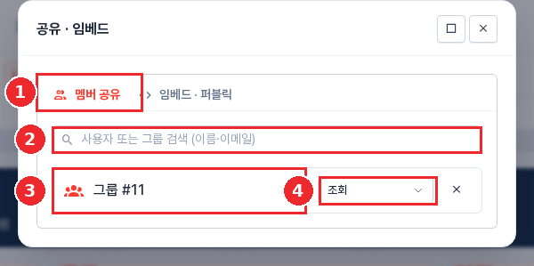
</p>

대시보드 오른쪽 위 **공유**를 연 뒤 다음 항목을 설정합니다.

1. **멤버 공유:** 사용자·그룹별로 공유할 수 있는 탭을 선택합니다.
2. **공유 대상 검색:** 사용자 또는 그룹명을 입력하여 대상을 찾습니다.
3. **대상 추가·확인:** 검색한 대상을 추가하고 공유 목록에 올바르게 표시되는지 확인합니다.
4. **권한 지정:** 열람용으로 제공할 대상에는 **조회**를 선택합니다. 함께 편집해야 할 경우에만 업무 범위에 맞는 권한을 지정합니다.

#### 6.1.2 연결 데이터셋 권한 확인

<p align="center">
  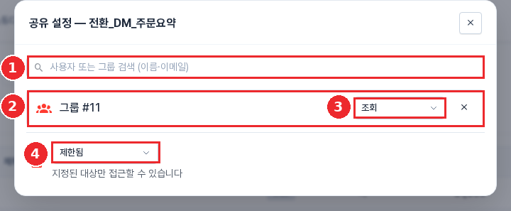
</p>

데이터마트에서 연결 데이터셋의 **공유 설정**을 열고 대시보드와 같은 대상에 필요한 권한을 지정합니다.

1. **공유 대상 검색:** 사용자 또는 그룹명을 입력합니다.
2. **대상 추가·확인:** 대시보드를 이용할 대상을 추가하고 목록을 확인합니다.
3. **권한 지정:** 데이터를 확인할 수 있도록 **조회** 등 필요한 권한을 선택합니다.
4. **일반 액세스:** 지정한 대상에게만 제공하려면 **제한됨**으로 설정합니다.

대시보드에 여러 데이터셋이 연결되어 있다면 각각 필요한 공유 설정을 적용하고, 조회 담당자 계정에서 데이터가 표시되는지 확인합니다.

#### 6.1.3 보고서 그룹 공유

보고서는 그룹 단위로 공유하며 보기·편집·복제·공유 설정 변경 권한을 구분합니다. 이 교육에서는 **작성 담당자가 관리하는 소속 그룹**을 공유 대상으로 사용합니다.

<p align="center">
  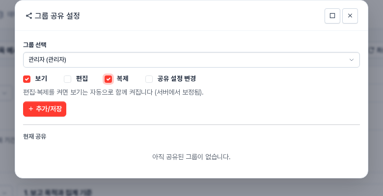
</p>

1. 공유할 보고서를 저장한 뒤 상단 **공유**를 클릭합니다.
2. 그룹 선택 목록에서 공유할 그룹을 고릅니다.
3. 조회만 제공하려면 **보기**를 선택합니다.
4. 사용자가 자기 보고서로 가져오게 하려면 **복제**도 선택합니다. 원본 수정이 필요하지 않으면 **편집**은 해제합니다.
5. **추가/저장**으로 적용하고, 해당 그룹 사용자 계정에서 결과를 확인합니다.

공유 설정을 다른 사람에게 위임하는 경우에는 **공유 설정 변경** 권한과 대상 그룹의 관리자 역할을 함께 확인합니다. 단순히 그룹 구성원이라는 이유만으로 다른 사람이 작성한 보고서의 공유 설정을 바꿀 수 있는 것은 아닙니다.

<!-- 확인 필요 EDU-01: 요청하신 교육 운영 기준은 '본인이 관리하는 소속 그룹에 보고서 공유'입니다. 검토한 소스에는 보고서 소유자의 공유 범위를 별도로 허용하는 예외가 있습니다. 소유자와 공유관리 권한자의 차이를 유지하고, '모든 보고서는 그룹 관리자만 공유 가능'이라는 절대 조건으로 해석하지 않도록 운영 정책을 확인합니다. -->

#### 6.1.4 배포 형태 선택

| 제공 형태 | 사용하는 상황 | 확인할 내용 |
|---|---|---|
| 대시보드 그룹·멤버 공유 | 로그인한 사용자가 조건을 바꾸며 결과를 조회 | 대시보드와 연결 데이터셋의 권한 |
| 보고서 그룹 공유 | 설명과 분석 결과를 문서로 전달 | 보기·복제 등 필요한 권한 |
| 보고서 인쇄·PDF 저장 | 검토·제출 시점의 문서를 파일로 보관 | 최신화 시점, 페이지 구분과 출력 범위 |
| 임베드·퍼블릭 링크 | 서비스 정책상 허용된 외부 화면에 제공 | 도메인 제한, 공개 범위와 필요한 승인 |

내부 업무 교육에서는 그룹 공유를 기본으로 사용합니다. 퍼블릭 링크는 승인 이후 활성화되는 별도 배포 방식입니다.

### 6.2 공유된 분석 결과 조회 및 활용

#### 6.2.1 공유받은 대시보드 조회

<p align="center">
  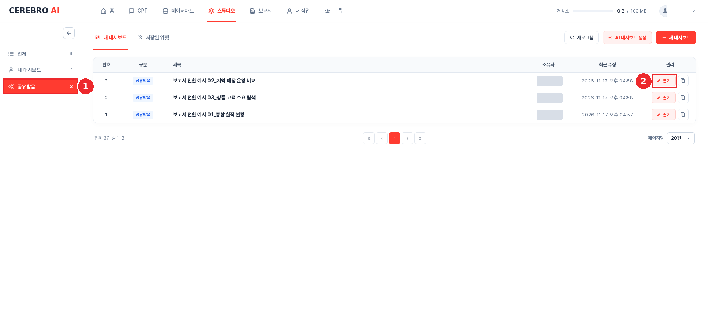
</p>

조회 담당자 계정으로 로그인한 뒤 스튜디오를 엽니다.

1. **공유받음:** 왼쪽 메뉴에서 공유받은 자료 목록을 선택합니다.
2. **열기:** 확인할 대시보드 행의 **열기** 버튼을 클릭합니다.

<p align="center">
  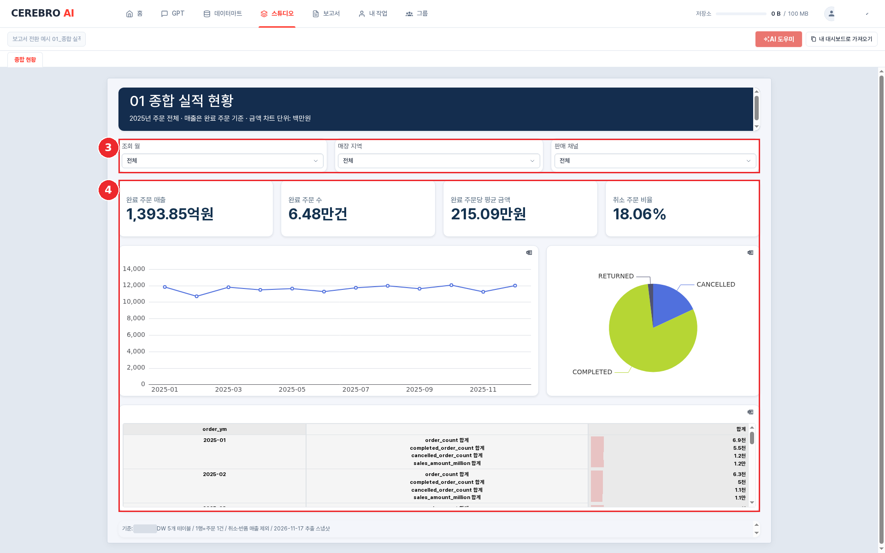
</p>

3. **조회 조건:** 화면 위쪽의 필터에서 확인할 조건을 선택합니다.
4. **결과 확인:** 연결된 KPI·차트·표에서 선택 조건에 해당하는 수치와 자료를 확인합니다.

#### 6.2.2 필터로 필요한 현황 조회

<p align="center">
  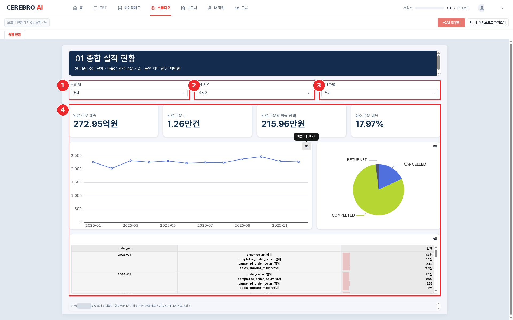
</p>

필터에 구성된 항목에 따라 필요한 조건을 선택합니다. 아래 화면은 기간·지역·판매 채널을 사용하는 예시입니다.

1. **기간 선택:** 조회할 월 등 기간 조건을 선택합니다.
2. **대상 범위 선택:** 지역 등 비교할 대상 범위를 선택합니다.
3. **세부 조건 선택:** 판매 채널 등 추가 분류를 선택합니다. 범위를 제한하지 않으려면 **전체**를 선택합니다.
4. **결과 확인:** 같은 조건이 적용된 KPI·차트·표를 확인합니다. 전체 현황으로 돌아가려면 필터 값을 **전체**로 되돌립니다.

필터 선택은 조회 범위를 바꾸며 원본 데이터의 내용을 수정하지 않습니다.

#### 6.2.3 내 대시보드로 가져오기

공유된 원본을 그대로 조회하는 방법과, 사본을 만들어 자기 형식에 맞게 수정하는 방법을 구분합니다.

<p align="center">
  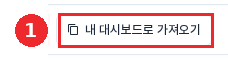
</p>

1. 공유받은 대시보드를 엽니다.
2. **내 대시보드로 가져오기**를 클릭합니다.

<p align="center">
  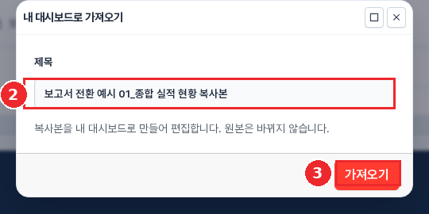
</p>

3. 원본과 구분할 제목을 입력하고 **가져오기**를 클릭합니다.
4. **내 대시보드**에서 사본을 열어 위젯의 데이터·스타일·배치를 수정하고 저장합니다.

사본은 페이지와 위젯 구성을 복사하며 원본 대시보드의 구성에는 영향을 주지 않습니다. 연결 데이터셋의 이용 권한은 별도로 필요합니다.

#### 6.2.4 공유받은 보고서 조회 및 내 보고서로 복제

1. **보고서 → 공유받은 보고서**에서 대상 문서를 엽니다.
2. 공유받은 문서를 그대로 활용할 경우 본문·표·위젯 결과를 조회합니다. 보기 권한만 있으면 원본을 편집할 수 없습니다.
3. 본인의 형식으로 작성하려면 보고서 목록의 **복제**를 선택합니다. 공유자가 **복제** 권한을 허용한 자료에서 사용합니다.
4. **내 보고서**에서 생성된 사본을 열고 제목·본문·표·위젯을 수정하여 저장합니다.
5. 최신화나 위젯 변경이 필요하면 연결 데이터의 조회 권한과 계산 결과를 확인합니다.

복제 권한과 원본 편집 권한은 다릅니다. 사본을 수정해도 공유받은 원본이 함께 수정되는 것은 아닙니다.

### 6.3 사용자·그룹별 접근 권한 정책 설정

자료의 이용 목적에 맞게 필요한 권한만 부여하고, 사용자 역할이 바뀌면 그룹 구성과 자료 공유를 함께 확인합니다.

| 사용자 유형 | 권장 권한 구성 |
|---|---|
| 결과 조회자 | 대시보드 조회, 필요한 데이터셋 조회, 보고서 보기 |
| 사본 활용자 | 조회 권한과 보고서 복제, 연결 데이터의 이용 권한 |
| 공동 작성자 | 해당 대시보드·보고서 편집, 필요한 데이터셋 이용 권한 |
| 그룹 운영 담당자 | 담당 그룹의 관리자 역할과 필요한 DB 연결 관리 권한 |
| 사이트 운영 담당자 | 사이트 관리자 등급과 운영 정책 관리 |

공유 후에는 대상 사용자 계정으로 접속하여 목록에 나타나는지, 위젯 값이 표시되는지, 허용하지 않은 편집 기능이 제한되는지 확인합니다. 공개 범위와 복제·편집 허용 여부는 기관의 업무 정책에 맞게 결정합니다.

## 7. 기존 보고서 전환

기존 보고서의 SQL과 계산 기준을 유지하면서 조회 조건·시각화·출력 형태를 CEREBRO AI로 재구성합니다. 결과 수치가 일치하는지 확인한 뒤 실제 보고 업무에 적용합니다.

### 7.1 기존 SQL 활용 및 데이터 조회

기존 BI에서 사용한 SQL의 테이블, 조인 조건, 기간 조건과 계산식을 확인합니다. **외부 DB의 테이블을 조회하는 SQL**과 **등록된 데이터셋을 조회하는 SQL**은 실행 위치가 다릅니다.

| 구분 | 실행 위치 | 활용 방법 |
|---|---|---|
| 기존 DB SQL | 새 데이터셋 등록 → DB 추출 | 허용된 DB 연결에서 테이블·뷰를 조회하여 데이터셋 생성 |
| 데이터셋 SQL | 새 데이터셋 등록 → SQL 쿼리 | 등록된 데이터셋의 식별자를 사용하여 새 분석용 데이터셋 생성 |

#### 7.1.1 DB 조회 SQL 활용

고객 정보 조회 예시는 다음과 같습니다. 실행할 DB의 실제 테이블·컬럼명과 삭제 여부 등 기존 조건을 확인하여 적용합니다.

```sql
SELECT
    customer_id,
    city AS customer_city,
    region AS customer_region,
    signup_date
FROM dw_customer
WHERE COALESCE(del_yn, 'N') = 'N';
```

1. 사용할 DB 연결에서 기존 SQL이 참조하는 테이블과 컬럼을 확인합니다.
2. DB 추출의 SQL 편집기에 조회문을 입력합니다.
3. 기간·상태·조인 조건과 결과 건수를 확인합니다.
4. 결과가 보고 목적에 맞으면 데이터셋으로 저장합니다.

#### 7.1.2 등록한 데이터셋으로 SQL 집계

주문요약 데이터에서 기간별·지역별 매출을 조회하는 예시입니다. 아래 `ds_372`는 교육용 주문요약 데이터셋의 식별자이며, 다른 환경에서는 SQL 편집기에 표시된 해당 데이터셋의 식별자로 바꿉니다.

```sql
SELECT
    order_ym,
    store_region,
    SUM(sales_amount_million) AS sales_amount_million
FROM ds_372
WHERE order_date >= DATE '2025-01-01'
  AND order_date <  DATE '2026-01-01'
GROUP BY order_ym, store_region
ORDER BY order_ym, store_region;
```

1. **SQL 쿼리**에서 등록된 주문요약 데이터셋을 선택하고 식별자를 확인합니다.
2. 조회문에 필요한 기간과 비교 기준을 지정합니다.
3. 실행 결과의 연월·지역별 합계와 행 수를 확인합니다.
4. 반복해서 사용할 결과는 별도 제목으로 저장하고 대시보드·보고서에 연결합니다.

주문요약의 `sales_amount_million`에는 완료 주문 매출만 반영되어 있습니다. 다른 데이터를 사용한다면 기존 보고서의 취소·반품 제외 조건과 단위 환산을 SQL 또는 지표 계산에 명시해야 합니다.

### 7.2 보고서 조회 조건 및 레이아웃 재구성

기존 화면을 그대로 복사하기보다 사용자가 어떤 조건으로 무엇을 확인하는지 먼저 정리하고, 해당 기능을 대시보드 위젯과 보고서 블록에 대응시킵니다.

| 기존 보고서 항목 | CEREBRO AI 구성 | 설정할 내용 |
|---|---|---|
| 조회 기간·지역·조직 | 필터 위젯 | 기준 컬럼과 적용 대상 위젯 |
| 총액·건수·평균·비율 | KPI 위젯 | 데이터셋, 값, 집계와 표시 단위 |
| 기간별 변화 | 선 차트 | 날짜·연월 축, 집계값과 시간 순서 |
| 항목별 규모 비교 | 막대 차트 | 분류 컬럼과 집계값 |
| 교차 집계표 | 피벗 | 행·열·측정값과 합계 |
| 상세 근거 목록 | 테이블 | 표시 컬럼·정렬·행 수 제한 |
| 설명·검토 의견 | 보고서 제목·본문·표 | 분석 기준과 결과 해석 |
| 출력 쪽·참고 화면 | 페이지 구분·이미지 | 쪽 나눔 위치와 이미지 설명 |

1. 기존 보고서에서 조회 조건과 핵심 지표를 목록으로 정리합니다.
2. 데이터셋의 컬럼과 계산식을 연결합니다.
3. 요약·비교·상세 목록 순서로 대시보드를 배치하고 필터를 연결합니다.
4. 제출용 문서가 필요하면 관련 위젯을 보고서에 넣고 기준과 해석을 작성합니다.
5. 화면 조회와 출력 문서를 각각 확인합니다.

### 7.3 기존 보고서와 데이터 정합성 비교

같은 기준 시점과 조회 조건으로 기존 보고서와 CEREBRO AI의 값을 비교합니다. 차이가 있으면 표시 형식부터 맞추기보다 원본 범위·조인·집계 조건부터 확인합니다.

| 비교 항목 | 확인할 내용 |
|---|---|
| 기준 시점 | 원본 추출 시점과 데이터셋의 마지막 갱신 시각이 같은 기준인지 확인합니다. |
| 기간 조건 | 시작·종료일, 기준 날짜 컬럼과 종료일 포함 여부를 맞춥니다. |
| 대상 범위 | 지역·조직·상태와 삭제·취소·반품 제외 조건을 맞춥니다. |
| 데이터 단위 | 한 행이 주문인지 주문상세인지 확인합니다. |
| 건수 | 행 수·고유 개수·조건에 맞는 건수 중 같은 정의를 사용합니다. |
| 금액·평균 | 합계·평균의 대상과 분모, 원·천원·백만원 단위를 맞춥니다. |
| 조인 | 누락된 키와 중복 연결로 집계값이 달라지는지 확인합니다. |
| 차트·피벗 | 동일 지역의 차트 값, 피벗 합계와 SQL 집계값을 비교합니다. |
| 표시 범위 | 상위 N, 행 수 제한과 화면 반올림이 전체 합계와 혼동되지 않는지 확인합니다. |
| 조회·출력 | 필터 적용 대상, 제목·단위·쪽 나눔이 기존 보고 목적에 맞는지 확인합니다. |

지역별 매출 실습에서는 **SQL의 지역별 합계 → 막대 차트의 값 → 피벗의 지역별 합계 → 보고서 위젯의 값**을 같은 조건으로 대조합니다. 차이가 있으면 조건과 계산 기준을 수정한 뒤 동일한 순서로 다시 확인합니다.

### 7.4 전환 후 기술지원 확인

운영 담당자와 교육 담당자는 문제가 발생한 단계와 화면을 구분하여 확인합니다.

| 확인 상황 | 먼저 확인할 내용 |
|---|---|
| DB 연결이 되지 않음 | 접속 정보, 연결 사용 권한, 방화벽과 CEREBRO 서버의 DB 접근 경로 |
| 데이터셋 값이 예상과 다름 | 원본 갱신, 조인 키와 한 행의 의미, SQL의 포함·제외 조건 |
| 분석·작성 기능이 제한됨 | 자료별 권한, 그룹의 기능 사용 설정과 라이선스 |
| 대시보드 위젯이 비거나 필터가 적용되지 않음 | 연결 데이터셋의 권한, 대응 컬럼과 필터 적용 대상 |
| 보고서 값이 이전 상태임 | 원본·데이터셋 갱신 후 보고서 소유자의 최신화 여부 |
| 공유받은 자료가 보이지 않음 | 그룹 소속, 자료별 공유 대상과 보기·조회 권한 |
| 사본 생성·수정이 안 됨 | 복제·편집 권한, 생성 한도와 연결 데이터의 이용 권한 |

지원 요청에는 사용한 메뉴, 기대한 결과, 실제 결과, 조회 조건과 오류 화면을 함께 정리합니다. 비밀번호나 실제 DB 접속 정보는 문서와 화면 사진에 포함하지 않습니다.

