# 보고서 전환 가이드

## 1. 기본 환경 구성

DB의 자료를 가져오려면 연결 정보와 접근 대상을 먼저 정해야 합니다. 담당자를 그룹으로 묶으면 DB 연결을 함께 관리하면서 연결을 사용할 사람과 조회할 테이블의 범위를 지정할 수 있습니다. 본 가이드에서는 **‘보고서 생성자’ 그룹**을 만들어 데이터셋과 분석 결과를 작성할 담당자를 배정합니다.

### 1.1 그룹 생성 및 관리

‘보고서 생성자’ 그룹은 보고서 작성 담당자들이 같은 DB 연결을 이용하기 위한 그룹입니다.

1. 사이트 관리자 계정으로 **관리 → 그룹/권한 관리**를 엽니다.
2. **그룹 추가**를 클릭하고 그룹명에 **보고서 생성자**를 입력하여 추가합니다.

<p align="center">
  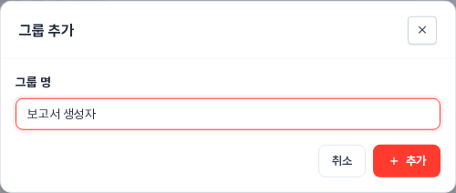
</p>

3. 생성한 그룹을 선택하고 작성 담당자를 **구성원**으로 배정합니다.
4. 구성원·DB 연결 등 그룹 운영을 담당할 계정은 **관리자**로 지정한 후 저장합니다.

<p align="center">
  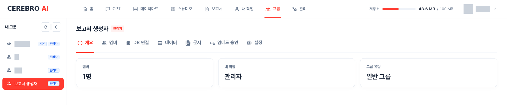
</p>

### 1.2 DB 연결 및 설정

그룹에 DB 연결을 등록하면 담당자가 허용된 범위의 자료를 데이터셋으로 가져올 수 있습니다. Oracle 또는 MySQL을 선택하여 연결할 수 있으며, 아래 사진은 Oracle 설정 예시입니다.

1. 상단 **그룹 → 보고서 생성자 → DB 연결**을 선택합니다.
2. **DB 연결 등록**을 클릭합니다.

<p align="center">
  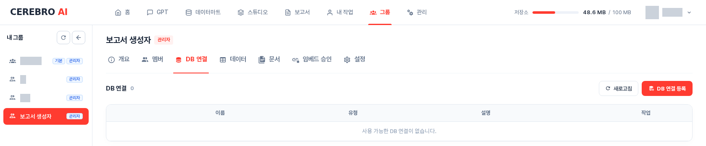
</p>

3. 운영 환경에 맞는 연결 정보를 입력합니다.

| 항목 | 입력할 내용 |
|---|---|
| 데이터베이스 종류 | Oracle, MySQL |
| 이름 | 연결을 구분할 이름 |
| 호스트·포트 | DB 서버 주소와 접속 포트 |
| SID / 서비스명(Oracle) | 연결할 Oracle DB의 SID 또는 서비스명 |
| Database(MySQL) | 연결할 MySQL 데이터베이스 이름 |
| 사용자·비밀번호 | DB 계정과 비밀번호 |

<p align="center">
  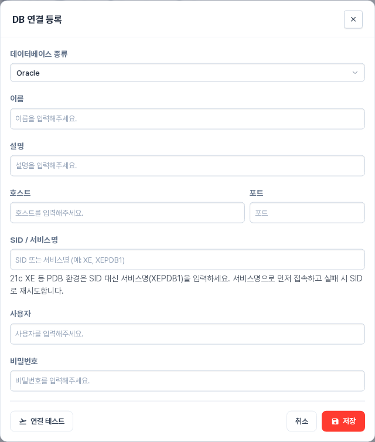
</p>

4. **연결 테스트**로 CEREBRO 서버에서 DB에 접속할 수 있는지 확인한 후 저장합니다.
5. 등록한 연결의 **권한 관리**에서 사용할 사용자·그룹과 사용·관리 권한을 확인하고, **허용 테이블**에서 조회할 테이블의 범위를 설정합니다.

## 2. 분석 데이터 구성

본 가이드에서는 수술일자·진료과·수술 종류·진행 상태와 소요시간으로 구성된 가상 데이터를 활용합니다. 수술 실적에 진료과 이름을 연결하고 연도·월 기준을 추가하여, 건수 추이와 진료과별 실적을 비교할 수 있는 분석용 데이터셋을 준비합니다. 자료가 변경될 때 결과에도 반영되도록 갱신 방법과 일정도 함께 확인합니다.

### 2.1 분석 데이터 생성 및 관리

#### 2.1.1 원본 테이블과 연결 관계

| 테이블 | 내용 | 주요 컬럼 | 원본 행 수 |
|---|---|---|---:|
| `TB_SURGERY` | 수술 한 건의 일자·진료과·종류·상태·소요시간 | `SURGERY_ID`, `DEPT_CD`, `SURGERY_DATE`, `SURGERY_TYPE`, `SURGERY_STATUS`, `SURGERY_MIN` | 200,000 |
| `TB_DEPARTMENT` | 진료과 코드에 대응하는 이름·분류·사용 여부 | `DEPT_CD`, `DEPT_NAME`, `DEPT_GROUP`, `USE_YN` | 12 |

두 테이블은 <strong>진료과 코드(`DEPT_CD`)</strong>로 연결합니다. 수술 데이터에 진료과 이름을 붙여 비교할 수 있습니다.

 - 수술일자는 **2023년 1월 1일~2026년 11월 23일**이며, 상태는 **완료·취소·예정**으로 구분됩니다.  
 - 한 행은 환자 한 명이 아닌 **수술 한 건**  
 - 소요시간(`SURGERY_MIN`)은 완료 건에만 기록되어 있습니다.

#### 2.1.2 DB 추출로 등록

DB에 저장된 원본 테이블을 SQL로 조회하여 데이터셋으로 등록합니다. 수술 실적과 진료과 기준정보를 각각 가져온 뒤, 공통 컬럼으로 연결하여 분석에 활용합니다.

1. **데이터마트 → 새 데이터셋 등록 → DB 추출**을 선택합니다.
2. **“연결을 선택하세요”** 목록에서 사용할 DB 연결과 스키마를 선택합니다.

3. **SQL 편집기**에서 다음 조회문을 입력하고 **실행**을 클릭합니다. `SELECT`에는 가져올 컬럼을, `FROM`에는 조회할 테이블을 지정합니다. `*`는 테이블의 전체 컬럼을 의미합니다.

```sql
SELECT *
FROM TB_SURGERY;
```

<p align="center">
  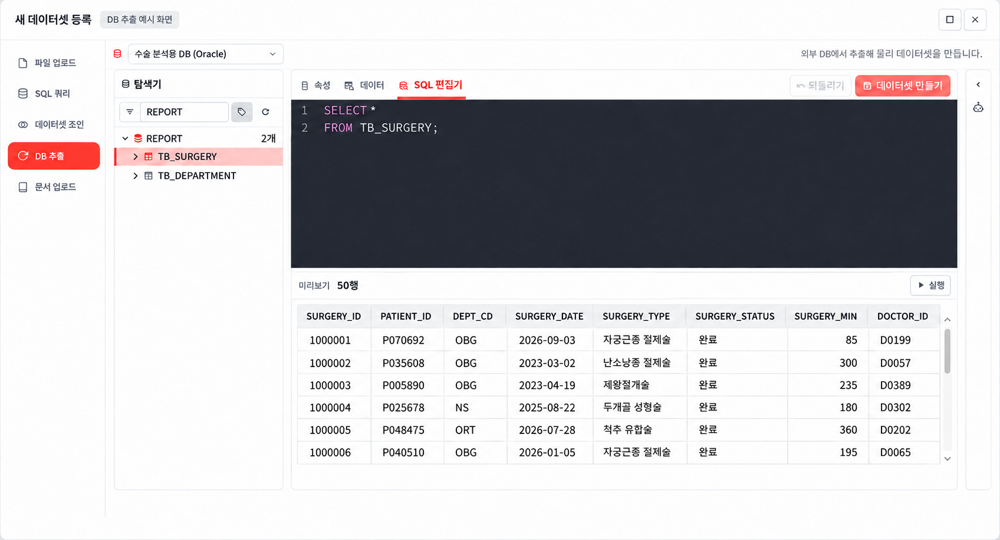
</p>

<p align="center">가상 데이터로 구성한 DB 추출 예시 화면</p>

4. 미리보기에서 컬럼과 데이터를 확인한 후 **데이터셋 만들기**를 클릭하고 **교육_수술실적_원본**으로 저장합니다.
5. 같은 방식으로 진료과 기준정보를 조회하고 **교육_진료과_기준정보**로 저장합니다.

제공된 샘플을 기준으로 수술 실적은 **200,000행·8개 컬럼**, 진료과 기준정보는 **12행·4개 컬럼**입니다. SQL 조회가 제한된 연결에서는 허용된 테이블과 컬럼을 선택하여 등록합니다.

> **💡 참고 : 데이터셋 조인**
>
> 각각 등록한 자료는 **새 데이터셋 등록 → 데이터셋 조인**에서 연결할 수 있습니다. 수술 실적을 기준으로 두 자료의 `DEPT_CD`를 연결하고 <strong>왼쪽 조인(LEFT JOIN)</strong>을 선택하여 진료과 이름·분류를 추가합니다. 조인 후에도 수술 실적이 200,000행으로 유지되는지 확인합니다.
>
> 수술 실적에서는 `SURGERY_ID`, `DEPT_CD`, `SURGERY_DATE`, `SURGERY_TYPE`, `SURGERY_STATUS`, `SURGERY_MIN`을, 진료과 기준정보에서는 `DEPT_NAME`, `DEPT_GROUP`을 선택합니다. 총 8개 컬럼을 포함한 결과를 **교육_수술실적_진료과연계**로 저장합니다.

<p align="center">
  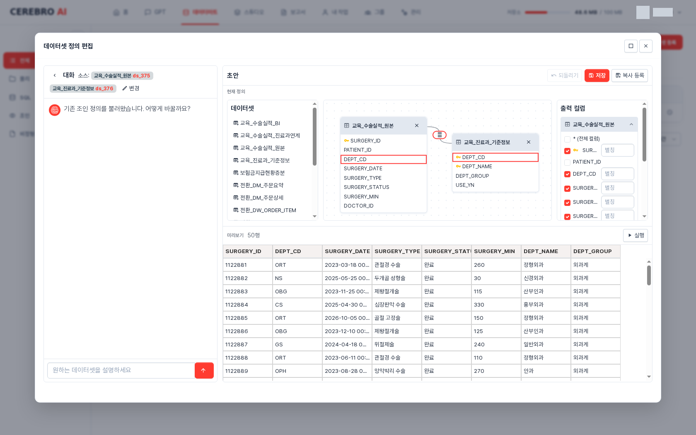
</p>

#### 2.1.3 연도·월 컬럼 생성과 분석용 데이터셋 저장

조인한 자료의 수술일자에서 연도와 연월을 추출하여 **교육_수술실적_BI**를 만듭니다. 이후 BI 분석, 대시보드와 보고서는 이 데이터셋을 공통으로 사용합니다.

1. **데이터마트 → 새 데이터셋 등록 → SQL 쿼리**를 선택합니다.
2. 소스 영역의 **변경**을 클릭하고 **교육_수술실적_진료과연계**를 선택한 뒤 **적용**합니다. 선택 창에서 데이터셋 이름 옆의 SQL 참조명(`ds_숫자`)을 확인합니다.
3. SQL 편집기에 다음 조회문을 입력합니다. 예시의 `ds_377`은 조인 데이터셋의 참조명이므로, 본인 화면에 표시된 값으로 바꿉니다. 이 조회문은 **CEREBRO에 등록된 데이터셋을 조회하는 SQL 쿼리**에서 실행합니다.

```sql
SELECT
    SURGERY_ID,
    DEPT_CD,
    DEPT_NAME,
    DEPT_GROUP,
    SURGERY_DATE,
    strftime(CAST(SURGERY_DATE AS TIMESTAMP), '%Y') AS SURGERY_YEAR,
    strftime(CAST(SURGERY_DATE AS TIMESTAMP), '%Y-%m') AS SURGERY_MONTH,
    SURGERY_TYPE,
    SURGERY_STATUS,
    SURGERY_MIN
FROM ds_377;
```

4. **실행**을 클릭하고 미리보기에서 새 컬럼과 수술일자가 일치하는지 확인합니다.

| 수술일자 예시 | SURGERY_YEAR | SURGERY_MONTH |
|---|---|---|
| 2023-01-15 | 2023 | 2023-01 |
| 2026-11-23 | 2026 | 2026-11 |

5. **데이터셋 만들기**를 클릭하고 제목을 **교육_수술실적_BI**로 입력하여 저장합니다. 생성이 끝나면 데이터마트에서 해당 데이터셋을 엽니다.
6. **데이터 구조**에서 **200,000행·10개 컬럼**인지 확인하고, **데이터 보기**에서 연도·연월 값과 진료과 이름을 확인합니다. 완료·취소·예정 상태를 모두 유지해야 다음 장에서 상태별 현황도 분석할 수 있습니다.

`SURGERY_YEAR`는 연도별 비교에, `SURGERY_MONTH`는 월별 추이에 사용합니다. 연월을 `YYYY-MM` 형식으로 구성하면 서로 다른 연도의 같은 월이 합쳐지지 않고, 이름 오름차순으로 정렬해도 시간 순서를 유지합니다.

| 데이터셋 | 구성 | 행 수 |
|---|---|---:|
| 교육_수술실적_원본 | 수술 실적 원본 | 200,000 |
| 교육_진료과_기준정보 | 진료과 코드·이름·분류 | 12 |
| 교육_수술실적_진료과연계 | 두 원본을 `DEPT_CD`로 연결한 자료 | 200,000 |
| 교육_수술실적_BI | 진료과연계 자료에 연도·연월 컬럼을 추가한 10개 컬럼의 분석 자료 | 200,000 |

<p align="center">
  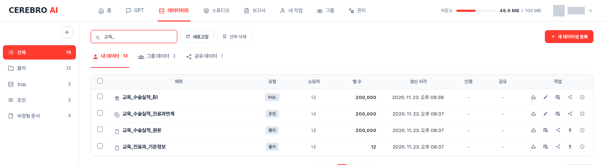
</p>

### 2.2 스케줄 생성 및 실행

DB의 자료가 바뀌어도 이미 수집한 데이터셋은 갱신 전까지 이전 결과를 유지합니다. 원본의 변경 주기에 맞춰 수동 갱신하거나 자동 갱신 일정을 설정하여 분석 자료를 최신 상태로 관리합니다.

1. 데이터마트에서 갱신할 데이터셋 행의 **스케줄** 버튼(시계 모양)을 클릭합니다.
2. 바로 반영하려면 **지금 갱신**을 선택합니다.
3. 정기적으로 반영하려면 **자동 갱신 주기**에서 매시·매일·매주 등의 주기를 선택하고 저장합니다.
4. 갱신 상태와 마지막 갱신 시각을 확인한 뒤 분석 결과를 다시 조회합니다.

<p align="center">
  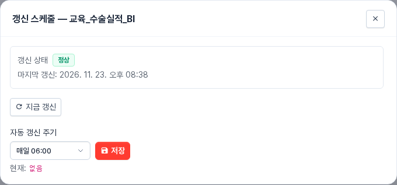
</p>

> **💡 참고 : 원본과 분석 자료의 갱신 순서**
>
> 업로드 파일은 변경된 파일을 재업로드해야 합니다. SQL·조인 데이터셋은 원본이 먼저 갱신된 뒤 다시 실행되어야 변경 사항을 반영할 수 있습니다. 예를 들어 **수술 실적·진료과 원본 → 진료과연계 → BI 분석용 데이터셋** 순서로 갱신하고, 대시보드에서는 갱신된 결과를 다시 조회합니다.

## 3. 데이터 분석

준비한 데이터셋을 BI 분석에서 집계하여 월별 추이, 진료과별 실적, 수술 상태와 평균 소요시간을 확인합니다. 같은 자료라도 비교 기준과 집계 방식을 바꾸면 서로 다른 지표를 만들 수 있으며, 필요한 결과는 위젯으로 저장하여 대시보드와 보고서에 활용합니다.

### 3.1 BI 분석 준비

1. 데이터마트에서 **교육_수술실적_BI**를 열고 <strong>BI (OLAP)</strong>을 선택합니다.
2. 완료 실적을 분석할 때는 왼쪽 컬럼 목록의 `SURGERY_STATUS`에서 **완료**만 선택합니다. 상태별 현황을 비교할 때는 **전체선택**으로 필터를 해제합니다.
3. 비교 기준을 **Column(열)** 또는 <strong>Row(행)</strong>에 배치하고, 집계할 컬럼을 <strong>Measure(측정값)</strong>에 배치합니다. 항목을 끌어 놓거나 빈 영역을 클릭하여 선택할 수 있습니다.

<p align="center">
  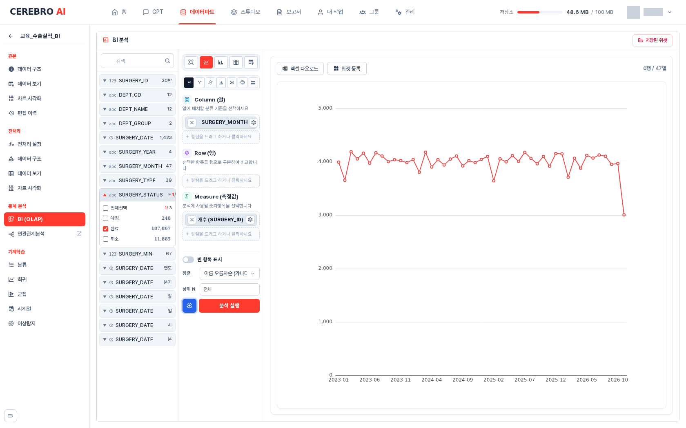
</p>

수술 건수는 `SURGERY_ID`의 <strong>개수(COUNT)</strong>로 집계합니다. 숫자로 된 ID를 합산하지 않도록 측정값의 집계 방식을 확인합니다. 평균 소요시간은 `SURGERY_MIN`의 <strong>평균(MEAN)</strong>을 사용합니다.

### 3.2 수술 실적 집계

#### 3.2.1 월별·연도별 수술 건수 추이

완료 수술 건수가 시기에 따라 어떻게 달라지는지 선그래프로 확인합니다.

1. `SURGERY_STATUS`에서 **완료**만 선택합니다.
2. <strong>Column(열)</strong>에 `SURGERY_MONTH`를, <strong>Measure(측정값)</strong>에 `SURGERY_ID`를 배치하고 집계를 **개수**로 지정합니다. <strong>Row(행)</strong>는 비워 둡니다.
3. **선 그래프**를 선택하고 **분석 실행**을 클릭합니다.
4. 연도별 합계를 보려면 열의 기준을 `SURGERY_YEAR`로 바꾸어 실행합니다.

<p align="center">
  
</p>

2026년 자료는 **11월 23일까지**이므로, 연도별 증감이나 11월 실적을 비교할 때 조회 기간의 차이를 함께 확인합니다.

#### 3.2.2 진료과별 수술 실적 비교

진료과별 완료 수술 건수를 막대그래프로 비교합니다. 연도를 행에 배치하면 같은 진료과의 연도별 실적도 함께 살펴볼 수 있습니다.

| 설정 항목 | 지정할 값 |
|---|---|
| 조회 조건 | `SURGERY_STATUS` = 완료 |
| Column(열) | `DEPT_NAME` |
| Row(행) | `SURGERY_YEAR` — 연도 구분 없이 합계만 비교할 때는 비움 |
| Measure(측정값) | `SURGERY_ID` / 개수 |
| 그래프 | 막대 그래프 |

<p align="center">
  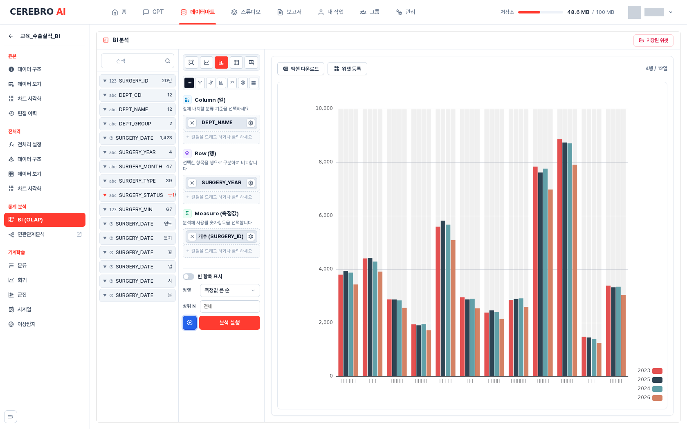
</p>

#### 3.2.3 수술 종류별 건수 및 비중

수술 종류별 완료 건수를 피벗표로 확인하고, **점유율 표시**를 전환하여 전체 완료 수술에서 차지하는 비중을 살펴봅니다.

| 설정 항목 | 지정할 값 |
|---|---|
| 조회 조건 | `SURGERY_STATUS` = 완료 |
| Column(열) | 비움 |
| Row(행) | `SURGERY_TYPE` |
| Measure(측정값) | `SURGERY_ID` / 개수 |
| 표시 | 피벗표, 점유율 표시 전환 |

<p align="center">
  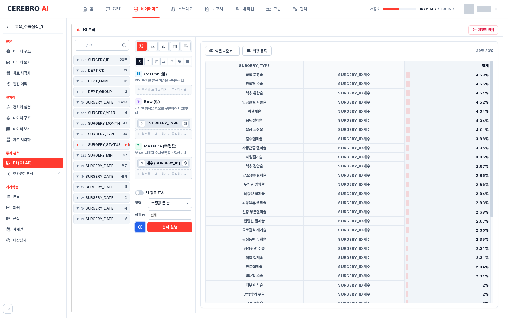
</p>

이 예시에서 비중의 기준은 **전체 완료 187,867건**입니다. 진료과나 기간을 추가로 제한하면 그 조회 범위에 맞춰 비중을 해석합니다.

#### 3.2.4 수술 완료·취소·예정 현황

완료·취소·예정 건수를 함께 비교하여 전체 수술의 상태별 구성을 확인합니다. 앞서 적용한 **완료 필터를 해제**한 후 실행합니다.

| 설정 항목 | 지정할 값 |
|---|---|
| 조회 조건 | `SURGERY_STATUS` 전체선택 |
| Column(열) | `SURGERY_STATUS` |
| Row(행) | 비움 |
| Measure(측정값) | `SURGERY_ID` / 개수 |
| 그래프 | 막대 그래프 |

<p align="center">
  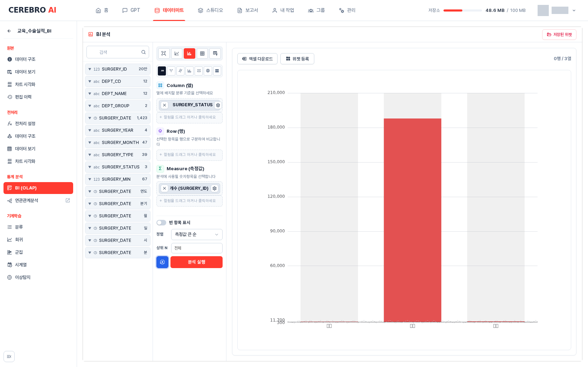
</p>

#### 3.2.5 평균 수술 소요시간 분석

완료 수술에 기록된 소요시간을 평균으로 집계하여 진료과별 차이를 확인합니다.

| 설정 항목 | 지정할 값 |
|---|---|
| 조회 조건 | `SURGERY_STATUS` = 완료 |
| Column(열) | `DEPT_NAME` |
| Row(행) | 비움 |
| Measure(측정값) | `SURGERY_MIN` / 평균 |
| 그래프 | 막대 그래프, 단위: 분 |

<p align="center">
  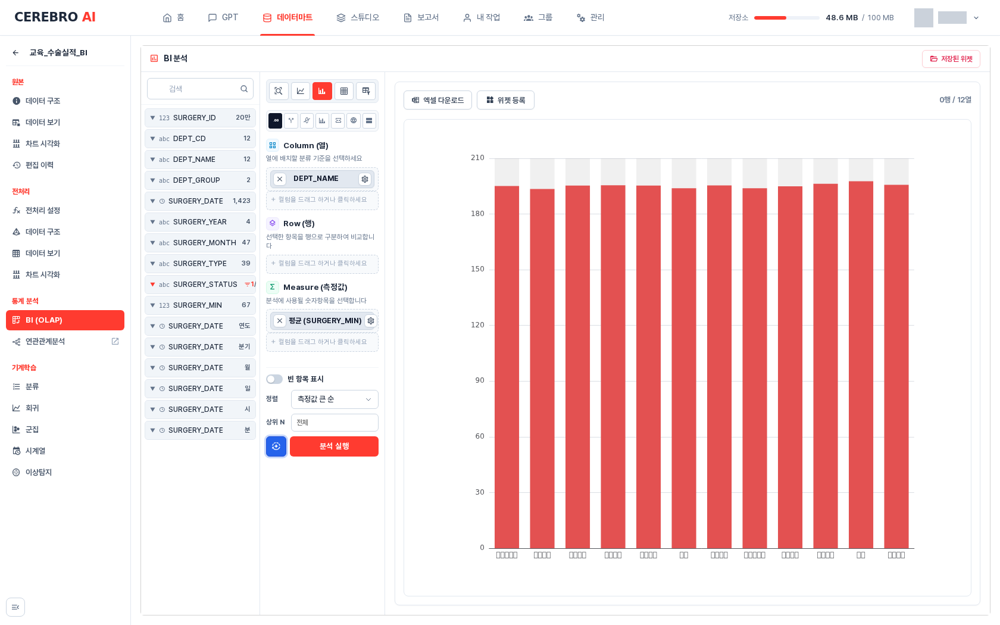
</p>

전체 완료 수술의 평균 소요시간은 **195.20분**입니다. 취소·예정 건의 빈 소요시간을 0으로 바꾸면 평균이 달라지므로 그대로 제외합니다. 전체 평균은 진료과별 평균을 다시 평균내지 않고, 전체 완료 수술을 대상으로 계산합니다.

### 3.3 분석 위젯 저장

분석 결과를 위젯으로 저장하면 같은 집계 기준을 대시보드와 보고서에서 다시 활용할 수 있습니다.

1. 분석 결과를 확인한 뒤 **위젯 등록**을 클릭합니다.
2. **교육_월별수술완료건수**처럼 분석 기준을 알아볼 수 있는 이름을 입력하고 저장합니다.

<p align="center">
  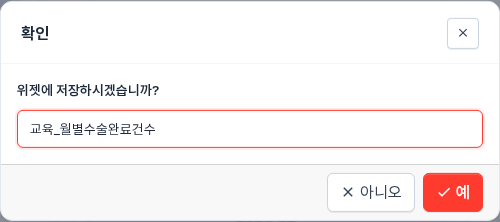
</p>

3. 같은 방식으로 진료과별 실적, 수술 종류별 건수, 상태별 현황과 평균 소요시간을 저장합니다.
4. **저장된 위젯**에서 등록 결과를 확인하고, 대시보드·보고서 작성 시 필요한 위젯을 선택합니다.

<p align="center">
  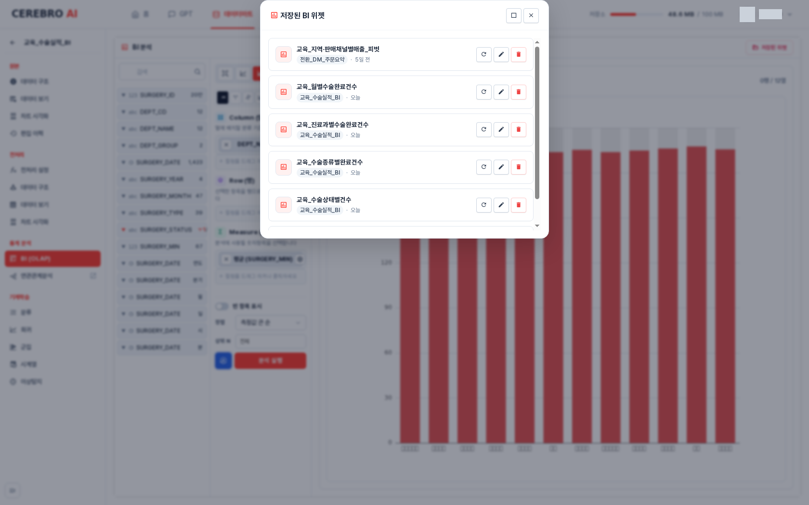
</p>

**💡 참고 : 보고서용 위젯 준비**

**5장 ③ 분석 위젯 연결**에서 사용할 위젯 두 개를 아래 이름으로 추가 저장합니다. 월별 차트는 **원본 → 차트 시각화**, 진료과·연도별 피벗은 <strong>BI (OLAP)</strong>에서 작성합니다. 같은 건수를 집계하더라도 표시 형태와 비교 기준에 맞춰 각각 저장합니다.

| 저장할 이름 | 작성 위치 | 설정 |
|---|---|---|
| 교육_월별수술완료추이_보고서차트 | 원본 → 차트 시각화 | 추이의 선 / 분류항목 `SURGERY_MONTH` / 측정값 `SURGERY_ID` 개수 / 완료 상태 |
| 교육_진료과별연도별수술실적_보고서피벗 | BI (OLAP) | 행 `DEPT_NAME` / 열 `SURGERY_YEAR` / 측정값 `SURGERY_ID` 개수 / 완료 상태 |

**교육_월별수술완료추이_보고서차트**는 다음과 같이 저장합니다.

1. **교육_수술실적_BI**를 열고 **원본 → 차트 시각화**를 선택합니다.
2. **그래프 선택 → 추이 → 선**을 선택합니다.
3. **분류항목**에 `SURGERY_MONTH`, **측정값**에 `SURGERY_ID`를 배치합니다. 측정값의 설정 버튼에서 집계를 **개수**로 지정하고, **비교항목**은 비워 둡니다.
4. 왼쪽 컬럼 목록에서 `SURGERY_STATUS`의 **완료**만 선택합니다. 정렬은 분류항목의 이름 오름차순으로 지정하고 **차트 생성**을 클릭합니다.
5. 생성된 차트의 **위젯 등록**을 클릭하여 **교육_월별수술완료추이_보고서차트**로 저장합니다.

**교육_진료과별연도별수술실적_보고서피벗**은 다음과 같이 저장합니다.

1. 같은 데이터셋의 <strong>BI (OLAP)</strong>을 선택하고 `SURGERY_STATUS`에서 **완료**만 선택합니다.
2. 기존 행·열·측정값에 배치된 항목을 제거한 뒤, <strong>Column(열)</strong>에 `SURGERY_YEAR`, <strong>Row(행)</strong>에 `DEPT_NAME`, <strong>Measure(측정값)</strong>에 `SURGERY_ID`를 배치합니다. 집계는 **개수**로 지정합니다.
3. **피벗표**를 선택하고 **분석 실행**을 클릭하여 진료과별로 연도별 완료 건수가 표시되는지 확인합니다.
4. **위젯 등록**을 클릭하여 **교육_진료과별연도별수술실적_보고서피벗**으로 저장합니다.

보고서의 **위젯 선택** 창에서 위 두 이름을 선택할 수 있으면 준비가 완료된 것입니다. 보고서에는 월별 차트를 첫 부분에, 진료과·연도별 피벗을 페이지 구분 뒤에 배치합니다.

## 4. 대시보드 제작

수술 실적을 **대시보드 한 개의 두 페이지**로 구성합니다. 첫 페이지에서는 전체 규모와 추이를 확인하고, 두 번째 페이지에서는 진료과별 실적과 상세 기록을 살펴봅니다. 같은 위젯의 설정 방법은 한 번만 설명하고, 페이지별로 달라지는 항목을 연결하여 안내합니다.

스튜디오에서 새 대시보드를 만들고 제목을 **교육_수술실적_통합대시보드**로 지정합니다. 일반 페이지 두 개의 이름은 **01. 수술 실적 현황**, **02. 진료과·수술 상세**로 설정하며, 예시 캔버스는 **1440 × 1000**입니다. 데이터 위젯은 **교육_수술실적_BI** 데이터셋을 사용합니다.

**완성 화면 1페이지 - 01. 수술 실적 현황**

<p align="center">
  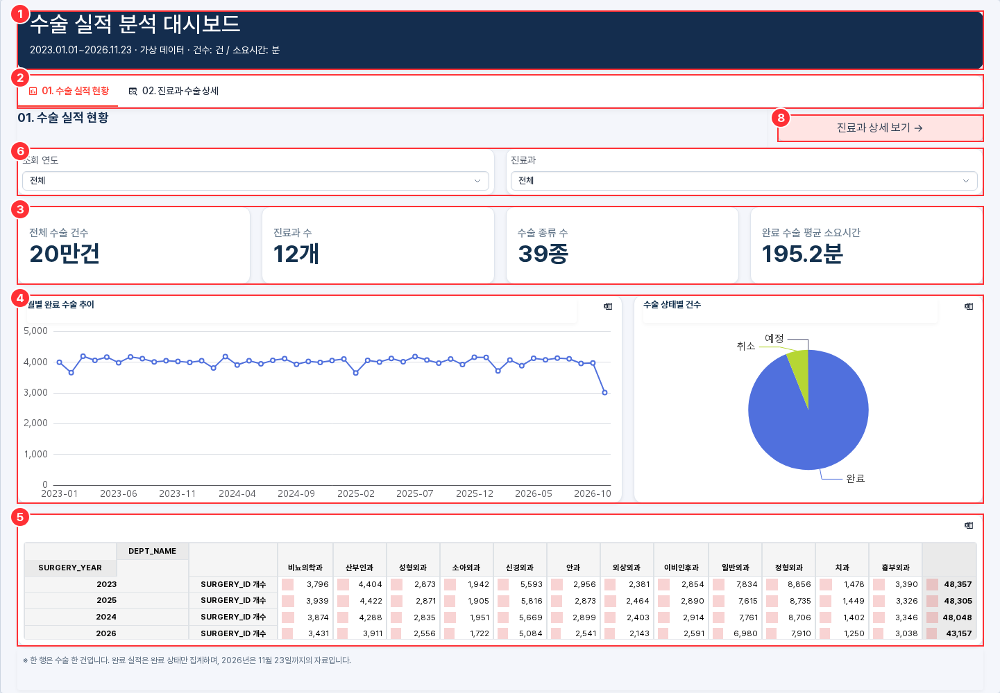
</p>

완성 화면의 번호는 아래 설명 순서와 같습니다. 공통 배경과 메뉴를 먼저 구성한 뒤, 데이터 위젯과 조회·이동 기능을 추가합니다.

### ① 배경 페이지 생성과 제목 영역의 배경색

먼저 두 페이지에 공통으로 사용할 **배경 페이지**를 만들고 제목 영역을 구성합니다. 이어지는 **② 공통 메뉴 구성과 배경 페이지 적용**에서 같은 배경 페이지에 메뉴를 추가한 뒤 두 일반 페이지에 적용합니다.

1. 왼쪽 **배경 페이지 추가**를 클릭하고 이름을 **공통 제목·이동 메뉴**로 지정합니다.
2. 생성한 배경 페이지를 선택하고 **위젯 추가**에서 **텍스트** 위젯을 추가합니다.
3. 오른쪽 **스타일 → 내용**에 제목 **수술 실적 분석 대시보드**와 기준 안내 **2023.01.01~2026.11.23 · 가상 데이터 · 건수: 건 / 소요시간: 분**을 입력합니다.
4. **색상**은 흰색(`#FFFFFF`), **배경**은 남색(`#142D4E`)으로 지정합니다.
5. 글자 크기와 여백을 조절하고, **배치**에서 제목 영역의 위치·너비·높이를 맞춥니다. 예시는 X 24, Y 16, 너비 1392, 높이 84를 사용합니다. 제목 아래에는 **② 공통 메뉴 구성과 배경 페이지 적용**의 메뉴를 배치할 공간을 남깁니다.

<p align="center">
  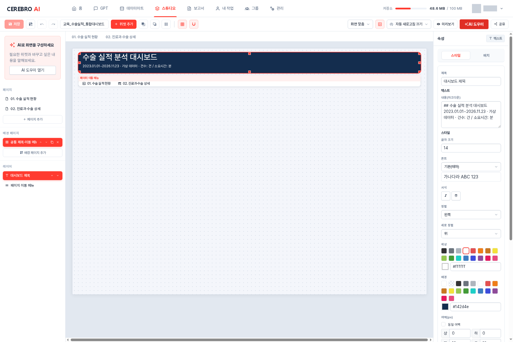
</p>

페이지 전체의 바탕색을 바꾸려면 위젯 선택을 해제한 뒤 **페이지 설정 → 배경색**을 사용합니다. 제목 위젯의 배경과 페이지 바탕은 각각 지정할 수 있습니다.

### ② 공통 메뉴 구성과 배경 페이지 적용

**① 배경 페이지 생성과 제목 영역의 배경색**에서 만든 **공통 제목·이동 메뉴** 배경 페이지에 이동 메뉴를 추가합니다. 제목과 메뉴가 완성되면 두 일반 페이지에 같은 배경 페이지를 적용합니다. 임베드·퍼블릭 화면에서도 이 메뉴로 페이지를 이동합니다.

1. 왼쪽 **배경 페이지**에서 **공통 제목·이동 메뉴**를 선택합니다.
2. **위젯 추가 → 안내·이동 → 메뉴**를 추가하고 **방향 → 가로**로 지정합니다.
3. 메뉴를 제목 아래에 배치합니다. 예시는 X 24, Y 108, 너비 1392, 높이 48을 사용합니다.
4. 메뉴 항목 두 개의 라벨과 대상을 다음과 같이 연결합니다.

| 메뉴 라벨 | 대상 | 연결 페이지 |
|---|---|---|
| 01. 수술 실적 현황 | 페이지 | 01. 수술 실적 현황 |
| 02. 진료과·수술 상세 | 페이지 | 02. 진료과·수술 상세 |

<p align="center">
  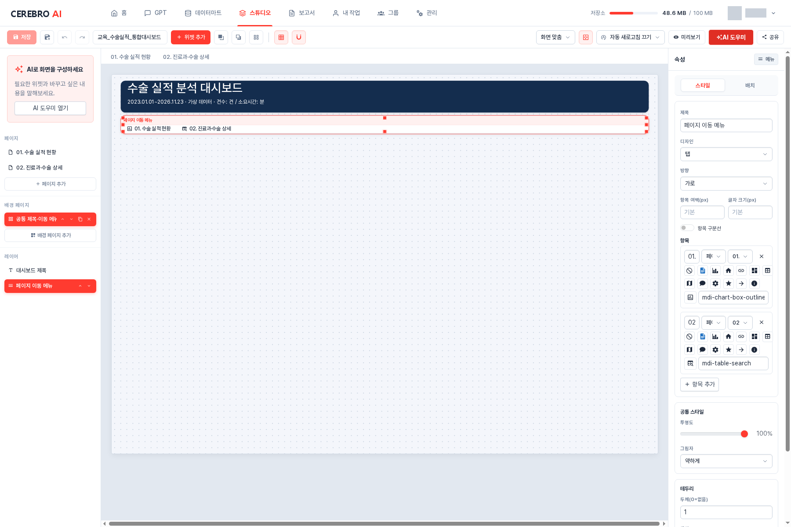
</p>

5. 일반 페이지 **01. 수술 실적 현황**을 선택하고, 위젯 선택을 해제합니다.
6. 오른쪽 **페이지 설정 → 배경 페이지**에서 **공통 제목·이동 메뉴**를 선택합니다.
7. 두 번째 페이지에도 같은 배경 페이지를 적용하고 저장합니다.

<p align="center">
  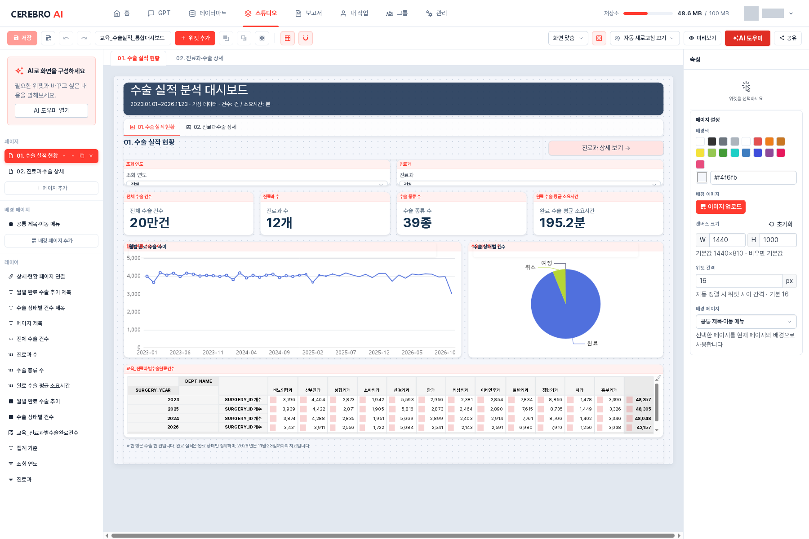
</p>

### ③ KPI 카드

전체 규모와 평균 수준을 숫자로 보여줍니다. 첫 페이지의 네 카드는 다음과 같이 설정합니다.

| 카드 | 값(Y) | 집계 | 전체 조회 시 결과 |
|---|---|---|---:|
| 전체 수술 건수 | `SURGERY_ID` | 개수 | 200,000건 |
| 진료과 수 | `DEPT_CD` | 고유 개수 | 12개 |
| 수술 종류 수 | `SURGERY_TYPE` | 고유 개수 | 39종 |
| 완료 수술 평균 소요시간 | `SURGERY_MIN` | 평균 | 195.20분 |

1. **위젯 추가 → 데이터 위젯 → KPI**를 선택합니다.
2. 오른쪽 **데이터** 탭에서 데이터셋을 **교육_수술실적_BI**로 지정하고 **값 형태 → 단일 값**을 선택합니다.
3. 위 표에 따라 <strong>값(Y)</strong>과 **집계**를 지정합니다. ID를 합산하지 않도록 건수 지표는 **개수**, 중복을 제외할 항목은 **고유 개수**로 설정합니다.
4. **스타일**에서 카드에 표시할 이름, 단위와 글자 크기를 정리합니다. 카드를 복제하면 데이터 항목과 집계만 바꾸어 같은 모양으로 구성할 수 있습니다.

<p align="center">
  
</p>

이 자료의 소요시간은 완료 수술에만 기록되어 있습니다. 평균 계산에서 빈 값을 제외하므로 **완료 수술 평균 소요시간**이 됩니다.

### ④ 차트

월별 완료 실적은 선그래프, 전체 수술의 상태 구성은 파이그래프로 표현합니다.

| 차트 | X축 | 값·집계 | 데이터 필터 | 종류 |
|---|---|---|---|---|
| 월별 완료 수술 추이 | `SURGERY_MONTH` | `SURGERY_ID` / 개수 | `SURGERY_STATUS` = 완료 | 선 |
| 수술 상태별 건수 | `SURGERY_STATUS` | `SURGERY_ID` / 개수 | 전체 상태 | 파이 |

1. **위젯 추가 → 데이터 위젯 → 차트**를 선택합니다.
2. **데이터** 탭에서 데이터셋, X축과 값·집계를 위 표와 같이 지정합니다.
3. 월별 추이에는 **데이터 필터**로 완료 상태만 선택하고, X축을 이름 오름차순으로 정렬합니다. 상태별 파이에는 완료 필터를 적용하지 않습니다.
4. **스타일 → 차트**에서 선 또는 파이를 선택합니다. 차트 위에는 텍스트 위젯으로 제목을 배치하여 어떤 결과인지 구분합니다.

<p align="center">
  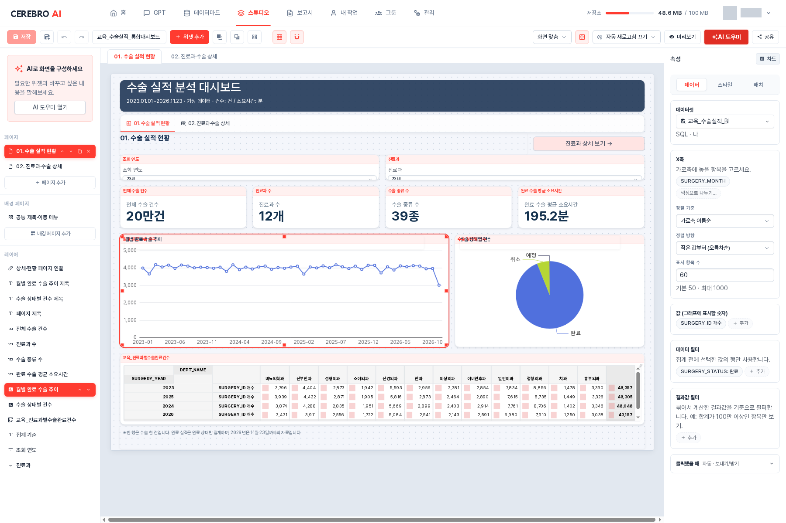
</p>

### ⑤ BI 위젯

**3장**에서 저장한 BI 분석을 가져와 연도·진료과별 완료 실적을 표로 배치합니다. 대시보드에서 같은 집계를 다시 작성하는 과정을 줄일 수 있습니다.

1. **위젯 추가 → 저장된 위젯 가져오기**를 선택합니다.
2. **교육_진료과별수술완료건수**를 선택합니다.
3. 가져온 피벗을 첫 페이지 아래에 배치하고 너비와 높이를 조절합니다.
4. 행이 연도, 열이 진료과, 값이 완료 수술 건수인지 확인합니다. 표 내부를 스크롤하여 합계도 확인합니다.

<p align="center">
  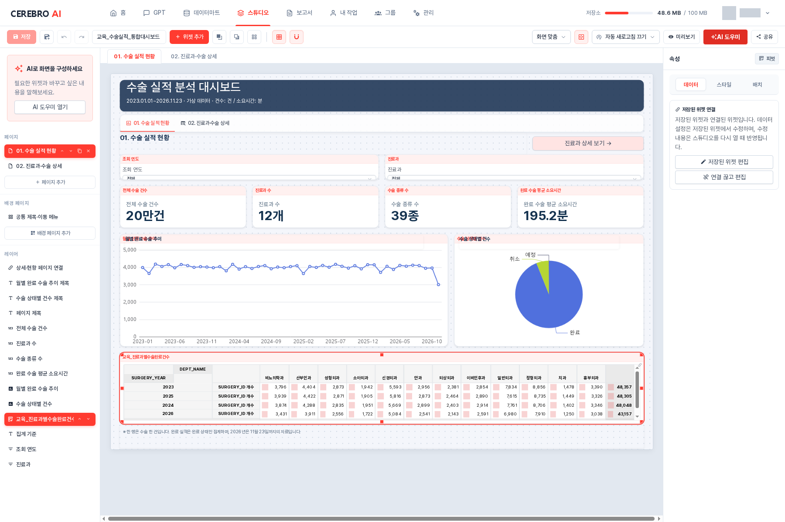
</p>

저장 위젯과 연결된 상태에서는 원본의 분석 설정을 활용합니다. 독립적인 설정으로 바꾸려면 속성의 연결 상태를 확인한 뒤 **연결 끊기**를 사용합니다.

### ⑥ 필터

위젯을 배치한 뒤 조회 조건을 연결합니다. 두 페이지에 **조회 연도**와 **진료과** 필터를 각각 구성합니다.

| 필터 | 필터 컬럼 | 적용 대상 |
|---|---|---|
| 조회 연도 | `SURGERY_YEAR` | 해당 페이지의 KPI·차트·BI·테이블 |
| 진료과 | `DEPT_NAME` | 해당 페이지의 KPI·차트·BI·테이블 |

1. **위젯 추가 → 데이터 위젯 → 필터**를 선택합니다.
2. **데이터** 탭에서 데이터셋과 필터 컬럼을 지정합니다.
3. **적용 대상**에서 함께 조회할 위젯을 선택하고, 대응 컬럼을 연도 필터는 `SURGERY_YEAR`, 진료과 필터는 `DEPT_NAME`으로 지정합니다.
4. 두 번째 페이지도 같은 방법으로 차트에 연결합니다. 상세 테이블은 **⑦ 상세 테이블**에서 추가한 뒤 적용 대상에 포함합니다.
5. **미리보기**에서 연도나 진료과를 선택하여 연결된 값이 함께 바뀌는지 확인합니다. **전체**를 선택하면 해당 조건을 해제합니다.

<p align="center">
  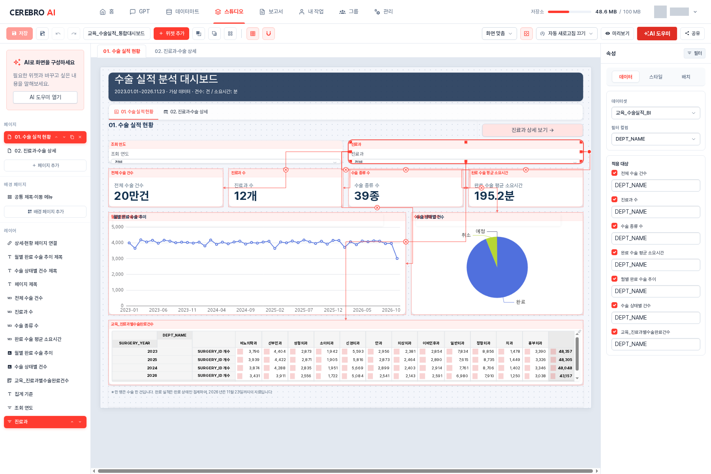
</p>

필터는 페이지별로 동작합니다.

**완성 화면 2페이지 - 02. 진료과·수술 상세**

첫 번째 페이지와 중복되는 설정은 앞의 설명을 참고합니다.

<p align="center">
  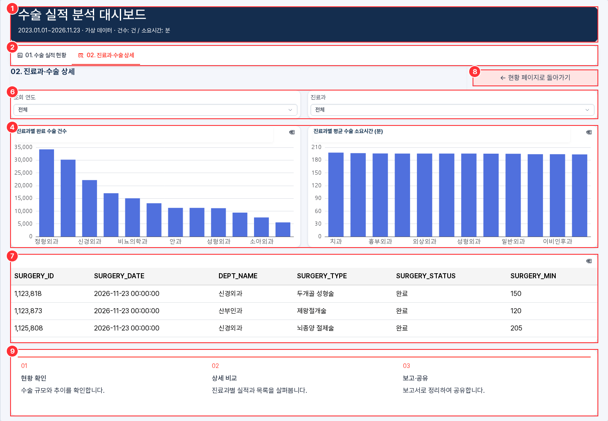
</p>

두 번째 페이지의 차트·필터는 **④ 차트·⑥ 필터**의 방법을 활용합니다.

| 차트 | X축 | 값·집계 | 데이터 필터 |
|---|---|---|---|
| 진료과별 완료 수술 건수 | `DEPT_NAME` | `SURGERY_ID` / 개수 | 완료 |
| 진료과별 평균 수술 소요시간 | `DEPT_NAME` | `SURGERY_MIN` / 평균 | 완료 |

두 차트 모두 막대그래프를 선택하고, 측정값 내림차순으로 진료과별 크기를 비교합니다.

### ⑦ 상세 테이블

차트에서 확인한 실적의 근거를 수술 단위의 목록으로 살펴봅니다.

1. **위젯 추가 → 데이터 위젯 → 테이블**을 선택합니다.
2. 데이터셋을 지정하고 아래 표시 컬럼을 선택합니다.
3. **정렬 컬럼 → SURGERY_DATE**, **정렬 방향 → 내림차순**, **행 수 제한 → 20**으로 설정합니다.
4. 조회 연도·진료과 필터의 적용 대상에 이 테이블을 포함합니다.

| 표시 컬럼 | 내용 |
|---|---|
| `SURGERY_ID` | 수술 식별번호 |
| `SURGERY_DATE` | 수술일자 |
| `DEPT_NAME` | 진료과 |
| `SURGERY_TYPE` | 수술 종류 |
| `SURGERY_STATUS` | 완료·취소·예정 상태 |
| `SURGERY_MIN` | 완료 수술의 소요시간(분) |

<p align="center">
  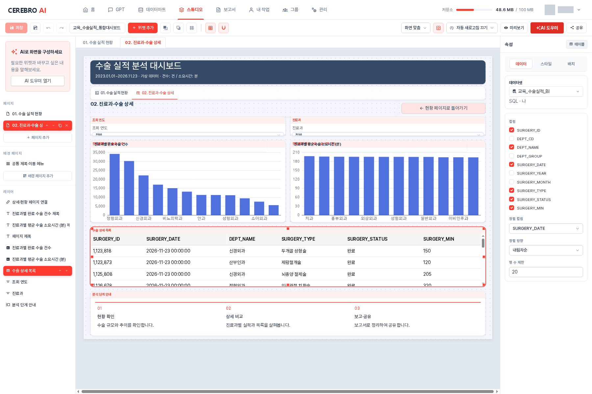
</p>

상세 목록은 전체 상태를 보여주고, 위 차트는 완료 상태만 집계합니다. 서로 대조할 때 조회 상태와 집계 기준을 함께 확인합니다.

### ⑧ 링크로 상세 화면 연결

현황에서 상세 기록으로 이동하고 다시 돌아올 수 있도록 링크를 배치합니다.

1. **위젯 추가 → 안내·이동 → 링크**를 선택합니다.
2. **스타일**에서 링크 문구를 입력하고 **대상 → 내부 페이지**를 선택합니다.
3. 첫 페이지의 **진료과 상세 보기**는 **02. 진료과·수술 상세**로, 두 번째 페이지의 **현황 페이지로 돌아가기**는 **01. 수술 실적 현황**으로 연결합니다.
4. 미리보기에서 링크를 클릭하여 이동을 확인합니다.

<p align="center">
  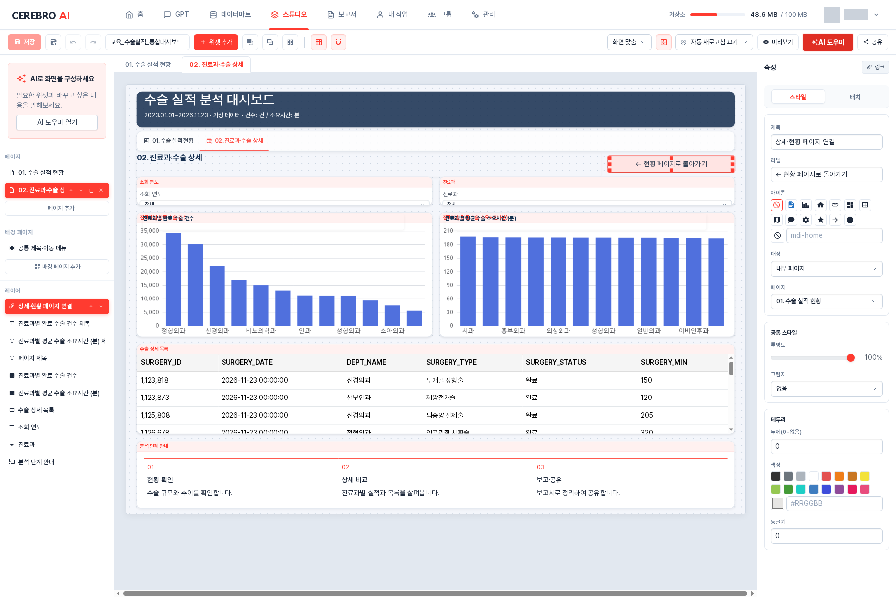
</p>

다른 대시보드의 임베드·퍼블릭 화면으로 연결하려면 **대상 → 외부 URL**을 선택하고 발급받은 주소를 입력합니다. 주소를 여는 사람에게 해당 링크의 접근 조건이 적용됩니다.

> **💡 참고 : 페이지 이동과 드릴스루**
>
> 이 예시는 상세 화면을 여는 링크입니다. 클릭한 진료과나 현재 필터 값을 다른 화면의 조건으로 자동 전달하는 드릴스루까지 설정한 것은 아니므로, 이동한 화면에서 조회 조건을 확인합니다.

### ⑨ 타임라인으로 단계 안내

사용자가 화면을 어떤 순서로 살펴보면 되는지 두 번째 페이지 아래에 안내합니다.

1. **위젯 추가 → 안내·이동 → 타임라인·단계 안내**를 선택합니다.
2. **방향 → 가로**로 지정하고 세 항목을 구성합니다.

| 날짜·단계 | 제목 | 설명 |
|---|---|---|
| 01 | 현황 확인 | 수술 규모와 추이를 확인합니다. |
| 02 | 상세 비교 | 진료과별 실적과 목록을 살펴봅니다. |
| 03 | 보고·공유 | 보고서로 정리하여 공유합니다. |

3. 항목의 글이 잘리지 않도록 높이와 위치를 조절한 뒤 저장합니다.

<p align="center">
  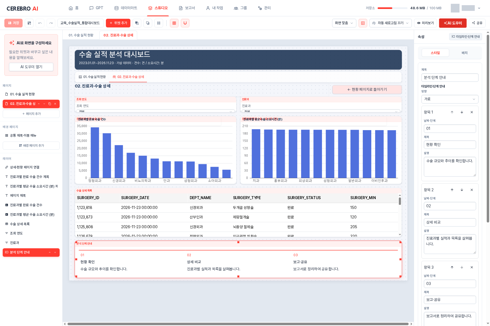
</p>

## 5. 보고서

대시보드와 같은 수술 데이터를 활용하여 **교육_수술실적_분석보고서** 한 개를 작성합니다. 첫 부분에는 분석 목적과 집계 기준·월별 추이를 정리하고, 페이지를 나누어 진료과별 실적과 결과 해석을 배치합니다. 완성 화면의 번호에 따라 필요한 블록을 구성합니다.

**완성 보고서 — 첫 번째 부분**

<p align="center">
  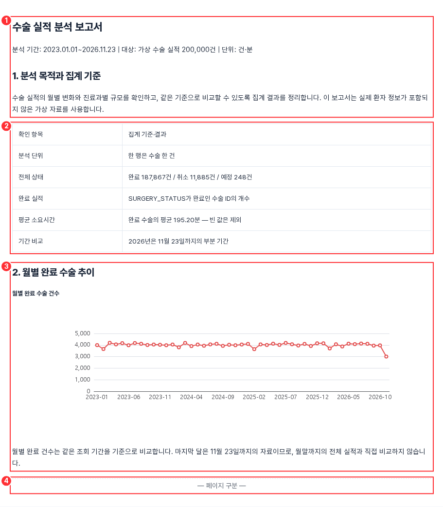
</p>

**완성 보고서 — 다음 페이지의 내용**

<p align="center">
  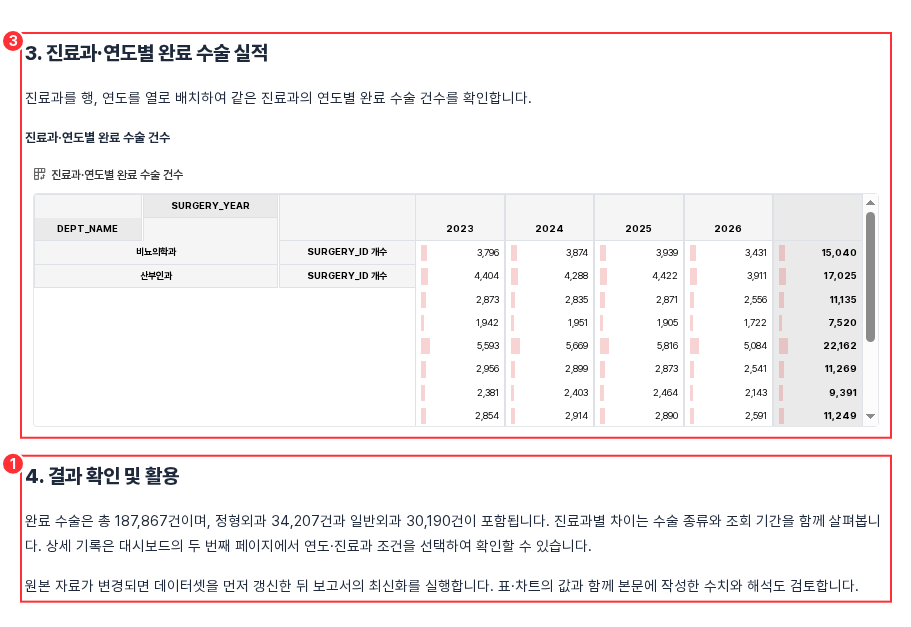
</p>

### ① 제목과 본문

1. **보고서 → 빈 보고서**를 선택하고 제목을 **교육_수술실적_분석보고서**로 입력합니다.
2. **블록 추가 → 제목**으로 **수술 실적 분석 보고서**를 입력하고 H1으로 지정합니다. 세부 항목은 H2로 구분합니다.
3. **본문**에 분석 기간, 단위와 가상 자료임을 작성합니다.
4. 분석 목적과 결과 해석도 본문 블록으로 배치합니다. 예시는 수술 한 건을 분석 단위로 삼고, 완료 실적과 전체 상태 현황을 구분하여 설명합니다.

<p align="center">
  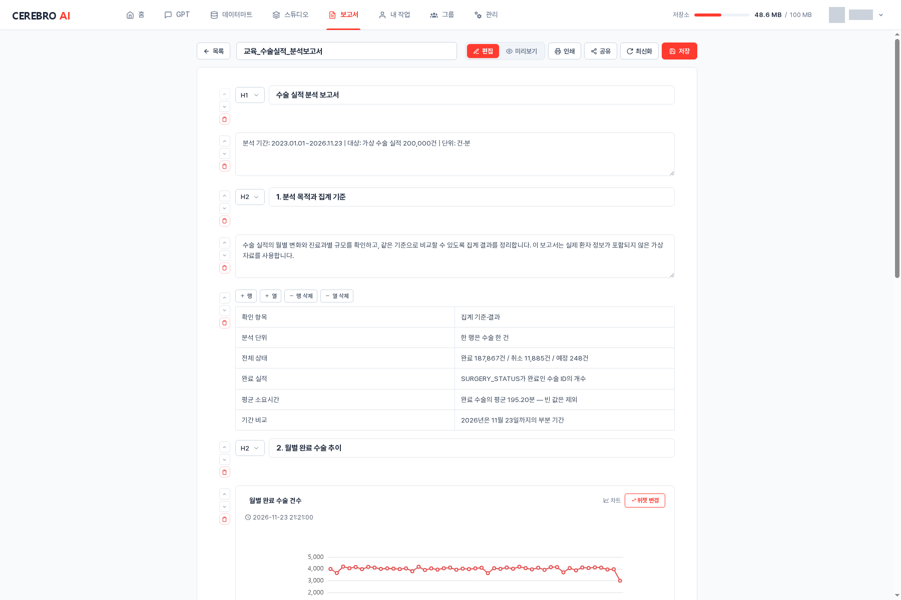
</p>

### ② 집계 기준표

**블록 추가 → 표**를 선택하고 행·열을 조절하여 아래 내용을 입력합니다. 지표를 어떤 기준으로 계산했는지 위젯 앞에서 확인할 수 있도록 배치합니다.

| 확인 항목 | 입력 내용 |
|---|---|
| 분석 단위 | 한 행은 수술 한 건 |
| 전체 상태 | 완료 187,867건 / 취소 11,885건 / 예정 248건 |
| 완료 실적 | 완료 상태인 수술 ID의 개수 |
| 평균 소요시간 | 완료 수술 평균 195.20분, 빈 값 제외 |
| 기간 비교 | 2026년은 11월 23일까지의 부분 기간 |

표 아래의 분석 위젯과 본문에서도 같은 조회 기간·집계 기준을 사용합니다.

### ③ 분석 위젯 연결

**💡 참고 : 보고서용 위젯 준비**에서 저장한 두 위젯을 사용합니다. 월별 추이는 차트로, 진료과·연도별 실적은 피벗으로 배치합니다. 아직 저장하지 않았다면 **3.3 분석 위젯 저장**의 작성 위치와 저장 이름을 확인하여 먼저 준비합니다.

1. **블록 추가 → 위젯 → 위젯 선택**을 클릭합니다.
2. 첫 부분에는 **교육_월별수술완료추이_보고서차트**를 선택합니다.
3. 다음 페이지에는 **교육_진료과별연도별수술실적_보고서피벗**을 선택합니다.
4. 블록 제목과 표시 결과를 확인하고 저장합니다. 피벗 내부를 스크롤하면 전체 진료과를 확인할 수 있습니다.

<p align="center">
  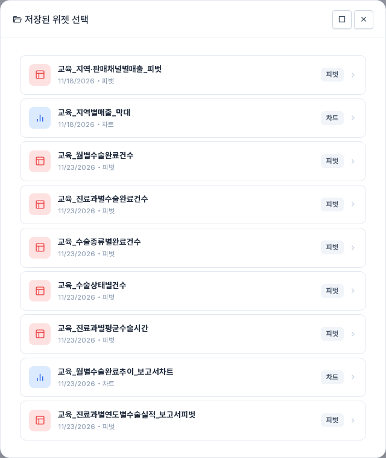
</p>

두 위젯의 집계 기준은 다음과 같습니다.

| 위젯 | 비교 기준 | 집계 | 조회 조건 |
|---|---|---|---|
| 월별 추이 차트 | 연월 `SURGERY_MONTH` | `SURGERY_ID` 개수 | 완료 |
| 진료과·연도별 피벗 | 행 `DEPT_NAME` / 열 `SURGERY_YEAR` | `SURGERY_ID` 개수 | 완료 |

### ④ 페이지 구분과 미리보기

1. 월별 추이의 설명 다음에 **블록 추가 → 페이지 구분**을 넣습니다.
2. 페이지 구분 뒤에 진료과·연도별 피벗과 결과 해석을 배치합니다.
3. **미리보기**에서 제목·본문·표·위젯의 읽는 순서를 확인합니다.
4. **인쇄**에서 출력 시 페이지 구분과 표·차트의 잘림 여부를 확인합니다.

페이지 구분은 출력 시 다음 내용을 새 페이지에서 시작하도록 지정하는 블록입니다. 화면 미리보기에는 구분 표시가 나타납니다.

### 5.5 저장과 최신화

보고서를 저장한 뒤 데이터가 바뀌면 **데이터셋 갱신 → 보고서 최신화 → 본문 검토** 순서로 반영합니다. 최신화는 위젯의 계산 결과를 갱신하므로, 본문과 기준표에 직접 입력한 수치·설명도 함께 확인합니다.

## 6. 분석 결과 공유 및 관리

완성한 자료를 공유하는 방법은 두 가지로 정리합니다. 로그인한 사용자에게는 **그룹·멤버 공유**로 자료를 제공하고, 대시보드를 링크나 다른 화면에 표시할 때는 **임베드·퍼블릭 링크**를 사용합니다.

| 공유 방식 | 활용 방법 |
|---|---|
| 대시보드·보고서 그룹·멤버 공유 | CEREBRO에 로그인하여 공유받은 자료를 조회하고, 허용된 범위에서 사본으로 활용 |
| 대시보드 임베드·퍼블릭 링크 | iframe으로 다른 화면에 표시하거나 승인된 퍼블릭 주소로 대시보드를 조회 |

보고서는 현재 **그룹 단위**로 공유하며, 대시보드는 **그룹 또는 개별 사용자**를 대상으로 공유할 수 있습니다.

### 6.1 결과 공유 및 배포

#### 6.1.1 대시보드 그룹·멤버 공유

1. **교육_수술실적_통합대시보드**를 열고 **공유 → 멤버 공유**를 선택합니다.
2. **공유대상 검색**에 **기본 그룹**을 입력하여 선택합니다. 기본 그룹에는 모든 가입 사용자가 소속되므로, 기본 그룹 공유는 **서비스의 전체 사용자에게 공유**하는 의미입니다.
3. 권한은 **조회**로 설정합니다.
4. 특정 대상에게만 제공하려면 기본 그룹 대신 **그룹명 또는 사용자 이름·이메일**을 검색하여 선택합니다.

<p align="center">
  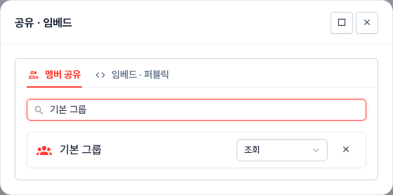
</p>

기본 그룹 공유는 로그인한 전체 사용자 대상입니다. 로그인 없이 주소로 조회하는 퍼블릭 링크와는 접근 방식이 다릅니다.

#### 6.1.2 연결 데이터셋 공유

대시보드의 조회 권한과 연결 데이터의 권한을 함께 확인합니다. 사본에서 데이터를 활용할 사용자에게도 필요한 범위를 지정합니다.

1. **데이터마트**에서 **교육_수술실적_BI → 공유 설정**을 엽니다.
2. 공유대상 검색에서 **기본 그룹**을 선택하여 **조회·분석** 권한을 지정합니다. 특정 그룹·사용자에게만 제공하려면 해당 이름이나 이메일을 검색합니다.
3. 원본 자료를 변경할 필요가 없다면 편집 권한은 부여하지 않습니다.

<p align="center">
  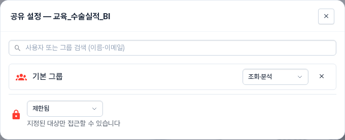
</p>

#### 6.1.3 보고서 그룹 공유

1. **교육_수술실적_분석보고서**를 열고 **공유**를 클릭합니다.
2. **그룹 선택 → 기본 그룹**을 지정합니다. 대시보드와 마찬가지로 서비스의 전체 사용자에게 제공할 때 사용합니다. 특정 그룹에만 공유하려면 그 그룹을 선택합니다.
3. **보기**와 **복제**를 허용하고 **추가/저장**을 클릭합니다. 예시에서는 공유받은 사용자가 원본을 직접 편집하지 않고 본인 사본을 만들도록 구성합니다.
4. **현재 공유**에서 대상 그룹과 권한을 확인합니다.

<p align="center">
  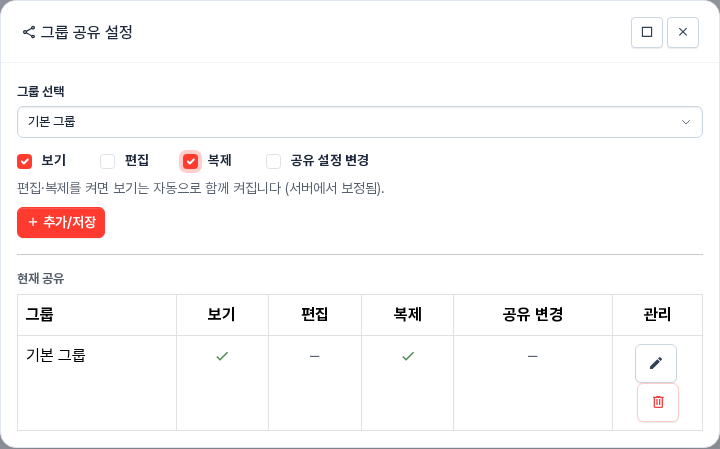
</p>

보고서는 개별 사용자 검색 대신 그룹 선택을 사용합니다. 공유할 그룹이 목록에 제공되는지와 해당 그룹의 공유 설정 권한을 확인합니다.

#### 6.1.4 임베드·퍼블릭 링크

완성한 대시보드를 링크로 열거나 다른 업무 화면에 표시합니다. 링크 화면에는 편집기에서 보던 페이지 탭이 제공되지 않으므로, **② 공통 메뉴 구성과 배경 페이지 적용**에 따라 두 페이지에 공통 메뉴를 적용한 상태로 저장합니다.

1. 대시보드의 **공유 → 임베드·퍼블릭**을 엽니다.
2. **퍼블릭 링크**는 요청을 등록하고 관리자 승인을 받은 뒤 **링크 복사**로 주소를 전달합니다.
3. **iframe 임베드**는 임베드를 생성한 뒤 **iframe 코드**를 발급받아 게시할 화면에 삽입합니다. 임베드 토큰에는 만료 조건이 적용될 수 있습니다.
4. 제공 대상 환경에 필요한 허용 도메인이 있으면 해당 범위를 지정합니다.

<p align="center">
  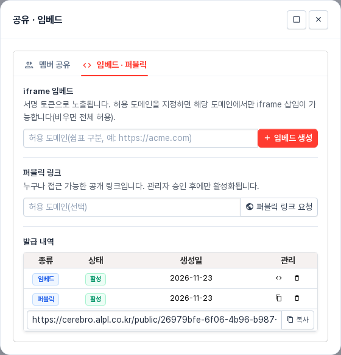
</p>

복사한 퍼블릭 링크를 열면 첫 페이지가 표시됩니다.

<p align="center">
  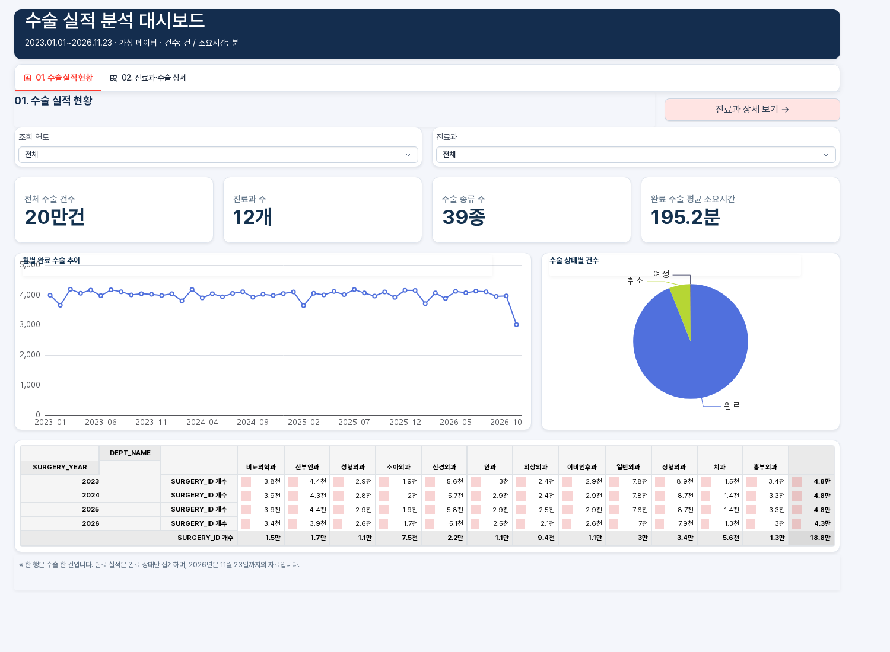
</p>

상단 메뉴의 **02. 진료과·수술 상세**를 클릭하면 같은 대시보드의 두 번째 페이지로 이동합니다. **01. 수술 실적 현황** 또는 **현황 페이지로 돌아가기** 링크로 복귀할 수 있습니다.

<p align="center">
  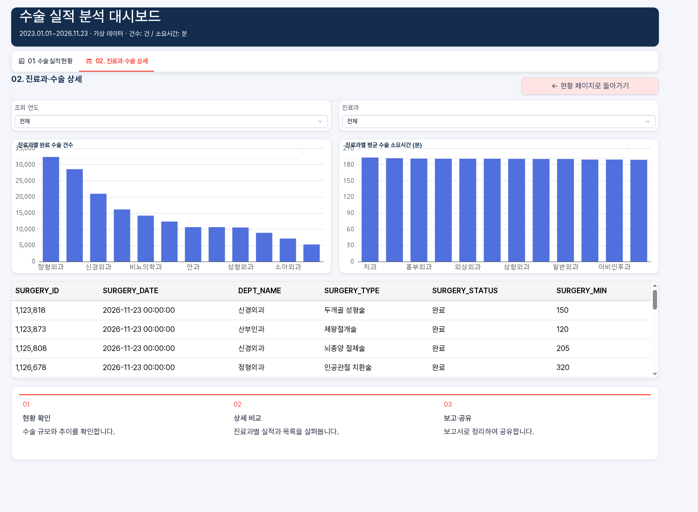
</p>

임베드 화면도 같은 메뉴와 링크로 이동합니다.

### 6.2 공유받은 분석 결과 조회 및 활용

#### 6.2.1 공유받은 대시보드 조회 및 내 대시보드로 가져오기

1. 사용자 계정으로 로그인하고 **스튜디오 → 공유받음**을 선택합니다.
2. **교육_수술실적_통합대시보드**를 엽니다.

<p align="center">
  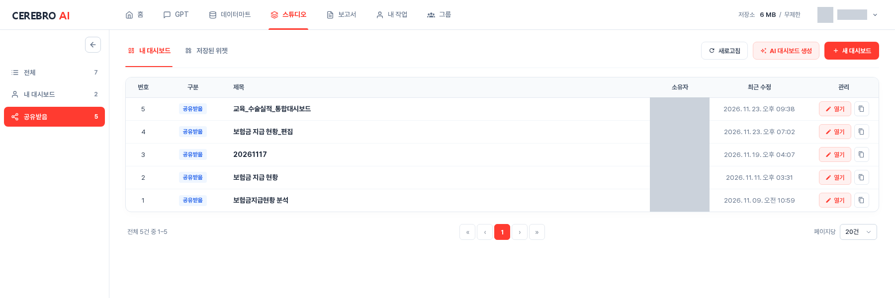
</p>

3. 공유된 구성 그대로 조회하거나 연도·진료과 필터와 페이지 이동 메뉴를 사용하여 필요한 현황을 확인합니다.

<p align="center">
  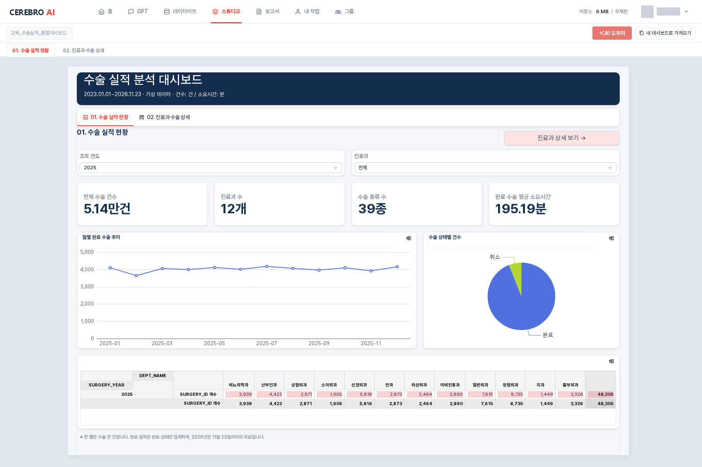
</p>

4. 본인 용도로 바꾸려면 스튜디오 목록으로 돌아가 해당 자료의 **복제**를 클릭합니다.
5. 사본 이름을 입력하여 생성한 뒤 **내 대시보드**에서 엽니다.

<p align="center">
  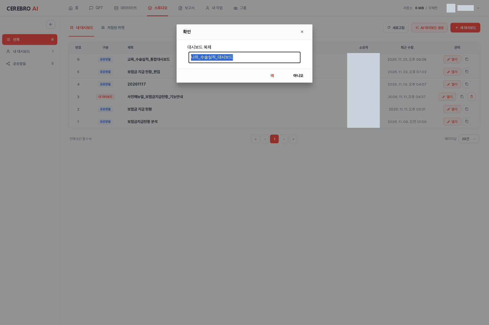
</p>

6. 본인 사본에서 페이지·위젯·배치를 수정하고 저장합니다. 사본의 변경은 공유받은 원본에 반영되지 않습니다.

<p align="center">
  
</p>

사본의 데이터 위젯을 계속 활용하려면 연결 데이터셋의 접근 권한도 유지되어야 합니다.

#### 6.2.2 공유받은 보고서 조회 및 내 보고서로 복제

1. **보고서 → 공유받은 보고서**에서 **교육_수술실적_분석보고서**를 선택합니다.

<p align="center">
  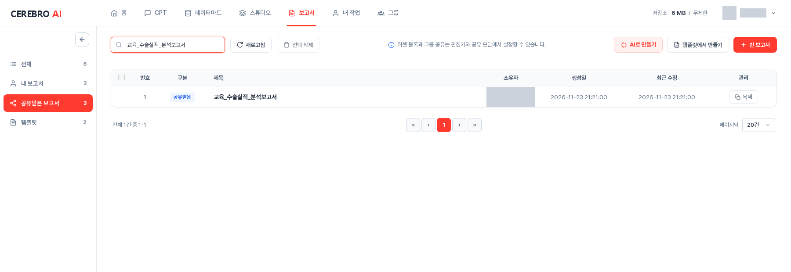
</p>

2. 보고서를 열어 본문과 위젯의 결과를 확인합니다. 보기 권한으로 공유된 원본은 읽기 전용으로 표시됩니다.

<p align="center">
  
</p>

3. **공유받은 보고서** 목록에서 **복제**를 클릭합니다. 공유자가 복제를 허용한 보고서에서 사용할 수 있습니다.
4. **내 보고서**의 사본을 열어 제목·본문·표·위젯을 본인 업무에 맞게 수정하고 저장합니다.

<p align="center">
  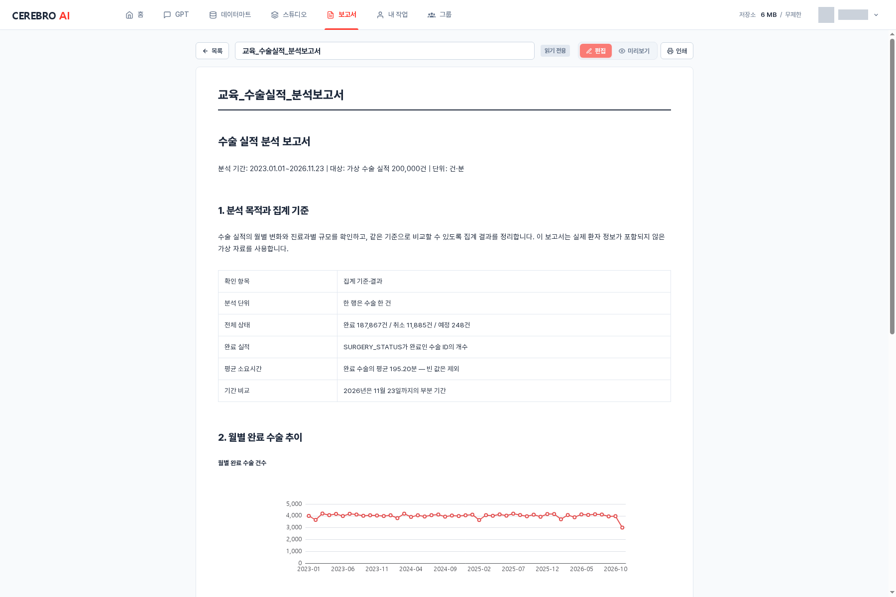
</p>

사본을 편집해도 원본 보고서는 바뀌지 않습니다. 복제 후 위젯을 변경하거나 최신화할 때는 연결 데이터의 접근 권한과 계산 결과를 함께 확인합니다.
